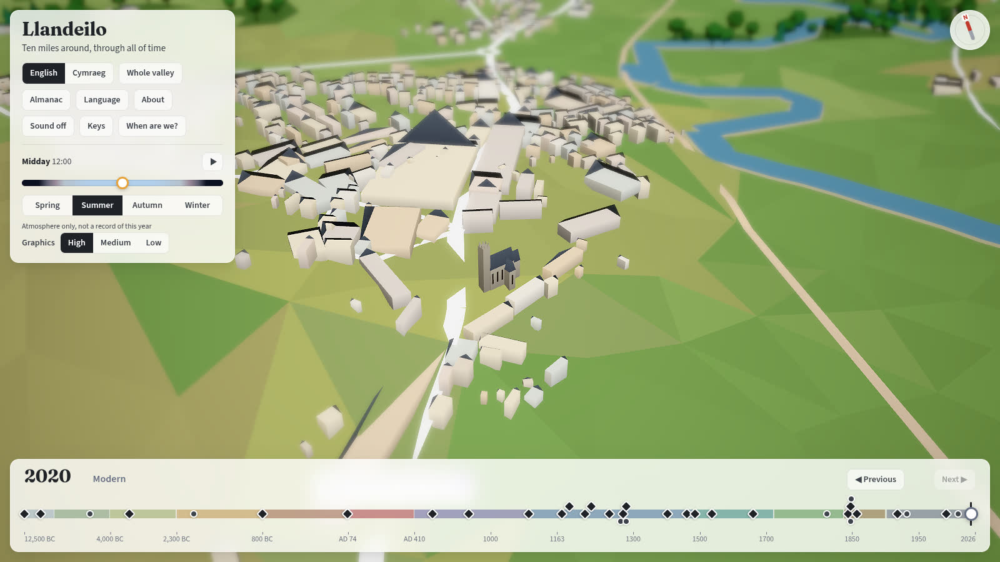
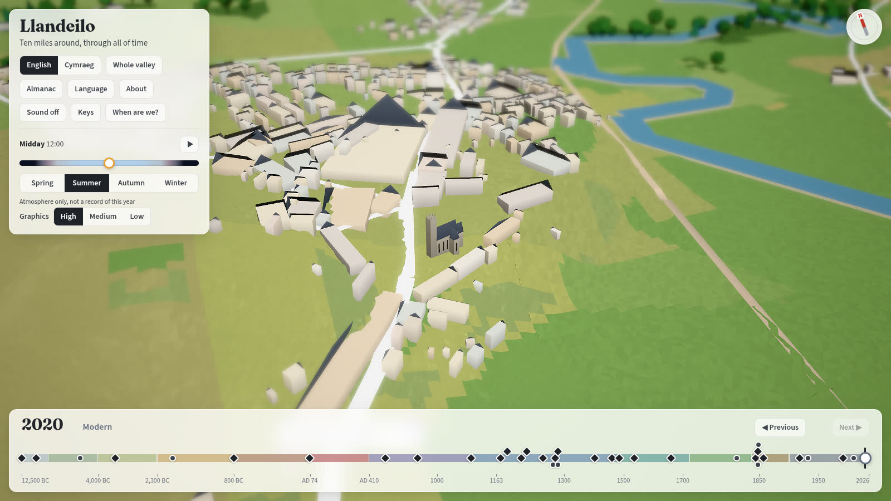
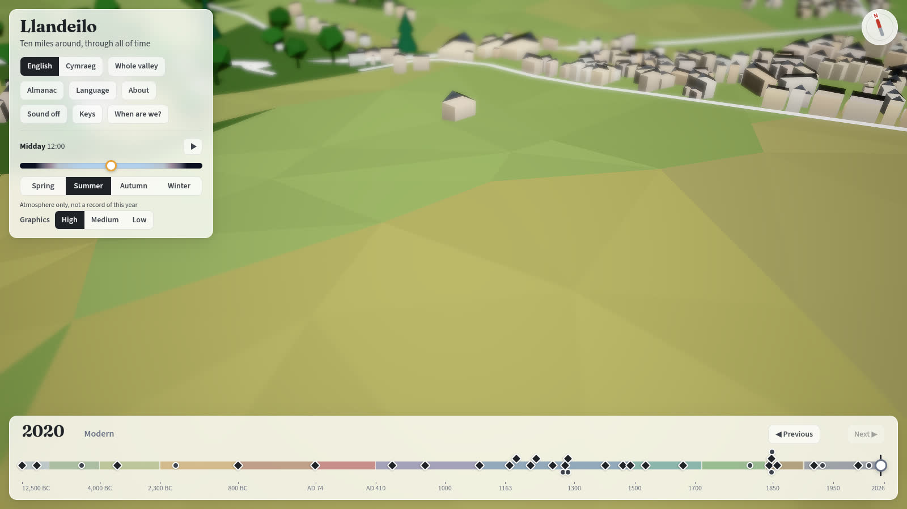
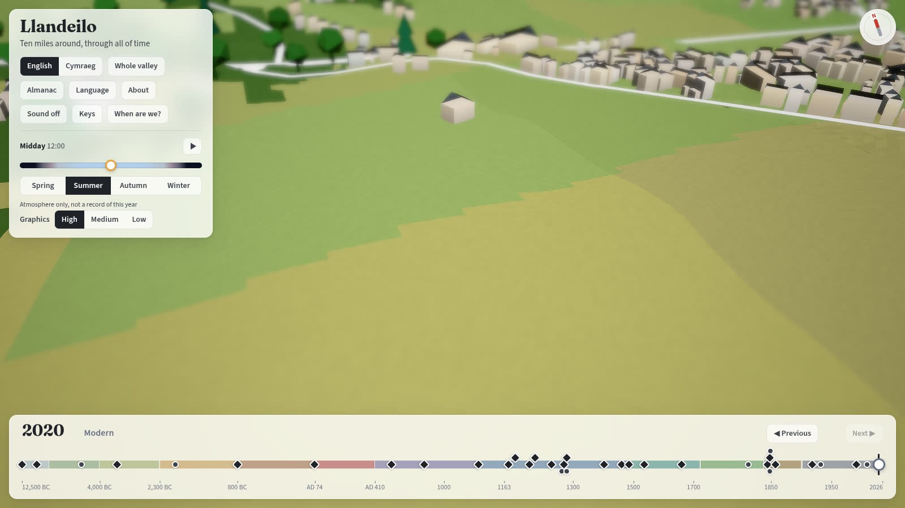
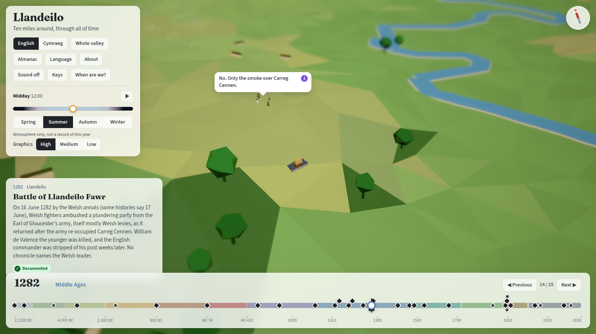
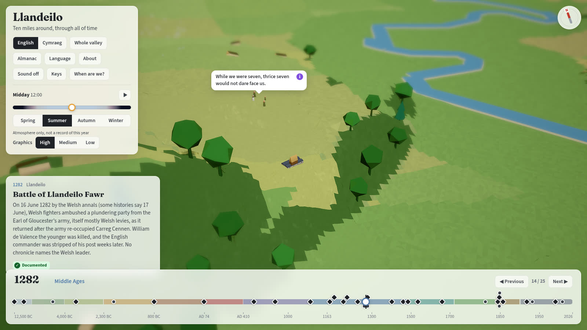
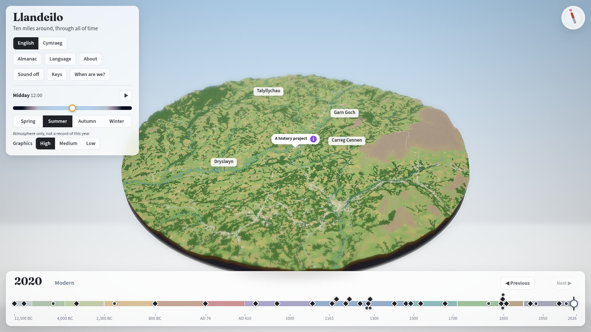
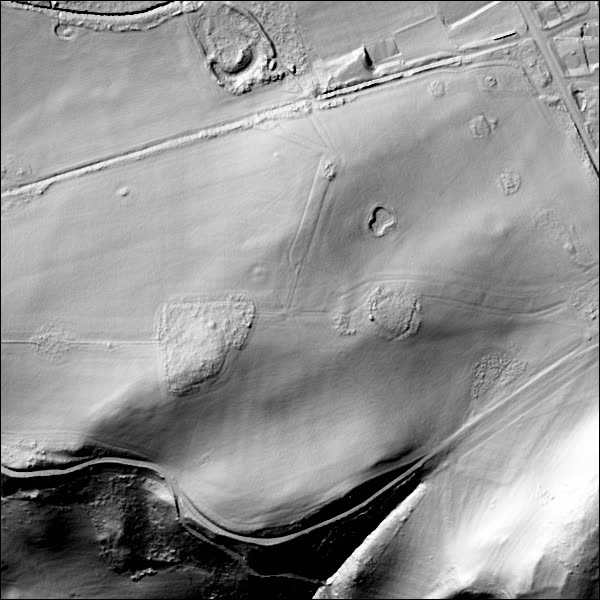

# Close-up terrain from Welsh Government LiDAR

The data behind the detailed ground at Llandeilo town and the Roman forts in Dinefwr Park
([GitHub issue 2](https://github.com/dewijones92/llandeilo-omnia-mutantur-nihil-interit/issues/2),
[ADR 0049](../adr/0049-lidar-terrain-tiles-blended-into-terrain-50.md)). Written by Claude under the
proactive mandate ([ADR 0027](../adr/0027-claude-proposes-and-builds-under-a-proactive-mandate.md)),
2026-10-09; the licence and accuracy statements were read from the sources named, on that date.

## What it is

| | |
|---|---|
| Product | The Welsh Government LiDAR **DTM** (digital terrain model: bare earth, buildings and most vegetation removed), 1m, from the 2020-22 national survey. The DataMapWales layer is "Welsh Government LiDAR tile catalogue 2020-2023" |
| Publisher | Welsh Government (Geography & Technology), through [DataMapWales](https://datamap.gov.wales/) |
| Resolution | 1m, one GeoTIFF per 1km tile (1000 x 1000 cells), Float32, DEFLATE, about 2MB each |
| Coordinate system | EPSG:27700, OSGB36 / British National Grid, read from every file with `gdalinfo`. Pixels are areas (`AREA_OR_POINT=Area`); the origin is the tile's north-west corner |
| Vertical datum | **Not stated** by any DataMapWales page or file. Against OS Terrain 50 (heights above Ordnance Datum Newlyn) over the whole region it reads 0.19m low on average (absolute mean 0.59m, 95% within 1.7m, 7,296 points), which is what 1m LiDAR averaged against 50m cells should give if both use Ordnance Datum. `tests/lidar.test.ts` keeps a looser version of that check |
| Vertical accuracy | **Not stated** on the DataMapWales pages. (The Environment Agency's England LiDAR states +/-15cm RMSE; that is another programme and is not assumed here) |
| Gaps | None in the region: 100% valid, no nodata cells. The DTM still holds some things a bare-earth model should not: tree clumps show as low rings in a hillshade of Dinefwr Park, and walls and bridges as ridges |

## Licence and credit, as stated

Three places say something, and they differ. Dewi's instruction (2026-10-09) is to ignore licence
problems and credit the source, so this is recorded rather than resolved.

1. **The files.** The GeoTIFFs carry no licence, copyright or attribution tag (`gdalinfo` shows only
   the projection, `AREA_OR_POINT=Area`, DEFLATE and the nodata value).
2. **The tile catalogue's own metadata** (`datamap.gov.wales/layers/geonode:welsh_government_lidar_tile_catalogue_2020_2023`,
   published 27 September 2024): licence **not specified**, copyright "Not applicable", no credit, a link
   to a "Usage Policy" that was not followed. Contact `data@gov.wales`.
3. **The metadata of the "LiDAR Data download" page** (`datamap.gov.wales/maps/6969/metadata_detail`,
   published 23 September 2024): **Open Government Licence for Public Sector Information, version 3**;
   copyright and credit not stated. It adds one limitation: the data "was not created specifically for
   flood modelling", so it may need cleaning before use for that, which does not touch a diorama.

The credit the app shows is written once, by `build-lidar.py`, into `public/data/lidar/lidar.json`
(`source.credit`) and, from the same string, into `src/content/generated/lidar-credit.ts`, which
`src/content/assets.ts` imports for the About page (so the 20.7KB manifest is not bundled into the app to read
one sentence; `tests/lidar.test.ts` checks the two agree): *Contains Welsh
Government data (LiDAR 1m DTM from the 2020-22 national survey, these tiles dated 01/12/2021 to
22/02/2022 in their file names), via DataMapWales. Licence stated on the DataMapWales download page:
Open Government Licence v3.0.* The catalogue's own silence is noted beside it in `assets.ts`. Nothing is
"all rights reserved", so ADR 0026 holds. The download page's copyright field reads "None".

## Exactly how it was downloaded

`tools/terrain/fetch-lidar.sh` (run 2026-10-09), with no account or key:

1. Read the region from `tools/terrain/lidar-areas.json` (E 260000 to 265000, N 220500 to 224500).
2. Ask the catalogue's WFS for the 1km tiles that touch it:
   `https://datamap.gov.wales/geoserver/ows?service=WFS&version=2.0.0&request=GetFeature&typeNames=geonode:welsh_government_lidar_tile_catalogue_2020_2023&outputFormat=application/json&cql_filter=BBOX(geom,260000,220500,265000,224500,'EPSG:27700')`.
   Each feature has `british_gr` (the tile, e.g. `SN6222`, whose south-west corner is E 262000 N 222000),
   `dtm_link`, `dsm_link`, `delivery` and `date`. The catalogue holds 22,473 tiles for Wales.
3. Download each `dtm_link` over HTTPS from the Azure blob store the catalogue names,
   `https://dmwproductionblob.blob.core.windows.net/lidar-zips/2020-22/dtm/wg_del_<delivery>_<tile>_<date>dtm.tif`,
   resuming a partial file, skipping one whose size matches the server's `Content-Length`.
4. Result: 25 files, 48MB, in `~/code/data/llandeilo/lidar/raw/` (outside the repository, never
   committed; `*.tif` is in `.gitignore` as a second guard). `build-lidar.py` records the name, size and
   SHA-256 of each in `public/data/lidar/lidar.json`, and `python3 tools/terrain/build-lidar.py --verify`
   checks the raw files against them (it fails on a changed file, a missing one, or a stray `.tif`). The
   build reads the file list from `links.txt`, not from a glob, so a raster left over from a wider region is
   never built or credited.

The catalogue's `date` column and the date in the file name disagree for 16 of the 25 tiles (checked
2026-10-10 from `surveyDate` and `fileDate` in the manifest, which keeps both). Ten differ by one day, the
file name a day before the catalogue (SN6023, SN6024, SN6123, SN6124, SN6223, SN6224, SN6323, SN6324,
SN6423, SN6424: file 1 December 2021, catalogue 2 December), which fits flights just after midnight, not
checked against the catalogue's start times. SN6421 differs by one day the other way (catalogue 12 January
2022, file 13 January). Five differ by weeks: SN6022, SN6122, SN6222 and SN6322 (catalogue 13 January 2022,
file 22 February) and SN6422 (catalogue 2 December 2021, file 12 January). (An earlier version of this
note said five.) The file names date the tiles December 2021 to February 2022; the catalogue's dates run
from 2 December 2021 to 13 January 2022. Which is the flight date is not known, so the credit says
"dated ... in their file names".

## The tiles

| Tile | File | Flown (catalogue) | Bytes | SHA-256 (first 16) |
|---|---|---|---|---|
| SN6020 | `wg_del_26_260220_20220113dtm.tif` | 13-01-2022 | 1,935,484 | `d9fca8e10eeefee6` |
| SN6021 | `wg_del_26_260221_20220113dtm.tif` | 13-01-2022 | 1,539,760 | `6b3492b1222fc317` |
| SN6022 | `wg_del_26_260222_20220222dtm.tif` | 13-01-2022 | 1,957,890 | `5b922d007de49f88` |
| SN6023 | `wg_del_18_260223_20211201dtm.tif` | 02-12-2021 | 1,972,073 | `d48feebbb002a0de` |
| SN6024 | `wg_del_18_260224_20211201dtm.tif` | 02-12-2021 | 2,201,209 | `61d61d789752c09e` |
| SN6120 | `wg_del_26_261220_20220113dtm.tif` | 13-01-2022 | 2,070,472 | `5d28b51cc1e646ec` |
| SN6121 | `wg_del_26_261221_20220113dtm.tif` | 13-01-2022 | 1,716,486 | `86eabc79b4f7a4fe` |
| SN6122 | `wg_del_26_261222_20220222dtm.tif` | 13-01-2022 | 2,101,230 | `bd0b11feaedf1a90` |
| SN6123 | `wg_del_18_261223_20211201dtm.tif` | 02-12-2021 | 1,920,190 | `cd2ef70d2812c124` |
| SN6124 | `wg_del_18_261224_20211201dtm.tif` | 02-12-2021 | 2,268,703 | `da2fdf0b4f439d09` |
| SN6220 | `wg_del_26_262220_20220113dtm.tif` | 13-01-2022 | 2,201,035 | `32a1bf558d02053d` |
| SN6221 | `wg_del_26_262221_20220113dtm.tif` | 13-01-2022 | 1,614,740 | `814325972f1741cb` |
| SN6222 | `wg_del_26_262222_20220222dtm.tif` | 13-01-2022 | 1,964,338 | `974051baa32ea64e` |
| SN6223 | `wg_del_18_262223_20211201dtm.tif` | 02-12-2021 | 1,956,957 | `871812e055dd9c5d` |
| SN6224 | `wg_del_18_262224_20211201dtm.tif` | 02-12-2021 | 2,289,527 | `5a4eeb5b971d9d8f` |
| SN6320 | `wg_del_21_263220_20220113dtm.tif` | 13-01-2022 | 2,389,424 | `1463b8d606e8709f` |
| SN6321 | `wg_del_26_263221_20220113dtm.tif` | 13-01-2022 | 1,944,677 | `74b3e42ba13f45c5` |
| SN6322 | `wg_del_26_263222_20220222dtm.tif` | 13-01-2022 | 1,841,507 | `3714fdacc2945cb3` |
| SN6323 | `wg_del_18_263223_20211201dtm.tif` | 02-12-2021 | 1,701,304 | `daa6948ffb84377a` |
| SN6324 | `wg_del_18_263224_20211201dtm.tif` | 02-12-2021 | 2,074,011 | `4170a02789cdcb55` |
| SN6420 | `wg_del_21_264220_20220113dtm.tif` | 13-01-2022 | 2,359,013 | `3c0b505ed8e14952` |
| SN6421 | `wg_del_21_264221_20220113dtm.tif` | 12-01-2022 | 2,346,608 | `a7e15b127cb3d7c8` |
| SN6422 | `wg_del_20_264222_20220112dtm.tif` | 02-12-2021 | 2,291,325 | `f00d025707132620` |
| SN6423 | `wg_del_18_264223_20211201dtm.tif` | 02-12-2021 | 1,462,248 | `af0f368edc4c2efd` |
| SN6424 | `wg_del_18_264224_20211201dtm.tif` | 02-12-2021 | 1,680,417 | `c76649d0b9020b51` |

The full hashes are in `public/data/lidar/lidar.json` (`source.tiles`).

## The areas and the region

`tools/terrain/lidar-areas.json` is the one place that says where detail goes; the manifest copies it.

| Area | Centre (OS grid) | Square | Tiles at 2m | Why there |
|---|---|---|---|---|
| `llandeilo` | E 262930, N 222236 | 1.5km (E 262180 to 263680, N 221486 to 222986) | 16 | The `llandeilo` place's own reference |
| `roman-forts` | E 262187, N 222534 | 1km (E 261687 to 262687, N 222034 to 223034) | 9 | The `roman-forts` place, whose reference is Coflein's; the Dinefwr Castle hill is not given detail of its own |

The two overlap, so the 21 tiles of 500m that touch either are kept at 2m (2.65MB). The **region**
round them, E 260000 to 265000 and N 220500 to 224500 (5km by 4km, 80 tiles of 500m), is kept at 10m
for the other 59 tiles (0.31MB). A test (`tests/lidar.test.ts`) fails if either place's reference is
not inside its area, or an area comes within the 300m blend margin of the region's edge.

## What the build makes (`tools/terrain/build-lidar.py`)

1. `gdalbuildvrt` joins the 25 files; `gdalwarp -r average` makes one 2m raster of the region with each
   output pixel centred on a vertex (a 2m cell is the mean of four 1m cells).
2. For each 500m tile it writes a square of **vertex** heights, (500/step + 1) per side, `uint16`
   little-endian **centimetres**, row by row from the north-west corner, so neighbouring tiles share
   their edge vertices exactly. 2m tiles are 251 x 251 (126KB); 10m tiles are 51 x 51 (5KB). The 10m
   values are samples of the same 2m raster, so where the two resolutions meet they agree. All 80 tiles
   go one after another into one file, `public/data/lidar/lidar.bin` (2.95MB), because a page load of
   81 separate requests failed twice under load in the end-to-end tests ("Failed to fetch"); each tile's
   byte offset is in the manifest, so a later version can fetch one tile with an HTTP range request.
3. `public/data/lidar/lidar.json` lists the region, areas, every tile (position, step, offset, byte
   count, lowest and highest height) and every source raster, with the credit.

The two files are 3.0MB together. They are committed; the downloads are not.

Same frame as the existing terrain: the world is OS grid metres, with the centre at E 262900 N 222500
and 10m to a world unit (`src/domain/geo.ts`). OS Terrain 50 is read as cell-centred samples (`sampleHeight`'s half-cell offset);
the LiDAR tiles are vertex samples, which the same function reads once a tile's origin is moved half a
step. No data is shifted. `tests/lidar.test.ts` compares every tile with Terrain 50 and fails if a tile is
transposed or shifted (seen red with one tile transposed), except one whose ground is nearly symmetric:
transposing is detectable in 60 of the 80 tiles.

## What it looks like

Before (Terrain 50 alone) and after (the LiDAR tiles), on the GPU through WSL, 1920x1080, High, summer noon.
They are in `docs/images/lidar/`.

| | Before | After |
|---|---|---|
| Llandeilo, 2020, 600m from the camera |  |  |
| The Roman forts' field, 2020, 300m |  |  |
| Llandeilo, 1282 (woodland from the era's environment) |  |  |
| The overview: no seam at the edge of the region |  |  |

The forts' field is flat pasture in 2020: the forts are not visible in the ground, and at a 4m mesh the
faint banks of Dinefwr Park do not show either. A hillshade of the 1m data over the park (below, 600m
square, E 261900 N 222250 at the south-west corner, made with `gdaldem hillshade -z 3` for this note) shows what
the LiDAR holds there: field boundaries, tracks, ridge and furrow, ponds, and tree clumps that the
"bare earth" model still carries.



## Rebuilding and expanding

```bash
tools/terrain/fetch-lidar.sh          # downloads the tiles for the region (needs curl and python3)
python3 tools/terrain/build-lidar.py  # needs GDAL's command-line tools and numpy
python3 tools/terrain/build-lidar.py --verify   # checks the raw tiles against the manifest; builds nothing
```

- **A new area** (the issue's "expand later without rebuilding the initial terrain"): add an entry to
  `areas` in `lidar-areas.json`, and widen `region` if it falls outside it (edges are multiples of
  500). Run both scripts. Tiles already built are rewritten byte for byte from the same sources; the
  renderer, the manifest reader and the tests need no change. Keep every area 300m (the blend margin)
  inside the region.
- **A finer mesh** is a change to the level-of-detail steps in `src/domain/lidar.ts`; the 2m data is
  already there for it (see ADR 0049 for why the mesh stops at 4m).
- **Later periods' changes** (a rampart, a ditch, a lost road, a re-cut river) are ground edits laid over
  this base ground at runtime, never written into these tiles ([ADR 0049](../adr/0049-lidar-terrain-tiles-blended-into-terrain-50.md)).

## An editable Blender model

```bash
blender -b -P tools/terrain/export-blender.py -- roman-forts out/roman-forts.blend      # 2m
blender -b -P tools/terrain/export-blender.py -- llandeilo   out/llandeilo.blend 4      # 4m
```

Blender 4.0.2 headless, from the committed tiles. One mesh object per 500m tile
(`terrain_262000_222500_2m`), under an empty named for the area. Axes are the OS grid's (X east, Y
north, Z up), in metres at full scale and with no exaggeration, with the empty's custom properties
`os_origin_e` and `os_origin_n` giving the grid reference of Blender's origin, plus the CRS, the credit
and the datum note. Tile edges share vertices. The Roman forts at 2m are 9 objects, 567,009 vertices and
a 39MB `.blend` (not committed). Checked by reopening the file: the vertex nearest E 262186 N 222534 is
76.83m, and GDAL reads 76.81m at that point of the 1m source. The original 1m elevation data is the
downloaded GeoTIFFs, kept outside the repository and checksummed in the manifest.
