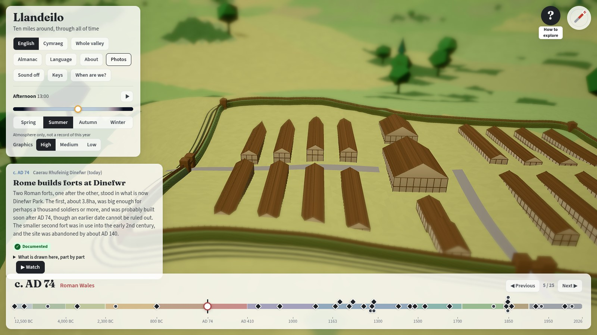
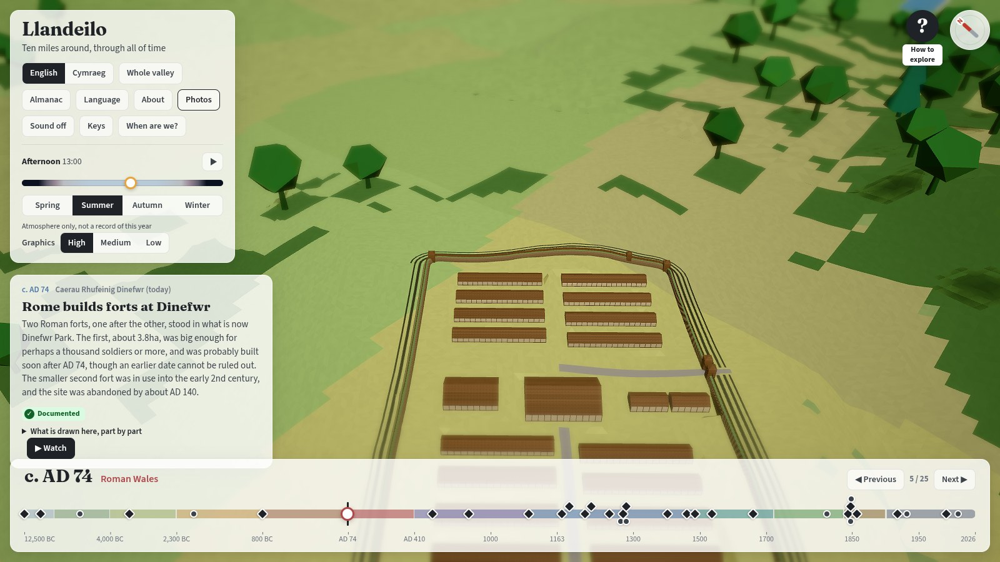

# Build log

Milestones and what each one taught us. Newest last.

## 2026-09-26

1. **Discussion and CLAUDE.md**, adapted from the Totum repo: kept the twin laws (unified and DRY),
   the testing pyramid and "a visual change isn't verified until it has been looked at"; dropped
   everything Android-specific; added the historical-accuracy law.
2. **Research**: six parallel agents. They exhausted the shared WebSearch quota; later sections
   relied on WebFetch. See [`../research/process.md`](../research/process.md).
3. **Scaffold**: Vite, strict TypeScript 6 (typescript-eslint does not support TypeScript 7 yet),
   Babylon.js 9, ESLint strictTypeChecked, Prettier, knip, Vitest, Playwright, GitHub Actions to Pages.
4. **First render**: the real Tywi valley from OS Terrain 50. ACES tone-mapping greyed the sky, so
   the neutral tone-mapper replaced it; a sky dome would not take vertex colours, so a screen-space
   gradient layer replaced that.
5. **CI failed twice before the first deploy**, both times on checks doing their job: generated
   sources had been reformatted by Prettier (now excluded), and knip flagged exports not yet used.
   A pre-push hook now runs the fast checks locally.
6. **Features**: 40 era features, key dates, moment card, labels and camera flights. A mesh-merge
   crash (mixed vertex attributes) was only caught by looking at the page before deploying.
7. **Scale**: the first close-ups mixed true-size buildings with trees 40–60m tall and landmarks
   ×4.5. Unified to trees at about 20–30m, landmarks ×2.6, true footprints for towns and hillforts.
8. **Citations**: the finalised Victorian note renumbered its sources and dropped list bullets, so
   every Victorian citation failed to compile. That is the compile-time check working; citations
   were re-mapped by title.
9. **First deploy**: https://dewijones92.github.io/llandeilo-omnia-mutantur-nihil-interit/,
   verified by loading it in a browser, not just by the HTTP 200.
10. **Conversations, almanac, language, sound**: six family scenes with voices, 32 almanac
    entries, 12 language periods, procedural Web Audio ambience.
11. **Bundle**: `@babylonjs/core` barrel imports pulled in the whole engine (1.6MB gzipped). All
    Babylon imports now go through `src/world/babylon.ts`, which deep-imports only the modules used
    plus the side-effect modules they need (ray picking, layer and shadow scene components, thin
    instances): 387KB gzipped. A missing side-effect import fails only at runtime, so this was
    verified by screenshot and the full e2e suite on the production build.
12. **Independent Opus review** (code, and history plus visuals). Fixed: Roman forts 0.9km out
    of place, Younger Dryas on uncalibrated dates, the year readout printing raw floats, arrow keys
    snapping back to key dates, a listener leak per provenance badge, whole-terrain recolouring
    on nearly every scrub frame, purity-lint holes, no voice/text or asset-licence checks, and
    bilingual gaps. New e2e tests then found that the full-screen label and bubble layers were
    swallowing mouse input meant for the 3D view (`#app > *` outranked their `pointer-events:
    none`); now fixed and guarded by a test that fails on the old CSS.
13. **Verification review of the fixes** (a second Opus pass). Most fixes held, but six
    regressions had come in with them: disposing one smoke system destroyed the shared smoke
    texture, the render-once shadow map froze the moving train's shadow, the collapsed event card
    only updated on scrub, an automatic panel close stole keyboard focus, and three new content
    sentences were not in the research. All fixed; lessons: a shared resource must survive its
    consumers' disposal, and a "render once" cache needs every moving caster accounted for.

## 2026-09-28

14. **Previous/Next and camera shots**, then two review rounds. The first found snaps pulling the
    camera away and a quick second Next being lost; the second found Next stepping from the wrong
    place after a marker click. Each fix landed with an e2e test seen failing on the old code first.
    A Playwright lesson: at SwiftShader's 1fps, two sequential clicks never overlap an animation, so a
    race test must fire both clicks in one page task.
15. **ADRs and a what-goes-where table**; desktop only; no bundle limit; the dev server always on 5051.
16. **Research verified by a second agent**: the conversations-by-class note had 13 corrections
    (inexact quotes, an overstatement, two unsupported "cross-checked" labels) and stays a draft.
17. **The first Blender model**: the 1850s train, researched first from the 1858 Board of Trade report
    on the engine Victoria (a six-coupled Hackworth of 1841). Two traps: Blender applies scale on the
    object's own axes before rotation (the carriage roofs came out as discs), and glTF's handedness
    conversion is a mirror, so baking it into the vertices turns every face inside out; the model
    looked black until the winding was flipped back. The train is now a feature kind with dates and
    its own provenance, so the 1840s-type engine no longer runs through the 1990s.
18. **Compass and follow**: the compass maths is pure and unit-tested; following lives in the one camera
    seam (Flight), so any other flight ends it.
19. **Atmosphere: time of day, seasons, effects** ([`../design/atmosphere.md`](../design/atmosphere.md)).
    One pure function, `lightingAt(environment, clock)`, turns the era's sky colours and the chosen
    hour and season into every light the renderer reads, from the real solar geometry at 51.88°N;
    `seasonLook` does the same for land and trees, with the winter snow line moved by a climate
    "chill" per period cited to the deep-time note. Lessons: a sun that has just set leaves the
    land black unless the sky itself becomes the fill light (twilight ambient rose to 0.85, plus a
    low afterglow key light from the sun's side); depth of field blurs the background too, so the
    stars were bokeh until the aperture closes as they come out; `DynamicTexture` defaults to clamp
    addressing, so a scrolling star layer smeared its edge column into lines until set to wrap;
    windows at true scale are sub-pixel from the default close-up, so they only read nearer in;
    autumn trees on a green woodland floor glittered at overview scale until the floor under the
    woods turned russet with them. Screenshots were shot from a production build served by
    `vite preview`, because hot reloads from ongoing edits kept restarting dev-server pages
    mid-shot. An independent Opus review then found: a failing e2e expectation (winter 16:30 is
    dusk, not night); the sun disc drawn with the wrong Babylon `Layer` maths (a layer's UVs are
    screen-space, so a scaled layer shows a cut-out of a full-screen texture; the glow is now
    painted into the sky gradient by ray angle); the ripple texture clamping after its first tile
    (the same `DynamicTexture` default as the stars); shadow sampling using a newer light
    direction than the shadow map; three copies of the snow rule; climate keys cited to sources
    that do not cover their dates; smoke staying day-bright at night; and the phone summary
    vanishing after a resize. All fixed. A second review of the fixes found the stars jumping as the camera passed due
    south (a non-whole number of star tiles per turn), 12,500 BC wrongly treated as the coldest
    point when in calendar years it sits inside the milder Late Glacial interstadial (checked
    against a source and written into the research findings, with the existing environment
    keyframes raised as an open question), and muted panel text too faint over the night scene.
    All fixed. Bundle about +10KB (about 436KB gzipped; the size limit has since been removed, ADR 0016). Built in a worktree by a parallel agent and merged into main on 2026-09-28.

20. **Building models from the documented plans** (option A in
   [`../design/models.md`](../design/models.md), "accurate low-poly"). The generic `castle`,
   `church`, `abbey`, `mansion`, `bridge` and `tower` kinds became one `building` kind: a plan
   (`src/content/buildings.ts`, true metres, citing the research) plus a condition. One renderer
   draws every plan, with one builder per part type, and ruins come from each part's `ruin` data
   rather than from code. 26 models, about 27k triangles in all.
2. **Every face was inside out at first.** Square prisms and roofs looked fine, so nothing gave it
   away until round towers showed as crescents from above. Hiding the terrain proved the geometry
   was solid; flipping the winding fixed it. Babylon's front face is the reverse of the right-hand
   rule used in `sculpt.ts`, so check a new primitive from above, not only from the side.
3. **Two terrains.** `ground()` interpolates the 50m OS grid, but the rendered terrain is a Delaunay
   mesh of points about 105m apart, and on a crag they differ by several units. Landmarks now sit
   on the rendered surface (`src/domain/surface.ts`), and `platform` levels a ward to its summit so
   a castle 2.6× larger than life stands on its hill instead of draping down it.
4. **The OS footprint of a landmark is the same building.** A model now hides any OS footprint
   that contains its grid reference or lies under it. That removed the white 120–150m slabs beside
   Newton House and Golden Grove, and the town's copy of St Teilo's.
5. **Scale rule**: `landscape` plans ×2.6 in all axes; `map` plans (the church, the bridges) at true
   footprint with heights × the terrain's 2.4, because they must meet true-size streets and the drawn
   Tywi. Recorded in [`../content/authoring.md`](../content/authoring.md).
6. **Bundle**: 429.9KB → 443.1KB gzipped (the base was already well above the 387KB in CLAUDE.md).
   About 7KB of headroom is left under the 450KB budget.
7. **Independent Opus review**: no CRITICAL, 9 IMPORTANT, all fixed. Square towers ignored the plan's
   rotation, so St Teilo's tower and Newton House's turrets sat askew. A raised part (the Dinefwr
   summerhouse) still reached the ground and filled in the ruined stump. Round towers drew no
   battlements, because every edge was shorter than the merlon spacing. Landscape plans hid real
   neighbouring buildings (six near Talley). Three houses whose form is a guess were labelled
   documented. Two source contradictions were left unsaid (the summerhouse's date; an early
   18th-century rebuild of St Teilo's). The orientation notes were missing. Tests now pin the
   documented dimensions, platform convexity, the surface lookup and the footprint rule.
8. **e2e on a shared machine**: port 4173 was already serving another agent's build, and
   Playwright reuses an existing server locally, so the first run tested someone else's code. Rerun
   against this branch's own preview on a private port: 10 passed. Built in a worktree by a parallel agent and merged into main on 2026-09-28.

## 2026-09-29

1. **The backlog became a board** (pilot, [ADR 0018](../adr/0018-backlog-as-a-gated-board.md)):
   Backlog.md task files in `docs/todos/tasks/`, `npm run board` on :5052, and gates in
   `tools/todos/rules.ts` run by `npm run check`, pre-push and CI. Five agreed items moved across.
2. **Proved against the real tool, not its docs.** A summary of Backlog.md claimed it blocks Done
   while checklist items are open; its source does not. A card pushed past each gate made the check
   fail for the right reason. An invented `agreed_on:` key survived a save that changed nothing but
   vanished on a save that did, which is why the validator rejects unknown keys. Removing each gate
   in turn made its unit test fail.
3. **`npx backlog` is a different package** (`backlog@1.4.56`); use the repo's own install
   (`npm run board`, or `npx --no-install backlog`).
4. **The validator reads the files itself** with `yaml`. The CLI's `task list --json` (one call, 0.37s)
   leaves out `documentation`, `dependencies` and the raw frontmatter keys, and `task view --json`
   takes 0.37s per task, about 37s for 100: too slow for the pre-push hook.
5. **The board only links `http(s)` references**, so a repo path shows as plain text. Links are now
   GitHub URLs that the validator maps back to repo paths (Dewi chose this over an upstream PR).
6. **Independent Opus review**: no CRITICAL, 3 IMPORTANT, all fixed. The gates were keyed to the
   config's column order, so swapping two columns silently moved the research gate (the columns are
   now pinned, in order); the file parsing had no tests and two gate behaviours none either (moved into
   `files.ts` and tested); an unagreed idea had been
   copied onto the board while still on the ideas board (moved back). Also taken: the tool's own
   checklist pattern, distinct whole years only, `..` paths rejected, malformed fields and YAML reported
   rather than skipped or thrown, `.locks/` ignored, Node ≥22.18 for running `.ts`.
7. **Verification review of the fixes**: the gate fixes held; 2 IMPORTANT in the new links, both
   fixed. The link base was a plain text prefix, so a missing or `git+….git` `repository.url` turned
   every link into an unchecked "web" link, and so did any other spelling of a link into this repo
   (another branch, a permalink, `http`, `www`, `raw`), while an `#anchor` could never pass. Links are
   now parsed as URLs, must be written as the one canonical URL, and a bad `repository` fails the
   check. `new URL()` resolves `../` and `%2e%2e` by itself, which is why the link is compared as
   written. Seven changes the reviewer could make without a test failing are now pinned; every rule
   was then broken once on purpose and a test failed each time (one check turned out redundant with
   the canonical comparison and was removed).
8. **The pre-push hook checks the pushed commits** (`check.ts --ref <sha>`, reading the files through
   `git show`), so an uncommitted drag on the board no longer blocks an unrelated push. An integration
   test builds a real git repo and shows the commit passing while the working tree fails.
9. **The whole lifecycle, driven through the board in a browser** (Playwright, a throwaway copy of the
   repo on its own port): create a `content` card, drag it column by column to Done, link its note,
   tick its criteria, record its review, running the validator after every step. 16 steps, all as
   expected. It found two things no unit test could. The board **cannot add Documentation** (it only
   displays it), so the research gate now reads References too and the notes moved there. And the board
   writes a long URL as a folded YAML value (`- >-` then the URL on the next line), which only a real
   YAML parser reads correctly, so the validator must never read these files with a regex.
10. **Third review round** (the changes after the browser run): no CRITICAL, 2 IMPORTANT, both fixed.
    Every URL into this repo was read as a file link, so a card citing one of its own issues or pull
    requests would have blocked every push; only file routes (`blob`, `tree`, `raw`) map to paths now.
    And the pre-push check failed any pushed commit from before the board existed; it now skips a
    commit with no `backlog.config.yml`. Also taken: case-exact routes and paths, encoded `/` rejected,
    a trailing-dot host recognised, the hook reading its push list before anything else runs, and
    commit-mode tests for a note reviewed on disk but not in the commit and for an uncommitted linked
    file. Each fix was broken once on purpose and a test failed each time.

## 2026-10-01

1. **The board pilot ended after two days** ([ADR 0022](../adr/0022-one-todo-file.md)). Five task files,
   the rest of the list in `_index.md` and issue rows on the ideas board made three places to look,
   and Dewi found it confusing. The lesson: a second home for the same kind of thing costs more in
   "where does this go?" than its gating saves, unless everything moves at once. The validator and
   its tests are in git history at `2f5d4a1`.
2. **Issue forms removed** for plain GitHub issues ([ADR 0020](../adr/0020-plain-github-issues.md)), and
   **session-start issue triage** set up ([ADR 0021](../adr/0021-issue-triage-at-session-start.md)). Two
   second-Opus reviews of the triage rule found real holes: a stranger's text could reach the public
   repo unseen, every subagent reading CLAUDE.md would also triage, and a date compared with a
   timestamp made our own replies re-trigger triage for ever.

## 2026-10-02

1. **A todo item can be already done by something else.** "Timeline tick labels overlap" named
   "8,300 BC", an anchor that no longer exists; re-measured at 1024-1920px in both languages, nothing
   overlapped. The overlap test was still worth adding, and a deliberately cramped anchor (10,000 BC
   at t=0.03) proved it fails at its assertion. Its first red run failed in the wrong place: a
   `getByRole('button', { name: 'English' })` also matched two timeline markers ("…to the English"),
   so language buttons need `exact: true`.
2. **e2e no longer reuses a server.** The preview port is derived from the checkout's path, so two
   clones cannot collide, and `reuseExistingServer` is off, so a run only ever tests the build it
   started ([ADR 0023](../adr/0023-e2e-own-port-never-reused.md)).
3. **The scale factors in the About text come from `WORLD`**: the landmark scale moved from the
   renderer (`MONUMENT_SCALE`, now removed) into `src/domain/geo.ts` beside the hill exaggeration.
   The review caught the first wording, "castles, abbeys and forts", as wrong: hillforts are drawn at
   true footprint, so the text now names what is enlarged and what is not.
4. **`Place.namedFrom` is required** ([ADR 0024](../adr/0024-place-names-carry-a-required-date.md)).
   The first draft gave Garn Goch AD 800 as a lower bound, which the review rightly called backwards:
   a lower bound on a name's first use, applied as "named from", shows the name as in use for 1,200
   years with no record. When unsure, the bound must err towards "(today)", so it is 1974, the
   oldest use we can cite.
5. **SwiftShader e2e is slow when the machine is shared**: with another project's emulator on ten
   cores, a page took over 150s to become ready once. A timeout at `data-ready` is load, not a failure
   of the test's own step.
6. **A rule that lives in one view misses the others.** "(today)" for the Roman forts did nothing on
   the map, because only visitable places get a label; their name appears on the moment card, which
   had its own copy of the place name and no rule. One domain function, `namedLater`, now answers
   it for both. The e2e test written against the labels failed for exactly this reason.
7. **Labels hid under the compass.** A screenshot showed "Garn Goch (today)" half under it: labels
   only dodged speech bubbles, and estimated their width from the name alone, missing the note.
   They now avoid every on-screen panel, using their measured size.
8. **The compass sat on top of every right-hand panel.** The conversation, info and debug panels
   were all at `top: 16px; right: 16px`, the compass's own corner, so it covered the conversation's
   close button. Found by a screenshot taken for a different change. They now share one
   `--below-compass` token.
9. **A test that watches the screen can pass while the bug happens.** The test for "arrows in the
   3D view do not step the timeline" first watched the key-date counter and passed on the buggy
   build: at SwiftShader's 1fps the counter had not redrawn two seconds after a step. A probe showed
   the step in the log (`dewidebug timeline step … to=dryslwyn-siege`), so the test now asserts on
   that logged decision and fails on the old build. Two quick key presses even left the counter
   unchanged on the buggy build.
10. **Three second-Opus reviews of one batch.** The first caught three accuracy errors (hillforts
   enlarged, the bridge's date, Garn Goch's bound). The second caught the keys help promising more
   than the code did, the dialect rule written backwards, and ticks claiming steps that had not
   happened. The third caught the fix for the keys (arrows now double-fired with the 3D camera) and
   the paragraph above overclaiming in the todo file. Each review found something in the previous
   fixes.
11. **Independent checks of four research notes, the medieval note first.** 127 of its claims were
    re-read against their sources: 91 confirmed, 8 contradicted. The worst was in the app's own 1282
    card: the English force did not sack Carreg Cennen, it re-occupied the bare walls the Welsh had
    burnt, and the ambushed men were a plundering party from an army that was mostly Welsh levies. Also
    corrected in content: the 1287 "tunnel collapse" was a mined wall falling on the men inspecting the
    mine; "The castles held" in 1403 took one side of a contradiction; Gerald of Wales's oats quote was
    cited to two Wikipedia pages that do not contain it, and is now cited to his own text.
12. **The Welsh had been quietly losing facts.** An audit of every English/Welsh pair found 16 places
    where the Welsh dropped a fact, a number or a caveat ("reported", "probably", "in calendar
    years"), and none where it added one. Translation drift only ever went one way: towards less
    hedging. All 23 fixed (24 edits); the human Welsh check is still parked.
13. **Talley and Dryslwyn rebuilt from checked research.** Talley's plan now has its origin on the
    crossing tower, so the Coflein grid reference places it exactly, and it is drawn as built (about
    49m with a four-bay nave and one aisle), not as designed. After 1536 it splits into a roofed east
    end serving the parish and an abandoned rest, until 1773. Dryslwyn grows in three phases that each
    contain the last, so a unit test can hold the order. The slider cross-fades features over about
    20 years in this part of the timeline, so a phase is half-visible ten years before its date: that
    is the morphing working, not two castles at once.
14. **CI ran out of time.** With 24 e2e tests the GitHub job passed its 25-minute limit and the deploy
    of 97cfad9 was cancelled; the limit is now 45 minutes (5aa8465). The real cost is one SwiftShader
    page load per test.
15. **The first real-GPU numbers found a bug SwiftShader hid.** At about 1fps everywhere, nothing
    looked slower than anything else. On the NVIDIA GPU (through WSL's D3D12 layer) the app idles at
    41fps but scrubbed at 2fps: each slider step recoloured all 153,944 terrain triangles, rebuilt the
    forest buffers and re-rendered the 4096² shadow map, and back-to-back steps queued GPU work until
    each took about a second. Throttling that heavy pass to every 150ms (with a final pass when the
    slider stops) gave about 15fps. Per-stage timings are now logged every two seconds
    (`dewidebug apply cost`).
16. **Four lenses and two refuters each.** Batch 4 was reviewed by a workflow: accuracy, Welsh,
    code and docs, every CRITICAL or IMPORTANT finding attacked by two independent refuters. 18
    survived and 2 were refuted. The critical one: the "From the record" sky caption stayed on screen
    after leaving its key date, so 1857's weather could sit over AD 600. Recorded skies now carry
    their own sources, say when an hour was chosen rather than recorded, and clear on any scrub.
17. **One page cited twice passed for two sources** on 17 items (a Wikipedia, Cadw or Coflein page
    filed under two notes' keys). A content test now rejects it.
18. **e2e on the GPU:** 26 tests in 2.7 minutes, against 9-12 on SwiftShader.
19. **Two GPU browsers at once can hang one.** A screenshot script and the e2e run shared the D3D12
    GPU path; one e2e page never became ready in 150s, then passed five times out of five alone. Take
    screenshots before or after an e2e run, not during.
20. **Two e2e workers broke CI.** On GitHub's 4-core runner SwiftShader renders on the CPU, so two
    workers starved each other: three slow tests hit the 3-minute timeout and the run still took 22.6
    minutes. CI is back to one worker; local runs on the GPU keep two.

## 2026-10-03

1. **Honest ambience, step one.** The sound beds had no provenance, and that hid three errors: church
   bells from AD 800 (the first bells in any source are the peal for the first train, 20 January
   1857), a train bed on the 1850 key (so its level climbed from 1600; only the need for a visible
   train kept it silent), and a market at 1250, before the fair said to date from 1291. Every bed now
   has its own dated track of points in `src/content/ambience.ts`, each heard point with a
   provenance, and `?debug` lists every sounding bed with its reason
   ([ADR 0028](../adr/0028-ambient-beds-carry-provenance.md)). The debug overlay then grew taller
   than the space above the timeline and covered Previous and Next; it is now capped like the other
   side panels, with the sound lines above the long feature list.
2. **A fix that only moved the bug.** The first version put the 1857 bells on a new look key and
   claimed "no bell before 1857", but linear interpolation faded every bed in from silence across
   the gap before its key: bells from 1851, labelled documented, and the content test that was meant
   to catch it stopped scanning at 1850. The second-Opus review found it. Lessons: a test of "nothing
   before date X" must scan right up to X, fractions included; a key list shared by look and sound
   makes every sound date cost a hand-copied look key; and an in-between year must not wear the next
   key's reason as its own (`since` and `towards` now). Red runs: the two content tests (bells heard
   from 1851; 200 fade-in samples across the beds), the two `soundAt` unit tests, and the overlay
   e2e test (the river still "documented" at 1282).
3. **"When are we?", a guess-the-year game** ([ADR 0029](../adr/0029-guess-game-hides-giveaways-by-one-root-class.md)).
   Five rounds from the 19 key dates that have something drawn to date them by; the viewer drags a
   ghost marker on the timeline, and the reveal sweeps from the guess to the answer and lists the
   clues with their ⓘ and a "Show me" flight. Two things the first draft got wrong, both caught before
   any UI existed: probing the real content showed features fading in or out offered as clues whose
   dates did not include the year (Carreg Cennen's 1287 inner ward at 1282), and a unit fixture
   showed the climate clue naming its period by its keys' years rather than the years the model
   keeps the chill visible, so it could fall outside the year (it now reads c. 1456 to 1887 for the
   Little Ice Age, and AD 933 to 1275 for the warm period).
   Playwright treats a zero-width element as hidden, so the ghost is checked by its flag.
4. **The game's review: firm had meant "documented", not "documented with exact dates".** The
   second-Opus pass found every documented feature called a firm clue with bare dates, beside a
   "c. 800 BC" answer: the Roman forts, an unexcavated hillfort, Dinefwr's rounded 1220 to 1600.
   Features now carry `datesExact` (three do), and the rest read "c." as probable clues. The same
   pass found four more things the tests had not asked: an inclusive range made a hillfort and its own
   ruin both clues at AD 74; "the scene cannot tell them apart" ignored the people and the mapped
   woodland; the climate clue claimed snow that summer never draws (the summer snow line is 995m at
   the Little Ice Age peak, the highest ground 675m); and the almanac opened underneath the game
   panel. Each was fixed behind a test seen red first. The tick labels under the slider at 800 BC
   and AD 74 still give two answers away; that choice is left to Dewi.
5. **Light after dark: the night is lit by the light of its time.** One time-of-day scalar used to
   light every window and hearth the same in every era, so the town glowed in 1942. Now dated keys
   in `src/content/lamplight.ts` (hearth, the medieval court's candles, rushlight from 1750, oil from
   1864, gas street lamps from 1876, electric street light from September 1902, the blackout from
   1 September 1939, the dim-out from September 1944, light again by 8 May 1945) resolve into the
   snapshot, and windows, hearth glow and new street lamps read the result
   ([ADR 0030](../adr/0030-night-light-as-dated-content-keys.md)). The keys hold rather than blend.
6. **Welsh Newspapers Online answered what the notes could not.** The Llandilo Gas Company's works were
   being built in 1864 (not "c. 1860", a single Wikipedia page), the Local Board had the town lamps lit
   "as heretofore" in 1876, and a 1902 columnist mocked those who saw no difference "now that they are
   electrically lit than when they were gas lit". The first gas lighting of the streets was not found,
   so lamps start in 1876 and the gap is in open-questions. The searches also turned up Llandovery's
   1863 gas lighting and Llandilo-Talybont's electric company, both easy to misfile as Llandeilo.
7. **Street lamps follow today's roads where the town's houses stand.** Placed within the town
   feature's radius, the first draft strung lamps out along empty roads into the fields; a screenshot
   showed it. They now go only on road within about 40m of one of the town's own houses.
8. **The e2e test reads the lamp state through `?debug`** at 1880 (gas) and 1942 (blackout). Its red
   run used the old code, exported from HEAD into a scratch folder with the new test copied in, so the
   worktree was never rolled back; it failed at the first `light homes` assertion.
9. **The second Opus review of Light after dark found the dates and places claimed more than the
   sources do, and the fixes are in the schema.** Lamps were drawn in Ffairfach from 1905 because the
   modern town reaches 1300m from the church, while the sources speak of lighting "the town"; lit
   streets now carry a `LitArea` (Llandeilo north of the Tywi) and a content test keeps Ffairfach
   out, so 145 modern lamps became 87 and the 9 on the road south of the bridge went in every era.
   "1876", "1750" and "8 May 1945" were shown as starts though they are latest or sample dates; each
   key now carries `dated: 'on' | 'by'`, and a test makes the almanac's words open with "By" or
   "From" to match. The blackout and the 1945 lifting each had one source; a home-front history site
   is now the second, and its weakness is noted. The keys were only in `?debug`, so the almanac now
   shows "Light after dark" with the active key's ⓘ. Lamps were also drawn twice while the Victorian
   and modern towns crossfaded; only the town most present gets them now. The ADR is renumbered
   0030: two sibling branches also use 0028 and a third moved to 0031.
10. **A Begin card and a Graphics menu.** The loading card now carries the Ovid motto and, once the
   valley is ready, becomes a Begin card veiled over the scene; Begin is the click browsers need
   before they play sound, so it turns the sound on. Links into a year or place skip it, and so do
   automated browsers (`navigator.webdriver`), so the existing e2e tests and screenshots needed no
   edits; `?begin=1` brings it back for a test. The graphics level is one table in
   `src/domain/quality.ts` ([ADR 0031](../adr/0031-one-graphics-quality-setting.md)), applied live,
   with `?fx=low` kept as an alias. The motto was checked in two texts of Metamorphoses XV, both
   line 165 ([findings](../research/findings.md); *corrected the same day*: this entry first said
   the Latin Library numbers it 164). First draft of the card left place labels and a speech bubble
   showing through the motto; the text now sits on its own panel. 8192² shadows cost nothing
   measurable on SwiftShader (four e2e tests: 1.2 minutes at 8192, 1.3 at 4096), and are unmeasured
   on a real desktop GPU.
11. **The second-Opus review of that work found the fix had not fixed it.** The card's own panel was
   86% opaque and its backdrop blur did not reach the labels (probably because its parent's own
   backdrop-filter made the parent the backdrop root; not proven), so "News of the ambush" and
   "Garn Goch (today)" still read through the motto in the screenshots said to show the fix. The card is solid now, and the e2e test checks
   its computed background. Two more lessons: the debug quality line printed the *table*, so the
   Low test would have stayed green with every apply line deleted; it now reads the renderer back
   (shadow map, pipeline flags, the forest's drawn count), and the test went red with the forest or
   the bloom line removed. And keys pressed with the Begin card up stepped the timeline behind it.
   High's trees went from 0.62 to 0.9 of woodland triangles (34,056 drawn at 1282, against 23,449
   at Medium); the ADR was renumbered 0031 because two other branches had already taken 0028.
12. **Two independent research checks and a second-Opus review, applied in one pass.** The light
   check found the app saying more than its sources: blackout curtains staying in the dim-out
   (Hansard: half-lighting from 17 September 1944; a Scarborough history: ordinary curtains), and the blackout "over everywhere" by 8 May 1945 (some coastal areas waited). The c. 1200
   key had no datable source, so a third `dated` kind, `'in'`, marks a period, and before the first
   key (7800 BC) there is now no key at all, rather than the first key stretched back to 12,500 BC
   ([ADR 0032](../adr/0032-night-light-before-the-first-key-and-period-dates.md)). The soundscapes
   check found no licence problems but eight claims that went past their sources (and one optional
   citation); all are corrected, and a 1290-91 fair is now documented (the market bed's start waits on Dewi). The review
   found: homes "mixed electric light, gas and oil" in 1902, which no source shows (homes went back
   to flame light; *corrected 2026-10-03*: this item first credited that to the light check, which had
   rated the claim "partly" and asked for no change); the Begin card's `aria-modal` did nothing for Tab (the app and canvas are now `inert`);
   the "ticks stay" of ADR 0029 was untrue, since a tick was only its label (each tick now draws a
   mark); the same-scene check ignored the night light, and its compile-time guard had gone dead when
   `ambient` left `Environment` (the comparison is now a record over every `Snapshot` field, so a
   new field is a compile error until it is compared or called unseen); the street-lamp rule was
   written four times (now one type guard); the lamp minimum-gap and carry had no test that could
   fail (now two, each seen red by deleting the line); the 1857 railway drew the 1858 Vale of Towy
   line and ran the train on it (dated sections, [ADR 0033](../adr/0033-railway-drawn-in-dated-sections.md);
   *corrected 2026-10-03*: that fix did not work on screen, see item 13);
   and steam played faintly until 2025 (it ends on 13 June 1964, and a reconstructed diesel-unit
   bed runs to today). Lesson: the merged items had been ticked ahead of their own path; a tick is a
   claim, and two were unticked rather than defended.
13. **The first railway fix tested content dates, not what is drawn.** The second-Opus review of
   item 12's fixes found the 1858 Vale of Towy line still drawn in the 1857 scene: every feature
   faded in over about 17 years before its `from`, the renderer drew a section above presence 0.5,
   and the new test filtered features by `contains(when, year)`, which the renderer never asks. So the
   line showed from about 1849.7 and a silent train ran from 1853.7, under a green test and an ADR
   that called it fixed. Now a feature with exact dates is never present outside them, and what of the
   railway is drawn is one pure rule (`drawnRailway`) that the renderer calls and the tests sample
   through `snapshotAt`; the three railway tests went red on the old presence rule at their named
   assertions ([ADR 0034](../adr/0034-exact-dates-draw-nothing-outside-them.md)). Lesson: test the
   picture through the renderer's own rule; a test of the data beside it can pass while the screen
   is wrong. The same review found the southern section still claiming January 1857 for track its own
   source dates to 1840 (it is now three dated stretches as grid boxes; the undated western lines are
   not drawn), the electric street lamps of 1902 drawn gas-orange because windows and lamps shared
   one colour (each street kind now has its own), the 1902 text saying homes "kept to gas", which no
   source shows (a re-read of the Carmarthen Journal of 10 October 1902 found tradespeople having the
   electric light installed, now light:S31), two source links swapped, a steam train still puffing
   in 2000 under a diesel sound (a placeholder diesel unit now runs after 13 June 1964), and docs
   crediting a change to the wrong review. Sampling the trains every quarter year, rather than every
   whole year, also found the Llanelly train ending in 1872 and the next starting in 1873. Seen red
   first: the three railway tests, the dated-stretch content test (with the old section's extent),
   the 2000 steam test, the 1903 street colour test and the same-night guess test. Screenshots at
   1857 (no line north-east of the town) and 1858.5 (the Vale of Towy line drawn).
14. **The fixes' own review: a reconstructed feature could not be drawn on its date.** The third
   review (2026-10-03) found the Llanelly Railway's 1840 lines drawn from about 1831: `datesExact` was
   both "draw nothing outside these dates" (ADR 0034) and "a firm clue" (ADR 0029), and a test allowed
   it only on documented features, so a section reconstructed for its course faded in for nine years
   while its ⓘ said April 1840. The two meanings are now separate
   ([ADR 0035](../adr/0035-exact-dates-are-about-dates-not-clues.md)). It also found that east of
   Garnant today's track is the Great Western's line of 4 November 1907, not the 1841 incline line
   (victorian:S29, and Mowat's 1957 *Railway Magazine* article, now victorian:S74, read from the
   Wayback copy because the live page answers 403); that stretch is its own section from 1907, with
   nothing drawn there from 1840 to 1907 (*corrected 2026-10-03, fourth review*: this said 1841). Coflein's unexplained "Ammanford Railway Station" turned out
   to be Cross Inn, 4m from the Amman valley branch. The 1902 street-colour fix had also turned every
   street lamp since 1945 near-white; a key can now give its lamps their own colour, and the 1945 key
   keeps its old warm one, labelled a guess. Smaller: the end of steam was four literals with gaps of
   a few days between train phases (one constant now, phases share boundaries, and at a boundary the
   phase starting there is drawn, as the sound already did); the guess game's "looks the same" counted
   a train the renderer does not draw (it now asks `drawnRailway`); and the year label rounded, so
   `?year=1858.5` read 1859 (it now floors, with a float allowance, so 1856.9999999 still reads 1857).
   Seen red first: the 1840 and 1907 drawn-railway tests, the steam handover test (and its exact
   boundary, red only without the new tie-break), the shared-boundary train tests, the 1945 street
   colour test, the two same-scene tests and the year-label tests. Lesson: a flag that means two
   things will be set for one of them and break the other. Screenshots at 1835 and 1845 (Llandeilo at
   radius 900, and the whole valley): the line is too thin to see at valley scale, so the renderer's
   own `dewidebug rail drawn` line is the evidence: nothing in 1835, `railway-llanelly-1840` alone in
   1845, every section with a steam train in 1910.
15. **The fourth review: one year for every reader, and no date for undated track.** A slider position
   turned into a year could come back a hair short of a key date (549.9999999999998 for the AD 550
   key), and only the year label and the guess game's clues allowed for it, each in its own way. So at
   the St Teilo key the header read AD 550 while the Language tab showed Late Brittonic, which ends in
   549. `yearAt`, the one place a slider position becomes a year, now settles a value within
   `YEAR_EPSILON` of a whole year onto it, and the label, the snapshot (era, language, almanac,
   conversations, sound, night light) and the guess game all read that one year; the guess game's own
   nudge is gone. Settling rather than adding the epsilon was chosen after a probe: adding it would
   have dropped the Iron Age almanac at the AD 74 key, the three-tollgates conversation at the 1848 key
   and three entries at the end of the slider, all of whose ranges end on those years. Exact days named
   by a source are now written with `onDay(year, month, day)` (leap years counted): 10 April 1840 and
   4 November 1907 had been a day or two early, and 1 April 1858 a day late; 13 June 1964 and the
   blackout keys moved by under a day. The 1907 line east of Garnant had drawn the colliery track past
   Gwaun-cae-Gurwen's level crossing from 1907, a date no source gives it. It now ends where the line
   joined the old course, placed from Mowat's length for it (1 mile 22 chains along today's track from
   the cut at Garnant), and the track beyond is undrawn, like the Cross Hands stubs; Pantyffynnon to
   Duffryn keeps exact dates though contested, because its ⓘ names both (ADR 0035, amended). Notes: the
   1907 ⓘ now says the first half mile east of Garnant opened in April 1840; Mowat and the Llanelly
   Railway page are recorded as disagreeing (1907 or 1933 for the Cawdor branch, June or May 1926, the
   halts) instead of "agreeing on every date"; Cwmamman's place on the old course is marked an
   inference; and Garnant station's grid reference is recorded as disagreeing with the coordinate used.
   Coflein has no Garnant station record; its Gwaun-cae-Gurwen viaducts record, dated just before the
   First World War, sits on the track about 65m east of the placed join and is kept as a lead
   (victorian:S76). Street warmth is now range-checked and shown in `?debug`. Seen red first: the
   per-key-step test (at `st-teilo`, on `language`), the three opening-day tests, the dated-stretch,
   exactly-once and 1907-length content tests, and the night-light range test (with a street warmth of
   4.5). Lesson: a float allowance belongs where the value is made, not where it is read; two readers
   had patched it and four had not. Evidence: the renderer's `dewidebug rail` line shows the 1907 section
   cut at E269996 and absent in October 1907, drawn in 1910.
16. **CI ran out of time, not tests.** The push of the fourth review's fixes was cancelled at the job's
   45-minute limit with 29 of 31 e2e tests done: since the merges, each test takes about twice as long
   on the runners' CPU renderer (the 1-minute tests of 2026-10-02 took 2), and three multi-page tests
   passed the 3-minute per-test limit. All 31 had passed locally on the GPU. The e2e tests now run in
   four parallel shards and the deploy waits for all of them; CI's per-test limit is 7 minutes
   ([ADR 0036](../adr/0036-ci-e2e-in-parallel-shards.md)). Lesson: the job time is a budget that every
   merged feature spends, so watch the trend, not just the colour.
17. **Two decisions from Dewi, built the same day.** The market sound now starts in the Middle Ages
   ("yes ok"): with the fair granted on 20 May 1290, reconstructed, then documented from the record of
   1326, then the gazetteer's "Market town c. 1600". The first medieval day a bed named exposed that
   `onDay` refused every day before 1753; it now reads earlier days in the Julian calendar and refuses
   only 1752. And the undated railway lines are drawn as labelled estimates ("put draw and give
   estimgate for dates but please label them as educated gueessess with sources?"): the line near
   Pontyberem is the Burry Port and Gwendraeth Valley Railway (c. 1870), the track past the 1907 join
   is Gwaun-cae-Gurwen's colliery line (c. 1841). The research turned on old maps: the National Library
   of Scotland's georeferenced six-inch mosaic, with today's track drawn over it, matched both lines
   to the railways on the 1896 and 1905 maps, and its IIIF images of the 1877 and 1878–79 surveys dated
   them, the second contradicting the "1886" both Coflein and Wikipedia give for Cwmmawr. The NLS sheet
   index (a WFS layer on geoserver.nls.uk) names the sheet and survey years for any grid point. The
   "Cross Hands" stub turned out to be 35m of narrow-gauge track, by OS's own attribute, that no source
   names, so it is the one stretch left undrawn. Seen red first: the market test (at the start date),
   the Julian `onDay` test, the every-stretch-in-one-section test, the educated-guess label test and
   the "c." fade test. Dead end: the Welsh Newspapers search returned nothing useful for "Cwmmawr" in
   1884 to 1887 (it errors on some queries and matches farm names on others).

18. **The review of the estimates.** The second-Opus review of entry 17 found three things worth
   keeping. A "c." date fades in over about 17 years before it, so the colliery line guessed "c. 1841"
   was half drawn by 1830, a decade before any railway reached the Amman valley, and the new test had
   locked that in. The fix is `notBefore`, the earliest date a source allows, before which an estimate
   never starts to fade in (ADR 0037); the colliery line now switches on at 6 May 1841. Second, the
   1878–79 map that "decided" the Gwendraeth line's date covers only its upper part: the sheet's south
   edge sits at the Hirwaun Isaf incline's head, and the page the note quoted also said a tramroad ran
   on the towpath above that incline by 1865. So the line is now three stretches, with the one beside
   the incline drawn across June 1886. The incline's foot is mapped by no source, so it is placed from
   the canal's 85ft rise at 1 in 10¼; the georeferenced 1905 map shows no incline label to check it by.
   Third, the Cross Hands stub was left undrawn against Dewi's "draw", and Claude's dates sat inside the
   decision log's "Dewi's decision" cells. The stub is now drawn `imagined` from c. 1950: the six-inch
   sheets of 1905 and of 1913 with 1948 additions, read through NLS's IIIF images, show old coal
   workings at Pen-y-graig and no track. Lessons: check that a map actually covers the stretch it is
   cited for; and a fade is a claim about dates, so it must not cross a documented one. Gotcha: NLS's
   IIIF server refuses any request over about 512 by 512 output pixels ("pixel area exceeds the maximum
   threshold"), so a sheet is read by stitching 512px regions, scaled down from larger ones. Seen red
   first: the two `presenceAt` earliest-date tests, the snapshot test (the colliery line fully present
   just before 6 May 1841), the every-stretch test (the stub undrawn), the label test (no earliest
   dates) and the stub test.

19. **Battles and black swans** (branch `feat/battles-and-black-swans`): three key dates and a
   minor marker (1849) from the checked invasions and ripples notes (*corrected 2026-10-09*: this
   entry said four key dates; 1849 is a marker, not a key step). **1213**, Llandeilo burned by Rhys Gryg and Dinefwr besieged,
   with winter from the record and a dark plume over the town drawn only at that step; **1257**, Coed
   Llathen and Cymerau, at the recorded midday of 2 June in summer, with the camp at Llandeilo said to
   be in one chronicle, Bauzan's death, mostly Welsh foot soldiers and no site marked; **1849**, cholera
   in Llandeilo, a card and an almanac note but no scene, since one partly illegible report is all there
   is; **1918**, influenza, cross-checked in four papers, in autumn. The almanac's "no case in Llandeilo
   itself has been found" for the whole Victorian era was stale since the ripples note read the 1849
   report; it is corrected, with a content test that went red on it. Three lessons. The
   world is 10m to a unit, so the first "spread 60" was 1.2km of emitter and invisible; and Babylon's
   size gradient overrides a particle system's min and max size, so every hearth puff has always been
   0.6 to 2.4 units whatever those said. Which features smoke is now one domain rule, tested through
   `snapshotAt` ([ADR 0038](../adr/0038-recorded-burnings-are-dated-features.md)). And the
   first long 1257 and 1918 cards ran up over the sky panel's record caption at 1600×900, found only by
   looking; both cards were cut to about 60 words, with the detail moved into the ⓘ.

20. **The battles branch's first review: markers you could not click, and smoke you could not see.**
   The 1849 cholera dot sat under nothing but on top of the 1848 church dot, 0.9px away, and the e2e
   test clicked it with `dispatchEvent`, which skips hit-testing. A test that asks `elementFromPoint`
   for each marker's own centre found nine covered at 1440×860, seven of them older than the branch
   (Carreg Cennen's 1287 grant sat exactly on the siege). Markers now keep their x and fan into lanes
   ([ADR 0039](../adr/0039-timeline-markers-fan-into-lanes.md)); the cholera test clicks with a real
   mouse. The 1213 plume was drawn but invisible: the step set winter and kept the default 17:30, which
   in January is night, and only a hand-set midday screenshot had shown it. It now sets a chosen 13:00
   ([ADR 0038](../adr/0038-recorded-burnings-are-dated-features.md), amended); the lesson is to look at
   the screen a viewer actually lands on, not one set up by hand. Also: the 1257 ⓘ names the Llanarthne
   reading, and the Victorian cholera almanac line is split so it neither shows 1849 in 1840 nor calls
   an unsearched absence documented. Seen red first: four marker-lane unit tests, three content tests
   (1213 by day, Llanarthne, the split), and three e2e assertions (13:00 at 1213, the real click, every
   marker's centre).

21. **A night that reads as night** (Claude, under the proactive mandate; [ADR 0040](../adr/0040-a-dark-night-and-halos-that-keep-a-few-pixels.md)).
   A winter 23:00 was a pale grey: the countryside above the town measured a mean luminance of 0.31 at
   1880, 21:00, and the dated night light was a few orange pixels at the site framing. The moon,
   sky light, night sky and self-glow are now darkened only where `night` weights them (0.07 there
   now), and every lit house, street lamp and hearth gets a soft halo that faces the camera and never
   shrinks below a few pixels, so the overview shows gas-lit 1880 orange, electric 1903 white at the
   centre, the medieval hearths, a black 1942 and a lit 2000. The first halos were turned on the CPU
   each frame the camera moved: 30ms a frame for 5,326 window halos, halving the orbit frame rate
   (88 to 41fps); the turning and sizing now run in the vertex shader through a material plugin, and
   the cost is lost in the noise. Two traps on the way: Babylon adds an emissive texture to the
   emissive colour, so a tinted emissive colour drew every halo as a flat square (the tint now rides
   on the per-halo colour), and a plugin's `hardBindForSubMesh` runs only when it sets
   `registerForExtraEvents`, so the halos' size uniform stayed at zero and they vanished without an
   error. Seen red first: the darkness unit test (moonlight 0.62 against at most 0.35), the halo
   sizing test (a halo that did not grow with distance), and the night e2e on the old build (luminance
   0.307 against under 0.12). Daytime is unchanged: three lightings pinned exactly in a unit test, and
   noon at the overview identical to the pixel. `tools/frames.mjs` takes the screenshots and measures
   idle, orbit and scrub frames on the GPU. Lesson: a light the size of a pixel is not shown by
   making it brighter; it needs a size on screen of its own.

22. **The second-Opus review of the dark night** (Claude, under the proactive mandate). Two IMPORTANT
   findings, both confirmed. First, the farm halos are most of what the 1880 overview shows, but the
   1876 gas key is 'Documented' and never said its lit windows, or the farms, were a guess; the
   decision log and ADR 0040 claimed the keys already did. A content test now fails any key that
   lights a drawn farm without saying so in both languages: red for 1200, 1750, 1864, 1876 and 1944
   (the review named three of them), green after one sentence each, with no date or level changed.
   Second, the halo e2e only read `isVisible` and instance counts, so neither of the two failures this
   feature had already hit (an unbound size uniform, halos drawn as flat squares) could turn it red.
   A new e2e counts warm lit pixels over the 1880 overview with the halos on and off: 2.6% against
   0.08%, red at 0.08% with `registerForExtraEvents` removed and red at 15% with a tinted emissive
   colour. Two suggestions applied: each fire's smoke source now carries its houses' glow points, so
   one rule decides both smoke and halos, and two lightings in the fading-day band are pinned from main
   (red when `selfLit` loses its night weighting). Lesson: a test that reads flags back from the
   renderer proves the code ran, not that anything reached the screen; count the pixels.
23. **The first cutscene: the Roman army arrives** (branch `feat/cutscene-roman-arrival`). One data model
   and one pure clock ([ADR 0041](../adr/0041-cutscenes-as-data-on-one-clock.md)): six shots over 79
   seconds, about 650 thin-instanced figures in nine draw calls, dust from the smoke layer, procedural
   cornu calls, tramping feet, hooves, mules and axes through the one mixer, and narration in both
   languages from edge-tts, with a content test that every caption is up for as long as its narration
   runs. **Watch** on the AD 74 moment card plays it; Skip or Escape lands on the key date. Lessons:
   (1) **never run `vite` (dev) in a worktree whose `node_modules` is a symlink to the main clone**: its
   dependency optimiser rewrote the main clone's `node_modules/.vite/deps` ("Re-optimizing dependencies
   because vite config has changed"), under the always-on dev server on :5051. The main server still
   served its modules afterwards, but a reload there may re-optimise once. Worktrees should look at
   their work with `vite build` and `vite preview`, which leave that cache alone. (2) **The letterbox
   hides part of the frame**: the first watchers' shot put them below the bottom bar, so camera keys are
   checked by screenshot, not by geometry alone. (3) The over-the-shoulder shot's depth of field falls on
   the column, not the watchers in front, because focus follows the camera's distance with a floor of
   400m; it reads as intended, but a scene cannot yet choose its focus. Bundle: the main chunk is 477,928
   bytes gzipped after this branch.
24. **The cutscene review: the later fort stood on the ridge all along.** The second-Opus review found
   that a scene overrode only the features it builds, so the smaller fort, whose "c. AD 83" fade starts
   well before AD 74 on the slider, stood finished on the Dinefwr ridge while the column marched up to
   it, and the two forts were drawn one over the other once fort A rose. Every unit test passed because
   none looked at what a scene frame draws. Now `sceneFeatures` draws the world at the scene's year, and
   a content test samples every frame of every scene through the same functions the renderer uses
   ([ADR 0042](../adr/0042-a-scene-draws-its-own-year.md)); it failed first with `roman-fort-b@0s=0.93`,
   the number the reviewer measured. The same pass: an open ⓘ pauses the scene and Escape closes it
   without skipping; the interface behind is inert; one polyline helper replaces six copies
   ([ADR 0043](../adr/0043-one-polyline-helper.md)); the garrison caption is hedged. Looking at the
   paused popover found one more fault the review had not: the letterbox's caption badge holder had
   `white-space: nowrap`, which the popover inherited, so its text ran off the box and off the screen at
   1440px; an e2e check now fails if any of its text spills. Lessons: (1) **a scene shows a moment, the
   slider shows a blur**: anything that sits on top of the timeline at one year must not inherit the
   slider's fades. (2) **`vite build` and `vite preview` both need `PAGES_BASE`** in every shell: a build
   made without it serves its assets at `/assets/`, which 404 under the test base, and the e2e reports
   it as the page never becoming ready, which looks exactly like the known GPU load hang. Three runs
   went to it before the console showed the 404s. (3) Under SwiftShader a scene opened part-way with
   `?cutsceneAt=` runs on to its end while the page loads, so a screenshot of a moment needs the GPU.
   (4) Merging main (the dark night, the battles) meant one real conflict: both sides had rewritten the
   smoke layer, so `dust` became a fourth `SmokeStyle` in the dark night's look table, with a `lift`
   field for where a plume starts. Main had also taken ADRs 0037 to 0040, so the cutscene ADRs became
   0041 to 0043; a branch's ADR numbers are only provisional until it merges.
25. **The second cutscene review: claims in the docs that the code did not keep.** Five findings, none
   of them a visible fault. (1) The narrator comment and decision log said no Roman-era character uses the
   narrator's voice; Nia, the Welsh narrator, also reads the woman at the fort (Welsh has two voices), so
   the claim was corrected and the overlap recorded in `docs/content/voices.md`. (2) The timeline lock's
   "a press ends the scene" path was dead, since the timeline is inert behind the scene; `lock` is now a
   plain guard and the design note says Skip and Escape end a scene. (3) Smoke, hearth glow and forest
   clearings read the slider's presence rather than the scene's; they now share the one filtered list
   (no behaviour change at AD 74, so no test could fail first; the e2e covers the wiring). (4) The train
   still had its own walk along a line, though ADR 0043 said every copy was gone; `segmentAt` is now
   shared (a unit test failed first on the missing function, then on the edge cases). (5) The bundle is
   490,121 bytes gzipped, recorded in CLAUDE.md. Lesson: **an ADR that says "every copy now uses it" is a
   claim to grep for, not to write from memory.**
26. **Map-style camera** ([ADR 0050](../adr/0050-map-style-camera-controls.md)). Dewi found himself
   "just orbiting around a certain point": Babylon's stock inputs turned the view on a left-drag and
   panned in the screen plane on the right button, and nothing said so. The stock inputs are now
   detached and `MapControls` slides the land under the cursor, turns on a right-drag, zooms at the
   cursor and adds keys; the maths is pure (`src/domain/camera-moves.ts`). Seen red first against the
   unchanged build: every new unit test at its own assertion (stubs returning zeros; four tests that a
   zero stub passed were tightened until it failed them), and in e2e the grabbed ground point not under
   the cursor (1,897 units away, the drag had turned the view), a right-drag not turning (it panned),
   WASD and the arrows not moving the target, the wheel not zooming in, no flight on a double-click, and
   the keys panel without the new rows. The compass test had been passing without testing its drag: it
   asserted a bearing over 10°, and the opening view already faces about 20°, so it passed even when the
   drag (now a right-drag) did not turn the view at all (seen: 0° turned on the old build). It now asserts
   the change. Lesson: assert the change an action makes, not a value the start state may already have.
27. **The camera and the sky** (second-Opus review of the map-style camera). At the steepest tilt the top
   of the view is sky, and a cursor ray that missed the ground fell back to a point 9,000 units along
   it, high in the air: one wheel notch moved the target about 1,500 units (seen red in e2e: 1,499.99,
   exactly as the reviewer measured on the GPU), and a drag on the sky threw the camera across the map.
   A unit test had locked the fallback in ("stops at the furthest distance allowed"); it now asserts the
   opposite. No point in the sky: the wheel zooms about the centre there, a drag that starts on the sky
   turns, and a slide pulled above the horizon waits. The new follow test first failed for the wrong
   reason: its drags started at (400, 600), which is under a panel in 1860, so neither drag reached the
   3D view; it now checks the element under the start point first, so that failure names itself. The
   Welsh for "Hold to slide faster" had read as "keep on sliding faster" ("dal i" + verb-noun means
   "continue to"); it is now "Daliwch hi i lawr i lithro'n gyflymach", pending the parked human check.
28. **One welcome panel** (Dewi's request; details by Claude under the proactive mandate; [ADR 0051](../adr/0051-one-welcome-panel.md)).
   Dewi asked for the controls and other info at start, closeable, with an obvious icon to reopen it.
   The Keys panel and the one-time camera hint became one "How to explore" panel; the Begin card and
   the welcome share one `setInert`. The panel was built before this pass, so the tests were seen red by
   mutation: the unit tests for `welcomeAtStart` with the viewer's stored choice removed (two failed at
   their own assertions), and the e2e with the remembered choice never written (failed at its "hidden
   after reload" assertion). Two things a screenshot found that
   green tests did not: the first panel had no height limit inside the wash (a grid area does not
   resolve `max-height: 100%`), so its footer, with the checkbox and About, was off screen and the click
   on About timed out as "outside of the viewport"; and a screenshot taken as the panel rose showed it
   half transparent, so the test now waits for its animation. Lesson: a button that exists in the DOM
   may be off the screen; click it, and look.
29. **The ? icon over the panels** (review of the welcome work). At 1440x860 the icon's caption wraps to two
   lines, so the button reaches 105px down while the right-hand panels started at 92px: the caption sat on
   the About panel's top edge. Nothing tested panels against the icon, only labels against both. The new
   e2e test first failed at the About-side assertion (`.convo` overlapping the icon, icon bottom 105,
   panel top 92); `--below-compass` is now 112px and the test passes for `.convo`, `.info` and `.guess` in
   English and Welsh. The same pass made the welcome test assert what the tests map claimed (a solid
   background, and the language sentence rather than the toggle button's label), deleted the unused
   `WelcomePanel.toggle()`, and made `PROVENANCE_KINDS` fail to compile if a fourth tier is added without
   being listed.
30. **Merging the cutscenes into the map-style camera** (Claude, under the proactive mandate). `main` had
   the cutscene engine; this branch had the map-style camera and the welcome. Six files conflicted, all
   resolved keeping both sides; the camera and welcome ADRs became 0044 and 0045, since `main` had taken
   0041 to 0043. The merge that compiled was not the merge that worked: the scene's `Stage` handed the
   camera back with Babylon's `attachControl()`, which on this branch re-attaches the stock inputs the
   map-style camera had replaced, so after any scene a left-drag slid the land and turned the view at
   once. Now `MapControls.setEnabled(false)` while a scene plays (dropping a drag, glide, zoom and held
   keys) and `true` after, through a `CameraInputs` interface on `Stage`. Seen red first in e2e against
   the plain merge: keys and the wheel sent to the 3D view during a paused scene moved the camera (drift
   7.3, turn 0.047 rad, zoom 9.4), and with the stock inputs put back, one left-drag after Skip turned the
   view by 1.1 rad. The welcome now waits for a scene (a `?cutscene=` link with the welcome due opened it
   and the scene then closed it for good; red at "visible after the scene"), says how to watch one, and the
   "?" icon fades with the rest of the interface. Lessons: (1) **two branches can each be right about who
   owns an object and still be wrong together**: `main` assumed Babylon's inputs were the camera's
   controls, this branch had replaced them, and no conflict marker pointed at `stage.ts`; search the other
   side for every call that touches what your branch took over (`attachControl` here). (2) A "camera has
   settled" test helper that compares two reads one interval apart passed while a landing flight was
   still under way, because one slow frame left both reads the same; it now wants three still reads in a
   row. Bundle: the main chunk is 496,323 bytes gzipped after the merge.

Review fixes on that merge: with `?begin=1&cutscene=<id>` the scene starts under the Begin card, and
pressing Begin cleared the interface's inert marks (the card clears its own), leaving the 3D view
reachable by Tab and keys for the whole scene. Seen red first (`#scene` not inert after Begin); the card's
open callback now re-marks the interface when a scene is playing. A second test pins the order in
`onStart` (close the welcome, then mark inert): with the two lines swapped `#scene` stays reachable, seen
red. One guard stays untested on purpose: `openWelcome`'s "a scene is playing" check cannot be reached
from `?` (the scene's own key handler takes it first) or from the Keys button (inert during a scene), so
it is defensive only.

## 2026-10-09

1. **The music and hunter-gatherer checks applied** (Claude under the proactive mandate, ADR 0027). Two
   independent checks (91 and 70 claims) found 10 contradicted or unsupported claims and 35 partly
   supported ones; every correction is in the notes marked "Corrected 2026-10-09 (independent check)", and
   the two checks sit in `docs/research/reviews/`. App changes: the Waun Fignen Felen burning moved from 6000
   BC to about 7000 BC ("about 9,000 years ago", EN and CY) with the pollen study and Coflein cited and an ⓘ
   that says the date is our calibration of a BP figure whose scale is assumed; the almanac fire now runs
   about 7000 to 4500 BC; the lamplight 1200 entry's basis now says S3 dates its manuscript to about 1300.
   A content test failed first on the year and the sources. The key date is not magnetic, so the
   magnetic-spacing test and the key-date e2e flows were unaffected. Lessons: (1) **a correction can be
   wrong itself**: the 2026-10-03 light check said no source dated the Deheubarth law-book's manuscripts,
   and S3's own preface does; "no source read" is a claim about the reader, so grep the preface before
   writing it. (2) **a check that recomputes a figure is worth more than one that re-reads the prose**: the
   IntCal20 calibrations all held, and the open question was the scale, not the arithmetic.

2. **The review of those corrections, applied** (Claude under the proactive mandate, ADR 0027). A review of
   the two applied checks found that corrections had reached the body of a note but not its source entries
   (S26 still said "first excursion trains", S29 still said *Moliant Seion*, S35 still carried the general
   fishing-area reading), that the burning event cited the same Coflein record under two keys
   (`deeptime:S12` and `hunters:S17`; the event now keeps `hunters:S19` and `hunters:S17`, and a content test
   asserts the duplicate is gone, seen red first), that two sibling notes still gave the old 8000-year date
   or the open BP question (`soundscapes.md`, `deep-time-and-natural-history.md`), and that the check's own
   US term for the 1944 recording was wrong (100 years to 2044 under the Music Modernization Act, not 95
   years to 2039; secondary sources). The Rachie composer claim got a source (S41, added at the end).
   Lessons: (1) **a correction has to be carried to every place the claim lives, source entries included**:
   grep the claim's key phrase across the whole of `docs/research/` after applying it. (2) **a check can
   mis-state a statute**, so a licence flag is a lead until the statute is read.

3. **CI timed out again, on one shard.** The push of the cutscene merge (run 37974359599) failed one
   e2e shard: the whole-valley night halo test took 7.0 minutes on CI's CPU renderer and ran past its
   7-minute limit while taking a screenshot. It had passed on the two runs before; the new cutscene test
   had shifted the split so both heavy night tests landed in one shard. The night tests are now marked
   `test.slow` in CI and the e2e job runs six shards ([ADR 0036](../adr/0036-ci-e2e-in-parallel-shards.md),
   amended). Lesson: a per-test limit is a budget too, and the heaviest test sets it.

4. **CI tests at Low graphics** (Dewi's call). The six-shard run still lost one shard, this time the
   cutscene test, at 7 minutes on the CPU renderer at High (run 37977166640). CI now stores Low in every
   test's browser (`E2E_QUALITY=low`); the graphics-menu test starts from the default High, and a new
   test checks the stored level reaches the renderer, seen red without the config line.

5. **The Harries photographs: the independent check's corrections applied first** (commits 0cf7411 and 392ccaa). Five captions
   were contradicted by the pictures themselves (a *Shoulder Arms* poster, Tariff Reform posters, an
   R.O.P. petrol sign, and two doubtful 1920s dresses), the Post Office was on the wrong side of the
   street, six descriptions of what a photograph shows were wrong, and "the 1890s map" was the 1905
   revision. Lesson: the first research pass wrote "looked at" for each image and still read none of the
   lettering; the check read every poster and sign. Each change is marked "Corrected 2026-10-09
   (independent check)". Four prints that still showed the mount were re-cropped from the PCW originals by
   finding the contiguous low-saturation block (the cream mount is the only strongly orange region).
6. **The photo layer** ([ADR 0044](../adr/0044-photographs-are-dated-placed-content-with-pins.md)): `Photograph`
   moved into the domain model beside the places (a `TimeRange`, a placement, a provenance), `snapshotAt`
   lists the pinned ones, `src/domain/photos.ts` holds the window and the fan-out of shared points, and the
   UI is a pin layer, a panel and a remembered toggle. `provenanceBadge` was split so the photo's ⓘ reuses
   the same badge (`infoBadge`) instead of a second popover.
7. **Red runs, each at the assertion it names.** Unit: a stub of `src/domain/photos.ts` returning
   nothing failed the window, the unplaced-never-pinned and the pin-position tests. E2E: with the pins
   and the photo panel taken out of `reveals-when`, the guess game's giveaway list failed at `.pins`
   ("Expected: hidden, Received: visible"); with the toggle ignored and the panel left out of the Escape
   chain, the toggle test failed at 0 pins expected and 6 received, and the Escape and slider tests failed
   at the panel still visible. The Welsh, About-credits and click-through e2e and the Welsh date label
   were written after the code and were not run red.
8. **A test trap, not a bug:** the ⓘ popover stays open while the mouse hovers its badge, so "Escape
   closed it" needs the mouse moved away first, as the existing provenance test does.
9. **Looked at:** pins in Llandeilo at 1900 and an open photograph with its ⓘ, in English and Welsh,
   on the NVIDIA GPU (`docs/images/photo-layer/`, made by `tools/photo-shots.mjs`). The first look found
   the credit below the fold and the ⓘ clipped by the panel's bottom edge; the credit moved under the
   picture and the popover opens upwards.
10. **The photo layer's review (ten findings, all fixed or answered).** (1) Two photographs captioned c. 1900
   showed a motorcycle at the door, a knee-length dress, cloche hats and electric lamps, yet their pin began in
   1895, so a 1920s scene appeared in the 1890s; the check had called them "doubtful" without reading the
   motorcycle. Their ranges now start at 1920 and 1922. (2) Six "Corrected" markers had landed one entry too
   early when the inline notes became comments, so the entries really corrected carried none and the log
   overclaimed; a content test now pins each marker to its entry, and failed first with one marker moved back.
   (3) A doubt about the photographer ("possibly", the NLW's "Unknown") sat only inside the ⓘ; it is in the
   credit now, with a test. (4) The market hall's crowd was said to be seated; it stands. (5) "c. 1928" had
   1926 to 1930 against the note's plus or minus five years; a test now holds every plain "c." date to it.
   (6) The licence line put "at Dewi's request" on the public About tab. (7) The projection and the overlap test
   were a third copy; `src/ui/screen-space.ts` is now the one. (8) The pin's collision box stopped 8 px short of
   its stem; the pin and the box now read the same two constants. (9) The ⓘ's tier ignored a disputed date; it
   is now `photoTier`. (10) The ADR said the panel closes when the slider leaves the photo's years; it closes
   when the slider leaves the pin window. Tests were red first: the unit tier tests (missing function), the
   range, caveat, licence, disputed-date and shows tests at their assertions, and the marker test at the
   count. The e2e for the 1920s photograph failed first at "Expected: hidden, Received: visible" with its range put back to 1895. Looked at: the pins at 1925 (their stems now inside the collision boxes) and the White Hart panel reading Reconstructed (`docs/images/photo-layer/disputed-1925-en.jpg`). Lesson: **a research check that says "doubtful" is a lead, so look at the picture before leaving a
   range that contradicts it.**

11. **The always-on dev server was watching the agents' worktrees.** Every build in `.claude/worktrees/`
   reloaded the :5051 tab (the log showed a reload per worktree build) and left Vite's dependency cache
   stale, so the page stopped loading with "504 Outdated Optimize Dep". `vite.config.ts` now ignores
   `.claude/`, `dist/` and test output, and scans only `index.html` for dependencies.
12. **Research stage for the Roman forts and vicus** (issue 3; Claude under the proactive mandate, ADR 0027):
   `research/roman-forts-and-vicus.md`, reference images in `research/refs/roman-forts/`. The commenter's
   Heneb "Tywi Time Line" PDF held no survey and no "AD 90-100"; the survey is Stratascan's magnetometry in
   the primary report's Fig 2. The only grid reference is Coflein's single point, so the forts were
   georeferenced from the report's Fig 1 and came out about 50m east of it. Lesson: a source a commenter
   cites may not contain the claim; read the whole file (every page image, not just the text) before
   deciding the claim is unsupported. The independent check the same day applied corrections: the Fig 1
   georeference was 45m east and 50m north out, so the "forts disagree with Coflein" finding was false; and
   Archwilio and llandeilo.org, called unreachable, were reachable at other addresses (the HER gives each fort
   a grid reference; llandeilo.org's caption explains "AD 90-100"). Lesson: when a page 404s, try the sibling
   address and the Wayback copy before listing it as a gap, and re-measure a derived number against a second
   anchor before reporting a conflict with a documented one.

13. **The Roman forts and their vicus, built detailed** (issue 3; Claude under the proactive mandate, ADRs
   [0045](../adr/0045-estimated-ends-carry-a-latest-date.md),
   [0046](../adr/0046-the-roman-forts-are-true-size-typed-plans-with-parts-that-carry-their-tier.md),
   [0047](../adr/0047-detailed-monuments-have-a-far-and-a-near-mesh.md)). From the checked note: Fort 1, Fort 2,
   Fort 1's backfilled ditches and the settlement are four `building` features with plans of 66, 83, 15 and 18
   parts, each with its own id, name, provenance and level of detail; the `roman-fort` feature kind and its own
   renderer are gone. **The placeholders were wrong and are corrected**: `roman-fort-a` sat on Fort 2's
   centre (Coflein's point), `roman-fort-b` 28m east and 29m south of it, both at 0.12 radians (7 degrees),
   with tiled roofs and a limewashed headquarters, at 2.6 times life size; Fort 1 is now centred about E 262206
   N 222470 and Fort 2 about E 262190 N 222538, long axes at bearings 48 and 53, in true size and height.
   Built in this order, red first where a bug could show: the latest-date rule (ADR 0045) and the fort-ring
   geometry in unit tests; the plan model's new parts; a screenshot of the first build; then the content
   tests. What the pictures taught, each cheaper to find by looking than by test:
   - **The content tests passed while the feature was wrong.** `notAfter` was in the type and the unit
     test and not in the content builder `feature()`, which copied only `notBefore`, so Fort 1 showed at
     1.00 in AD 80 instead of 0.65. The new content test (`tests/forts.test.ts`, read through `snapshotAt`)
     was red at the named dates (Fort 1 at AD 80 was 0.996, Fort 2 at AD 132 was 0.81) until the builder
     passed it on. Lesson: test what the snapshot says, not what the data says.
   - **Vertical exaggeration made a fort a farm.** On the `map` setting a 3m barrack drew 7m tall and the
     headquarters read as a barn. A new `true` setting (across 1, up 1) fixed it; the screenshot with
     `up: 1` against `up: 2.4` is the evidence for ADR 0046.
   - **Depth of field blurred the whole screen at a close radius.** Its focus was clamped to 40 units while
     the camera's lower limit was 25, so a fort at radius 14 was soft everywhere; both limits now follow the
     detail (10 units).
   - **The vicus parallel check was wrong, not the vicus.** A test that no two houses share an angle failed
     on four pairs of a random scatter, which is what random angles do; the real property is the spread of
     angles and of nearest-neighbour distances, which is what the test now holds.
   - **Latent trap found, not hit.** A `map` plan hides the OS building footprints under its parts for
     every year, so a Roman barrack over a modern farm would have removed the farm for ever. No footprint
     lies within 250m of either fort (checked from `buildings.bin`), and `true` plans hide none; a test
     reads the data and fails if one ever does.
   Not drawn, each "perhaps" or contested in the note: the annex, the practice camps, the possible
   bathhouse, Fort 1's kiln and its third possible ditch, the vicus's funnel ditches and enclosure, the
   cremations in Fort 2's interior, the Llandyfeisant building. Fort 1's north-east and north-west gates were
   not found and are not drawn. The About text no longer says the forts are drawn larger than life
   (a content test holds it). Registration on the LiDAR terrain waits for issue 2 (not in this branch).
   Looked at (GPU, `tools/shot.mjs`, `docs/images/roman-forts/`): AD 74, 80, 110 and 140 at radius 45 (near)
   and 160 (the key-date framing), and the card's part list. A card line "Ditch 1 of 2, south-west" appeared
   twice on the first look at the list, one per piece of a side cut by a gate; a content test now holds every
   part's name to be its own, in both languages.

14. **The review of the forts build, and the merge with main** (Claude under the proactive mandate). Eleven
   commits of main had landed, among them the Roman arrival cutscene, whose `drawnEastGate('roman-fort-a')` read
   the `roman-fort` kind this branch deleted: it merged with no conflict and would have thrown at load. Lessons
   and fixes, in the order they bit:
   - **Auto-merged is not compatible.** `tsc` caught the deleted kind in `cutscenes.ts` and its test; the real
     fix was not a patch but moving the army's road to end outside Fort 1's evidenced south-east gate at true
     scale, with a test that it goes round the fort and ends within 2m of the gate's line, and the last shot's
     lead computed from the road's length so the head arrives. The cutscene's own content test then caught the
     settlement standing at AD 70, before any fort ("nothing drawn whose dates do not contain the scene's
     year"): the second symptom of the settlement's exact dates.
   - **A fade window is not a stratigraphy.** Fort 2 started at about 82 with a fade-in from 78, so in AD 79 to
     82 both forts stood at near full height on one ground, and my own test asserted it. The soft handover was
     wrong, not the numbers: the evidence rules out coexistence. Fort 2, the levelled ditches and the settlement
     now start at 83 (the latest end of Fort 1), and a test steps the whole timeline in quarter years and fails
     on any pair drawn together above 0.01. Red first at the old dates, seen on all of them.
   - **A trench belongs to one side.** The measured outer ditch (1.0m by 0.5m) sat on the unexcavated
     south-east side while the south-west side, where Trench 1 actually cut, drew the middle profile; the old
     test only looked at the south-east side so it could not see it. Profiles are now chosen by side, with a
     test on the south-west side and on the "not measured here" wording on the south-east.
   - **The card named the key date's year, not the slider's.** At AD 110 it listed Fort 1, which is gone, and
     never Fort 2. `listedAt` takes the snapshot's presences; the card rebuilds when the set changes and keeps
     an open list open. The unit test was red (no such function); the e2e at AD 110 checks the three headings
     and the rear gate's "not demonstrated" entry.
   - **Duplicates after a merge.** `tiers.ts` was byte-for-byte main's `provenance.ts`; and ADR 0043 had said
     every `densify` copy was gone while `terrain.ts` and my `buildings.ts` each still had one. One `densify`
     now lives in `domain/polyline.ts` with a test. ADRs 0041 to 0043 were also main's, and main then took 0044 for
     the photographs, so this branch's are 0045 to 0047.
   - **Contested points stay contested.** The annex (the excavator's suggestion, Trench 3) is now said on the
     backfilled ditches and kept drawn as a stated simplification; the tile finds, the Jay Lane tower and the
     unwritten wider berm are worded as the sources are.
   Looked at (GPU, `tools/shot.mjs`, `docs/images/roman-forts/`): AD 74, 80, 84, 110 and 140 at radii 45 and 160
   (80 is Fort 1 alone, 84 is Fort 2 over the pale backfilled ditches with the settlement), and the card's parts
   list at AD 110 (`parts-panel-110.jpg`). Found, not fixed: every source title in the credits shows its markdown
   asterisks (176 titles), so the Hughes report reads "*The Llandeilo Roman Forts...*".
   Not done: a visual comparison against the Ludlow drawing's compass orientation (still open in the note).

2026-10-10, second-Opus findings on the Roman forts merge, fixed and verified:
   - **The grain sellers stood inside Fort 1.** "Outside the Roman fort" was placed at E 262280 N 222450, 41.6m
     across and 64.4m down Fort 1's plan, inside its rampart. Moved to E 262286 N 222408, outside the south-east
     gate. A new test checks that every conversation at the forts lies outside each fort, and the levelled
     ditches, drawn at any time in its dates; red on the old position for Fort 1 and its levelled ditches.
   - **Fort 2's ⓘ** no longer cites a GitHub commenter ("a later date of AD 90 to 100 seen online"), hedges the
     order ("the excavator reads Fort 2 as the later") with AD 83 as a choice, says the annex may have kept
     part of Fort 1 in use, and says the levelling evidence once.
   - **Backfilled ditches** are drawn with `profileOf`, so ring 2 of a two-ditch side is 1.0m, not 1.4m; the test
     was red at the named assertion.
   - Also: ADR 0047 (not 0043) for detail parts in the authoring guide; `geo.ts` no longer says the forts are
     drawn larger than life.

15. **The GPU e2e kit: WebGPU tested for the first time** (Dewi's idea, "Chrome exe in windows has beefy
   GPU, maybe run any graphics stuff on there?", and his choice of a self-hosted runner; the design Claude
   under the proactive mandate, ADR 0027; [ADR 0048](../adr/0048-gpu-e2e-on-windows-chrome.md)).
   `npm run e2e:gpu` builds and serves the site in WSL and runs Playwright on Windows against Windows
   Chrome on the NVIDIA GPU. First full run: WebGPU on `nvidia lovelace` with no WebGPU errors, the night
   halos' WGSL running at last, 7 GPU tests and 37 e2e specs green at High in 5m15s (numbers in
   CLAUDE.md). Lessons: (1) **WSL cannot reach a Windows browser, but a Windows browser can reach WSL**, so
   the browser and Playwright go to Windows and only the server stays; a probe showed headless Chrome gets
   the same NVIDIA adapter as a visible window, so nothing opens on the desktop. (2) **Windows' npm is
   6.14 through Volta**, older than the lockfile format, so the Windows side installs only Playwright, at
   the lockfile's version. (3) **A whole-run `--uncapped` stalled once; the cause is not known.** The
   frame test ran, then each page load slowed until one sat on "Raising the Tywi valley…" for 150s, the
   next navigation aborted, and output from Windows stopped reaching WSL while the run hung past its
   limit. WSL's swap was 15.4 of 16 GB full at the time, so memory pressure is as likely as the flags.
   `--uncapped` now launches a browser for the frame test alone and the rerun was clean (one rerun, so
   not proof). The run has a 30-minute Playwright limit per pass and `windows.ps1` kills a pass's process
   tree on a timeout. (4) the summary's
   duration printed 59.6s as `0m60s` until its unit test caught it. (5) **The first review found the
   kit's own guards weak**, and each was fixed and checked: the "no WebGPU errors" check could not see
   Babylon's warnings (so "no WebGPU errors" above was true but unproven; a rerun with the fixed guard
   is clean, and a self-test now proves the guard fires); `npm ci` ran on a file-time comparison and would
   have deleted the dev server's `node_modules`; `timeout` left Windows `node.exe` and Chrome running;
   and a `kill -9` left an orphan preview holding the lock.

16. **Real ground for the town and the Roman forts** (Claude, under the proactive mandate, GitHub issue 2;
   [ADR 0049](../adr/0049-lidar-terrain-tiles-blended-into-terrain-50.md), [`data/lidar.md`](../data/lidar.md);
   merged with main on 2026-10-10, which took ADR 0041 to 0047, so this ADR became 0048, and 0049 when the GPU kit took 0048). The long-agreed
   close-up LiDAR was built: 25 one-kilometre Welsh Government 1m tiles became 80 tiles of 500m in one 3MB
   file (2m for the town and forts, 10m round them), drawn as flat-shaded meshes at 4, 10 or 20m by distance,
   in a hole in the Terrain 50 mesh whose rim is watertight by construction (read back from the real vertex
   buffers: largest gap 0.0000038 world units). One `Terrain` answers the height for everything, so the town
   sits on its ground; a period's changes are ground edits laid over the base, never written into it.
   The things that cost time: a winding I had backwards (the new ground was invisible and the plinth showed
   through the hole, until a unit test pinned Babylon's rule: a face seen from above has its cross product
   pointing down); a 2m mesh, 127,000 triangles a tile, took 0.4 to 2.5s to upload on this laptop and
   hitched the camera, so the mesh stops at 4m and the 2m data sets the heights; classifying the ground per
   triangle at 4m dithered farm and grass into confetti, so covers are scored per 10m block on the lie of
   the land over 40m each way; 81 separate tile requests failed twice ("Failed to fetch") in the full e2e
   run under load, so the tiles are one file; and a first draft let trees stand on the coarse triangles'
   cover while the ground drawn under them used another, which the review caught. The review also showed
   that adding the rim points shifts the coarse mesh's percentile ranks, so about 0.2% of far-away
   triangles can change cover; the ADR says so. Seen red first: the LOD, blend, rim, tile-geometry, seam,
   river and ground-edit unit tests (stubs returning wrong values), the data tests (six tiles, then one,
   transposed), and all five e2e tests (with the detail switched off). Frame cost, measured on the shared
   laptop: about a quarter less idle, the same orbiting. Lesson: put the proof of "no seam" in the shipped
   code (`llandeiloDebug.seam()`), and read it from the buffers, not from the arithmetic that made them.

   **The review of the LiDAR build, fixed 2026-10-10** (second Opus; each finding verified first, ADR 0049
   amended). (1) **Roads sank into the new ground.** A ribbon takes the height at its vertices and runs
   straight between them; OS road legs are hundreds of metres long and the 2m ground has bumps. Measured
   by the e2e test on the old build: a road ribbon 0.85 world units (3.6m) under the ground, against the
   review's 3.7m over a 551m leg. Fix: a point every 4m inside the region (`densifyWhere`, `Terrain.lineOnGround`)
   for roads, rail sections and the train, and the forts' ribbons use the same step (they had 6m). Red at
   the assertion "lowest > 0.1" with the lines left unsplit, green with them split; the street lamps are
   points on the ground and needed nothing. Looked at on the GPU: the town road at radius 60 is whole, and
   Fort 1 and Fort 2 at AD 80 and 110 sit with their ditch and road ribbons on the ground
   (`docs/images/lidar/review-*.jpg`). (2) **Every tree on the map moved.** A tree took its traits from the
   Delaunay triangle's index and the rim points renumber them. Checked by building main beside the branch:
   all 148,111 triangles more than 500m outside the region have the same centroid, so seeding from the
   centroid (`treeSeed`) keeps them; the 277 that changed lie within 103m of the region. My first
   comparison, of tree positions against main, said 0% unchanged, which was true and meaningless: a new
   hash re-rolls every tree once, so the check had to be on the triangles, not the trees. (3) The first
   seed hash, `hash2` on the rounded centroid, collided for 17% of a million centres; a murmur-style mix
   fixed it, and the unit test that counts distinct seeds is what found it. (4) **A ground edit moves only
   what asks the height**, not what was placed at start: now said plainly in the ADR, the todo and CLAUDE.md,
   rather than built (it needs `Terrain` to publish a change and the features, forest and water to
   re-place). (5) The seam check proved heights, not watertightness: it now also counts coarse corners
   inside the region (0) and rim edges drawn (450 of 450), in `rimTopology`, with mutation checks that the
   unit tests fail when either rule is broken. (6) The data note said five date mismatches; it is 16
   (checked from the manifest). (7) One point-to-segment distance, not two (`nearestOnSegment`). (8) The
   whole manifest was bundled for one sentence; the credit is generated into one small file. (9)
   `build-lidar.py --verify`, and the file list from `links.txt`. (10) The coarse-terrain triangle count
   in CLAUDE.md. Not done: pinning outside-region land cover (a test of it would pin a value that moves
   whenever the point set does; the trees, which the review said had no test either, got only a test of the
   seed hash, which does not fail if the seed goes back to the triangle's index: see the second review
   below). The
   merge with main took ADR 0041 to 0047 and then, a quarter of an hour later, 0048 for the GPU kit: the
   LiDAR ADR is 0049, after two renumberings, so check the highest number *at the push*, not at the merge.
   Final run on the merged tree (2026-10-10): `npm run check` green (487 unit tests), `vite build` green, the
   full e2e with `E2E_WORKERS=1` 54 passed and 1 skipped (the one that needs `E2E_QUALITY`) in 8.5 minutes;
   one page-load hang appeared earlier in a two-test run and did not recur on rerun.

   **The second review of the LiDAR build, fixed 2026-10-10** (second Opus; each finding verified first).
   (1) **Roads and the railway were buried by the coarse mesh.** `surfaceAt` inside the region is the smooth
   2m ground, but the mesh drawn is cut at 4, 10 or 20m by camera distance, and the road test compared
   ribbons with `surfaceAt`, so it could not see it. Built `drawnAt` (the resident tile at its step) and
   `drawnAtStep`, from one `tileSurfaceAt` that shares the cell cut with `tileGeometry` (unit test seen red
   with the cut flipped), and rewrote the road test to compare every road and rail leg with the mesh drawn.
   Red on the old build at the assertion "samples under the mesh": 709 at the overview, 276 in the town view.
   My first fix, lifting each vertex to the highest mesh any step could draw, made the e2e green and was
   wrong: the same measure showed the road hovering up to 5m above the 4m mesh in 714 samples, because a
   coarse mesh bridges a cutting. Reading the "floating" number, not only the "under" one, is what
   caught it. Chosen instead: ribbons lie on the mesh drawn and are laid again when their tile is redrawn
   (`Terrain.onDrawnChange`, `Ribbon.relay`, `Train.relay`): none under, at most 0.59 units above, at the
   overview, in the town and back. That seam also carries ground edits, which the review's earlier
   finding had said needed building: with a 3m ridge laid, 341 samples were under before and none after.
   The train's re-laying was not covered by a test (see the third review below). (2) **The tree-identity fix had no test that fails if
   undone.** The earlier "test" only checked the seed hash. Pulled candidate generation into a pure
   `treeSites`, moved the rim clearance into `nearRim`, and `tests/tree-identity.test.ts` triangulates a
   point set with and without the rim and asserts the same tree for every triangle more than 500m outside
   the region; with the seed taken from the triangle's index it fails with 14,584 trees changed. The 148,111
   figure above stays a one-off measurement against main's build; this is the standing check.

   **The third review of the LiDAR build, fixed 2026-10-10** (second Opus; each finding verified first, ADR 0049
   amended). (1) **Ribbon corners were under the mesh.** Each vertex pair was laid at its centreline point's
   height, so both corners shared one y, and the e2e sampled the midpoint of each leg, which is exactly where
   that is right. Made the e2e sample both edges and saw it red on the code as it was: 2,412 samples under the
   mesh drawn, as low as 0.46 units under, at the overview. Fix: each corner is laid at the ground under its own x
   and z, in the build and in `relay`. Now none under, lowest 0.10 above, at most 0.46 (overview) and 0.51 (town)
   above, with the 6,216 legs and both edges sampled. Retook the town screenshot at radius 60 on the GPU: roads
   whole, on the ground. (2) **`Train.relay` had no test.** Added an e2e that puts the train near the town
   (`Train.placeNear`, behind `llandeiloDebug.placeTrainNear`: the train starts at the far end of its line and
   takes minutes to reach the town: about 10 units a second over a line some 1,500 units long, so waiting for it was no use) and reads its height
   above `drawnAt` at the overview, with its tile at 4m and back out. Seen red with the relay call commented
   out: 0.19 off at the overview and 0.10 off back out. Lesson: the previous fix's own claim, "none under the
   mesh", was true of the quantity measured and false of the mesh; the number to check is the one nearest the
   thing drawn. (3) **Docs overstated.** The ADR said forts' ditches and roads were laid again; they are laid
   once, by `buildPlan`, on `surfaceAt`. It also understated the relay's cost: every relay loops all eight rail ribbons, and recomputes the normals for and re-uploads the 16,496-vertex roads mesh; the ADR now says so.
## 2026-10-10

1. **The photo layer merged into the map-style camera and welcome** (branch `feat/map-style-camera`,
   Claude under the proactive mandate). Conflicts in the ADR index, the decision, build and test logs
   (both sides kept), `provenance.ts` (`main`'s `infoBadge` drawn with this branch's shared `chip`),
   `main.ts` (the photo pins and panel appended without the Keys panel this branch removed, and the photo
   panel in the Escape order after the conversation panel) and the e2e file (both blocks of tests kept;
   git had interleaved the camera tests with the photo tests). The camera and welcome ADRs became
   [0045](../adr/0050-map-style-camera-controls.md) and [0046](../adr/0051-one-welcome-panel.md), since
   `main` had taken 0044 for the photo layer. Integration: (1) a press on a pin never reached the map
   controls, which listen on the canvas, so a drag that began on a pin did nothing and the wheel over one
   did not zoom; `MapControls.passThrough` hands a layer's presses to the same drag code, the button
   keeping the pointer so a plain click still lands on it, and drops the click after a drag. The place
   labels and the speech bubbles had the same gap and use it too. Seen red three ways, each at its own
   assertion: with no pass-through the land did not move, without the dropped click the photograph opened
   after a drag, without the wheel the radius stayed at 140. (2) The welcome says what Photos does, in
   English and Welsh (red before the line). (3) Escape closing the welcome before the photograph under it,
   and the "?" icon clear of the photo panel and the Photos toggle, were checked and already held (no
   change needed). Lesson: **an overlay button over a canvas swallows more than its click.** Every press,
   drag and wheel on it stops there, so a layer added over the 3D view needs the controls handed its input,
   not only a pointer-events rule. The first pin-drag test was flaky because a drag let go of at speed
   glides on and the followed pin can end up hidden behind a neighbour; pausing before letting go (the
   fling window is 80 ms) made each drag move the land by exactly the cursor's travel. Bundle: the main
   chunk is 508,785 bytes gzipped after the merge.
2. **The LiDAR terrain merged into the map-style camera and welcome, and the review of the photo merge
   fixed** (branch `feat/map-style-camera`, Claude under the proactive mandate). `main` had taken ADRs
   0045 to 0049 (the forts, the GPU kit, the LiDAR terrain) since the last merge, so the camera and welcome
   ADRs are now [0050](../adr/0050-map-style-camera-controls.md) and
   [0051](../adr/0051-one-welcome-panel.md); the fourth renumbering. Conflicts: `main.ts` (`controls.tick`
   next to `features.setViewer`; the welcome-at-start callback next to the richer debug object), the
   ADR index, `CLAUDE.md`'s performance line and the build, decision and test logs (both sides kept; the
   long test rows merged word by word). Review fixes: the pin-drag test's second leg ("a drag from the
   land that ends on a pin") could never end on a pin, because the land slides with the cursor and a pin
   keeps its place relative to it, so it tested only a plain land drag; it is removed, with its claim in
   `docs/tests/_index.md`. The drag helper now refuses to run unless the press lands on the layer under
   test, so the pass-through cannot go untested if a layout change moves the pin. The label and the
   speech bubble pass-through, which no test covered (deleting either `passThrough` line failed nothing),
   each have a drag test, seen red at the slide with the line removed. The merged full run also turned up
   one failure that was the merge's, not the review's: the e2e `terrainAt` helper picked only the coarse
   `terrain` mesh, and the LiDAR leaves a hole in it under each detail tile (whose meshes are not
   pickable by default), so after a scene's Skip landed on Llandeilo the pick found nothing ("no terrain
   under 900,520"); it now accepts the `detail-` tiles too. Lesson: **a number is renumbered
   every time `main` moves, so check the highest ADR at the push, not at the merge** (it moved four times
   in two days). Bundle: the main chunk is 534,258 bytes gzipped after the merge.

3. **The GPU job ran no e2e tests after the LiDAR merge** (CI run on afa3b5f, `gpu` failed in 2.5
   minutes). The summary read "gpu 8 passed 0 failed, e2e 0 passed 0 failed": Playwright on Windows could
   not load `e2e/terrain.spec.ts`, which imports `public/data/lidar/lidar.json`, because
   `tools/gpu/run.sh` copied a hand-kept list of paths to Windows and the new import was not on it. The
   list now comes from the specs' own `from '../…'` imports outside `src` and `tools/gpu` (the first
   attempt also listed `tools/gpu/results.ts`, already inside `tools/gpu`, and Windows tar refused the
   duplicate entry), and a missing import fails the run by name. Run locally after the fix: WebGPU on the
   NVIDIA GPU, 8 GPU tests and 70 e2e passed (1 skipped) in 5m12s; idle 53fps, orbit 60, scrub 40 (p90
   50ms). Lesson: **a copy list that mirrors code drifts the day the code grows; derive it.**

4. **A test that passed with the feature removed** (CI run on f6dfc49, shard 4: "the map controls stand
   aside while a scene plays" failed at its last step, the arrow-key slide, moved 0 after a 1.5s hold).
   The hold was a fixed time, which at CI's ~1fps can span no frame, so the step now holds the key until
   the camera moves (up to 20s, the time logged as `dewidebug e2e arrow slide`). Checking that fix against
   a broken build (no key pressed) showed the step had never tested the key: the camera still glides
   after the drag before it, so "moved more than 5" held with no key at all. The step now starts from
   `cameraSettled`; with no key it fails at the slide's assertion, with the key it passes (267ms held).
   Lesson: **a red check of a test fix can reveal that the test was green for the wrong reason**.

5. **The Blender pipeline, phase 1: the Roman forts drawn from scripted Blender models** (Dewi's decision,
   ADR 0052: "Make all important as stuff in blender maybe? Or?"; the pipeline Claude's, under the proactive
   mandate, [ADR 0053](../adr/0053-the-blender-pipeline-sheet-script-fitted-gltf.md)). `npm run models` turns
   each fort plan into a build sheet in TypeScript, runs headless Blender 4.0.2 once for the landmark (about 7
   seconds) and finishes the glb with every part's tier, sources and kits. Fort 1 near is 61,346 triangles and
   1.08 MB, Fort 2 40,916 and 0.74 MB, the settlement 10,760 and 0.15 MB; the far levels about 27 KB. Up close:
   six-post and four-post timber towers with boarded stages, turves in courses, the breastwork's posts and
   boards, timber-framed barracks with shingle roofs, thatched houses, planked walkways and gate leaves that
   pivot on their hinge posts, each detail a kit with its own ⓘ. Lessons: (1) **an empty mesh blacks out the
   whole frame.** The settlement's far level has no parts, the loader made a mesh with no vertices anyway, and
   as a shadow caster its infinite bounds turned every pixel black; an empty level now makes no mesh, and an
   empty ground plan none either. (2) **A worktree's dev server never sees its own edits.** `vite.config.ts`
   ignores `**/.claude/**` so the always-on server is not reloaded by agents, which also means a dev server
   started inside a worktree serves its first build for ever; restart it after each change, or test a build.
   (3) **Bevelling everything tripled the triangles** (170,328 for Fort 1, 11.5 MB); bevelling only squared
   timbers by edge weight, a 6m station step on the banks and dropping normals from the files (the app
   computes flat ones) took it to 61,346 and 1.08 MB with no compression and no new dependency. (4) **The
   probe earns its keep**: with the loader's turn back from Babylon's left-handed root mirrored, the probe
   lands 20m out (from the raw position the log prints) and every model was refused, which is what the e2e test caught when run red. (5) **Fitting at
   load time, not in the sheet**: the design note put a grid of ground heights in the sheet, but the drawn
   surface (LiDAR tiles blended into Terrain 50) exists only in `world/`; the loader instead fits each part to
   the same ground function the procedural builder uses, so models and fallbacks sit identically and a terrain
   change needs no rebuild. **Second-Opus review, same day** (fixed in the next commits; [ADR 0053](../adr/0053-the-blender-pipeline-sheet-script-fitted-gltf.md)'s
   amendment): (6) **a source was credited with what it does not say.** The tower kits' ⓘ said the boarded
   stage and open frame follow Jay Lane; the page (read again directly) gives post layouts, sizes and "the same
   scantling" only, and for the gatehouses a guard-room at ground level, the opposite of an open frame. The
   claim had been tested for presence ("the kit has a source that exists") and never for what the source says;
   a test now at least keeps the stage and boarding words out of the kits that cite Jay Lane for layouts.
   (7) **The Python script held numbers the sheet did not**, though its docstring and the ADR said it held none
   (a ridge beam, the stage slab, the thatch's ridge roll). A test now fails when the script reads a measurement
   no kit holds. The same grep showed the script's own list of kits was a second copy of `KIT_IDS` (a new kit
   failed the build at "unknown kit"), so a test now holds the two lists equal. (8) **Editing the finisher
   left every model "up to date"**: the hash covered the sheet and the script but a hand-bumped version stood
   in for the finisher's source; adding a function to `glb.ts` turned the staleness test red at once, as it
   should, once the source was hashed. (9) **A mis-turned part passed every test**: nothing compared a mesh
   with its sheet. Turning every hall 90 degrees in the script now fails the new bounds test at the first
   barrack ("extent 0: expected 43.5 to be at most 41.4"); the check was cheap, and it passes on all 73 rigid
   parts of the first build and on the rebuilt ones. (10) **A parts card described detail that was not drawn**
   at Low and with `?models=off`; its e2e test failed with 3 kits listed when the gate was removed. The GPU kit's e2e pass failed on `lidar.json` before main's fix to it (6b05ed5, merged in); with it, `npm run e2e:gpu` on Windows Chrome at High passed 8 GPU tests and 72 e2e, including the models loading and the card, so the models have now run on WebGPU (idle 57fps, orbit 57, scrub 51, vsync on). One e2e test (the almanac one) hung at load in the full local run and passed when re-run alone, the known load flake.

### The photo layer on by default (2026-10-10)

Dewi chose "On by default", reversing ADR 0044's off-by-default ([ADR 0044](../adr/0044-photographs-are-dated-placed-content-with-pins.md), amended).
`initialPhotos` now ends `stored ?? true`; `?photos=1` and `?photos=0` and the remembered toggle are unchanged,
so a visitor who switched it off stays off. Seen red first: `tests/photos-pref.test.ts` failed at "is on for a
first visit" and "ignores any other parameter value" against the old `?? false`. What assumed "off": the toggle
e2e (it began by asserting `aria-pressed` false; it now starts from empty storage, expects the pins, switches off
and checks the choice survives a reload), the welcome's Photos line (now says it is on to begin with, English and
Welsh, asserted in the welcome e2e), CLAUDE.md's `?photos=1`, and the docs. The existing overlap tests (labels
under panels, labels against each other, the "?" icon) mostly never ran in the pin years: the "?" icon one
already passed `photos=1`, while the label tests sit at 1880, AD 74 and 1172, where no photograph is pinned, so
they pass but do not exercise pins. A new e2e covers it: pins at 1900, 1925 and 1950 (overview, town at 140 m
and 400 m radius), plain, with the welcome open, with the Almanac open, never under the chrome, a bubble, a label
or the photo panel. Seen red by making `pins.update` ignore the chrome: it failed at "harries-2282276 under welcome".
No layout change was needed: pins already avoid the chrome and each other, and labels already avoid pins.
Full e2e (E2E_WORKERS=1, 71 tests): 68 passed, 1 skipped (the stored-quality test), 2 failed with the known
"page never becomes ready" flake (a right-drag test and the AD 110 Fort 2 test); both passed re-run alone.
Lesson: **a default flip moves the baseline of every test that never named the setting**; the overlap tests were
green only because the years they use have no pins, so check what a green test actually exercised.

Review follow-up (same day): the Llandeilo label vanished in the photo years (the overview at 1900, and the town
at 1925 and 1950) because `main.ts` placed the pins first, avoiding only the chrome, and the labels then avoided
the pins. Labels now go first (`PlaceLabels.visible` exposes their boxes) and the pins avoid the labels, the
bubbles and the chrome. Seen red first: the new "Llandeilo label still shows" e2e failed at the label count
(expected 1, received 0) at `./?year=1900`. "Never under a bubble" in the earlier pin test tested nothing, as no
pinned year (1895 to 1960: the earliest start, and the latest end 1935 plus the 25 lingering years) has a conversation, so it is dropped from the test, the map and the docs; the code
still passes the bubbles to the pins. The GPU kit's frame-timing scene (1903 winter night) now carries `&photos=0`
so its numbers stay comparable with 2026-10-09's. Consequence: in the whole-valley overview at 1900 the one pin that used to fit sat exactly under Llandeilo's
label, so the overview now shows no pin until the camera comes in; the town views still show several, and
`a photograph whose caption its picture contradicts` now expects two or more at 1900 (it was three) for the same
reason. Full e2e on a fresh build (`E2E_WORKERS=1`, 72 tests): 67 passed, 5 failed: two were the known "never ready"
flake, two were my overview tests assuming a visible pin there, one was the pin-count threshold above; the five
passed re-run alone after the test edits (the app code did not change after that build).
Known gap, found in re-review: harries-2281931 (Rhosmaen Street at New Road, 1924 to 1935) sits under the focused
Llandeilo label at all three standard views (overview, town at 400 and at 140) from 1925 to 1960, and is the only pin in
1956 to 1960, so those years show no pin at any standard view; it shows once the camera moves (15 to 16 of 16 positions
at radius 140 to 250). A fix was weighed and not made: the pin layout has no candidate offsets, and nudging a pin sideways or up
by its own size puts its tip tens of metres from the spot, which defeats a pin whose job is to say where (its accuracy is
30 m). An e2e pins the gap down: every fifth year 1895 to 1955 shows a pin at some standard view, and 1960 shows none.
Lesson: **a test that names something no view contains
asserts nothing**; find the scene that has it or do not claim it.

5. **The photo-pin overlap test failed on CI with the welcome open** (run on a6a8d34, shard 3): four pins
   were "under" the welcome 500ms after it opened. The pins re-lay themselves out on a rendered frame, and
   CI renders at about 1fps, so a fixed half-second wait can end before any frame. The three checks now
   poll for up to 20s; with pin avoidance switched off (`pins.update([])`) the test still fails at
   `./?year=1900`, and with it on it passes. The same shard's per-year pin test took 6.8 minutes against
   CI's 7-minute per-test limit, so it is marked slow in CI like the night tests. Lesson, the second in a
   day: **on a 1fps renderer a fixed wait is a guess; wait for the state**.

### The Blender pipeline: second-Opus re-review of the fixes (2026-10-10)

A second pass over the first review's fixes found four IMPORTANT points, each verified before it was fixed
([ADR 0053](../adr/0053-the-blender-pipeline-sheet-script-fitted-gltf.md), second amendment). Jay Lane's page was
re-read directly: it contradicts itself on its turf (summary "revealed earth ramparts revetted with turf", excavation
section "no trace of a rampart bank... must have been provided with a turf revetment"), so the turf kit now says so
and cites Dinefwr's own inference from Fort 1's ditch fill; the gate and interval towers' ⓘ no longer credit Jay Lane
with height or roof, and the six-post corner tower is "assumed", as its page says. The script's "every measurement is a
kit parameter" claim was untrue in six places; a test that rejects bare decimals in the drawing functions (colours
passed to `shade` or `jitter` and `0.5` apart) listed them against the old script, and each is now a kit parameter or a
named constant. The ADR's "main bundle did not grow" compared two different days' builds: main is 535,397 bytes and the
branch merged with it 543,954 (+8,557, mostly `kits.ts`'s text), now recorded in CLAUDE.md as well.

Seen red: the bare-decimal test (13 hits on the old script), the wall bounds test (every wall shifted 5m east:
"fort1/breastwork-ne-0 west: expected 33.9 to be at most 29.2"), the node-transform reader (a part under a shifted
group read at the origin when the world matrix was ignored), the forts' Jay Lane wording (against the first-review
`forts.ts`), the turf kit (against the old `kits.ts`), and the Low-mid-session e2e (with the card's open-part memory
removed: `tower` open expected true, got false). Lessons: **a node's mesh bounds are only scene positions if its
ancestors are untransformed, so assert that, or compose the matrices**; and **a doc's "did not grow" needs the same
build on both sides, on the same day, from the same merge**.

Also: a card keeps its open parts when a model finishes loading or Low is chosen, and its kits heading says "in the
close-up model" (the far level draws none); a kit's sources show on the card; `npm run models` rebuilds when the
installed Blender differs from the one a model records, and `sheets.ts` counts towards staleness; a second `--force`
run gave byte-identical glbs and index. Dewi's three answers of the day (commit the glbs, Low shows today's simple
model, click parts in 3D) are in the decision log, the note and the ADR; clicking parts is agreed and not built.
Checks: `npm run check` green (572 tests, branches 90.6%); full e2e on a fresh build, `E2E_WORKERS=1`, 77 tests: 76
passed, 1 skipped (the stored-quality test), 14.3 minutes, no hang and no "never ready" failure with fis-worker
stopped. Looked at on the GPU (`tools/shot.mjs`, WebGL, High) at AD 80, 84 and 110, radius 60, and a close-up at AD 84:
Fort 1's turf bank, breastwork and thatched halls at 80; Fort 2 with shingled towers and the settlement at 84 and 110.

6. **Dinefwr Castle researched for its Blender model** (Claude, for Dewi's pick of the next model;
   [`research/dinefwr-castle.md`](../research/dinefwr-castle.md)). Docs only. Three things worth keeping:
   (1) **a 1m LiDAR surface model (DSM) measures a ruin's standing heights and checks a published plan**: the tile's
   DSM, which the app had not downloaded (it uses the DTM), shows the keep, the curtains and the north-west tower as
   clean flat wall-tops in a January flight, and fitting the Cadw plan to five of its points showed the plan as
   reproduced drawn about 5% larger than its scale bar says (cause not known); earlier measurements taken from that bar
   (`building-models.md`) are about 5% too big. (2) **A chronicle
   date in a secondary source may rest on a manuscript variant**: the HER's "1151 ... built" is the Brut's "repaired the
   castle of Dinweileir", Dinevwr in two manuscripts only. (3) **One source can reach a note by three routes**: Coflein,
   castlewales.com and medievalheritage.eu all carry the Cadw guidebook, so agreeing with each other is not
   cross-checking; the note marks those claims. No `src` change: a draft plan module would fail `knip` and duplicate the
   one in `buildings.ts`. A review of the note the same day (second Opus) found five things worth keeping: the proposed
   phases left 1600-1660 empty and drew the castle intact to 1600 against the "abandoned" reading (now a contested end
   about 1450 and a decay phase to the 1660s); the scale-bar fault was stated backwards (the bar is drawn short, not
   long); a roof is a plan value (`top: 'cone'`, `'pyramid'`, `roof: 'gable'`), not a kit, so the proposed kit list had
   split one capability across two seams; one painted roofed tower was tiered "documented" as the south turret when
   the identification is an inference; and a summary had misquoted the Cadw guide as finding no work after the 14th
   century, when it records post-1403 repairs and a rebuilt south wall. Each was a thing the note's own text, read
   against its own sources or code, already contradicted.

   **The independent check (a second Opus, the same day, [check 2](../research/reviews/dinefwr-castle-check-2.md))**
   found six more, each verified by fetching the source again: a **1525 end date** for Sir Rhys ap Thomas's residence
   that none of the three cited sources gives (the listing and the HER say the end of the 15th century and "soon
   abandoned"; 1525 is his death year); the **1213 siege** reported as walls and a tower held against engines, where the
   Brut has the walls scaled and the castle taken "save one tower"; an **inner gatehouse of two square towers** on Cadw's
   1280 plan that the note had left out (measured here, and added as a reconstructed part); a **kit that claimed
   nothing**; a **quotation ("survive only in short lengths") in no source**, which had reached a second note; and parts
   marked documented on **one source reaching the note by three routes**. Two things worth keeping: (1) a hedge is
   easily dropped in a quotation ("may have been an extensive remodelling" had become "an extensive remodelling"), so a
   quotation check should compare the whole clause; (2) the same agent's own review had called the 1213 reading
   "confirmed (independent)" while Phase 2 still said the opposite, so a correction made in the Summary has to be
   searched for in every place the claim recurs (`grep 1213`), not only where it was first noticed. Fitting the second Cadw plan's 1280 panel the same way as the first showed that panel needs **no** scale correction (6.52 px/m against its bar's 6.63); check 3 (below) found that was that panel's alone, the plan's panels being drawn at different scales. All ten of today's kits are Roman-period evidence or analogy (seven cite the Llandeilo fort survey, three only Jay Lane), so a medieval part reusing one shows Roman evidence under a medieval label.

   **A third independent read (2026-10-16, [check 3](../research/reviews/dinefwr-castle-check-3.md))** found five important points, each verified against the source or re-measured before fixing: (1) the "needs no scale correction" claim held for the 1280 panel only: the keep to north-west tower distance (survey 40.36m) is 274, 261, 296 and 292 pixels on the 1250-70, 1280, 1330 and 1750 panels, 6.78, 6.48, 7.33 and 7.24 px/m, so the panels are drawn up to 13% apart and each needs its own fit (re-measured here from the image, with an independent two-point refit of the gatehouse towers); (2) the inner gatehouse's drawn gap of 1m cannot hold the 3m passage estimated for the gate, so the model now sets the towers 3.0m apart, recorded as a departure from the plan; (3) the Tudor works are dated to the end of the 15th century by the listing and medievalheritage only, the HER saying "in Tudor times", so the range is c. 1485-1525 with c. 1500 as the estimate, and the 1531 confiscation (medievalheritage) is a holder, not a resident; (4) a turret's latrine-or-watch contest had been written onto the south turret when it belongs to the chamber block's turret; (5) the tier rule was uneven: the listing's "gatehouse added on S" was not cited, "nothing stands to measure" ignored S9's remaining loop holes and bar hole, and the outer wards' stone walls had been given the banks' second strand. Also corrected: the kit claim ("all ten cite `fort:S1`" was wrong: seven do), and "a strong tower" in 1213 is Cadw's gloss on a Brut that records a conditional surrender. Two things worth keeping: (1) **a fit to one panel of a multi-panel figure is a fit to that panel**: the check that justified a general claim ("Cadw's two plans") had measured one of five panels; (2) when a note says an assertion about a set of sources is true "of all" of them (all ten kits, both plans, all three documents), count them rather than trust the earlier count.

   **A fourth independent read (2026-10-16, [check 4](../research/reviews/dinefwr-castle-check-4.md))** found that check 3's fix for finding 2 was itself wrong. Check 3 had called the gap between the inner gatehouse's towers "a hairline" in S10, said nothing gives the passage as that narrow, and moved the towers 3.0m apart as a "departure from the plan". Re-measured from the pixels, **both Cadw plans draw the gate about 1.3-1.5m wide**: S10 has no towers and a plain break in the curtain of 13 pixels between the red fills (1.2-1.5m at 8.58 px/m), and S11's 1280 panel has 8-9 clear pixels between the towers on every row from y 306 to 318 (1.2-1.4m at 6.48 px/m); S9's "the door's bar hole" fits a door-width gate. The model now follows the drawings (towers on the two-point refit's centres (2.0, -15.3) and (8.1, -15.3), `gate-inner` a door of about 1.4m, one source: Cadw), the tier columns of `gate-inner` and `gatehouse-inner` say what is Cadw's (existence, form, gap) and what the fit's (place and spacing), and a build-list point asks the `gatehouse-inner` provenance note to say its spacing comes from the 1280 panel's fit. Smaller points: S2's independence from the guide is not known (its description is undated); S9, S10 and S11 are one source in five forms (with S1 and S8); the 1250-70 "inner gatehouse" is the south-east gate's `gate-se`; `fort:S14` is the vicus evidence from Trawscoed and Llanio, not "another Roman fort"; and the 1213 surrender is worded as an agreement before the afternoon to surrender unless relieved by the next evening. **Two things worth keeping:** (1) a fix made to reconcile a measurement with an estimate (a 1m gap against a 3m passage) has to be checked against the measurement's other source first: S10 was a second plan that disagreed with the estimate too, and the note had read it as "a hairline" without measuring it; (2) the "gap" had been computed as centre spacing minus tower width, which carries both measurements' errors, where the clear pixels between the outlines are read directly; where a figure can be read off the picture, read it, and say whether the outlines count (here the gap is 1.2-1.4m clear and up to about 1.9m if the outlines are centred on the wall faces).

### The Blender models, phase 2: textures and clicking a part (2026-10-10)

Built for the Roman forts ([ADR 0055](../adr/0055-textured-landmark-models-and-clicking-their-parts.md)), carrying out
Dewi's "Get proper textures" and "Yes, click parts in 3D"; the design is Claude's, under the proactive mandate. The
research came first ([`research/fort-surfaces.md`](../research/fort-surfaces.md)): six surfaces, each with its tier,
and one CC0 Poly Haven photograph each, tinted to the palette, at 1024 for High and 512 for Medium. Hovering a part of
a model veils and names it; a click opens its ⓘ, the same body as the key date's parts list.

What went wrong on the way, each found by looking or by a test:

1. **UVs from Blender tripled the files.** Writing texture coordinates in the glb split every vertex per face: Fort
   1's near model went from 1.2MB to 4.2MB against a 1.5MB budget. The script now writes each face's grain into its
   colour's alpha and the app works out coordinates in metres; with byte colours (the finisher converts Blender's
   16-bit ones) Fort 1 is 1.30MB.
2. **Everything textured came out half as bright.** Babylon clamps a material's diffuse colour to 1 before it meets
   the texture, so a diffuse of 2 to lift a mid-grey detail map did nothing, and a second bug read the map as sRGB.
   Found by switching the maps off in a debug session (the vertex colours alone were right); the lift is now in the
   vertex colour and the map is read as linear data. Lesson: **when a texture darkens a scene, take the texture away
   first and see which half is wrong**.
3. **The lengthwise grain seamed every quad.** Both triangles of a quad share the diagonal but walk it opposite ways,
   so their v axes pointed opposite ways; the unit test caught it (6.33 against -6.33) before any screenshot.
4. **Grassed turf steps shimmered.** With the turf kit's courses corrected from 0.3m to Vegetius's 0.15m, alternating
   green treads and brown risers aliased into a fence-like pattern at the 100m the camera allows. The research said
   turves were often laid grass side down, so the faces and steps are now soil and only
   the walk on top is grassed. (The first soil colour was the ditches' olive cut earth, and it did not read as soil: see the
   review fixes below.)
5. **The new surfaces list broke an old e2e selector** (`.moment-kits h5` matched two headings); it has its own class.

Seen red: the quad-seam test; the model surface and grain tests against main's glbs; the texture-files test with one
map removed; the click e2e with picking switched off ("hover expected the tower, got none"). Not seen red: the drag
check, because Babylon already refuses a tap once a press has passed the drag threshold, so a guard written for it in
the controls was never needed and was taken out. Checks: `npm run check` green; a second `npm run models -- --force`
and `npm run textures -- --force` gave byte-identical files. Full e2e (`E2E_WORKERS=1`, 78 tests): the first run 76
passed, 1 skipped, 1 failed on the selector above; after the fix 77 passed and 1 skipped (12.9 minutes). The GPU kit
(`npm run e2e:gpu`, Windows Chrome, WebGPU, High) passed 8 GPU tests and 77 e2e, the click test among them, in 5m38s
(overview idle 60fps vsync on, scrub 49fps). Frame cost on WebGL (CLAUDE.md's performance line): nothing measurable
through the noise against main's untextured models. Bundle 552,593 bytes against main's 544,900 (+7.7KB). Looked at on
the GPU (WebGL, High) at AD 80, 84 and 110 from 450m and close to a gate, at Medium, and at night: the forts keep the
valley's colours, the roofs show their courses and grain, the rampart read as earth with a grassed walk (that was
wrong at the closest view: the faces were olive and read as a hedge, see the review fixes below)
([`docs/images/blender/textures/`](../images/blender/textures/)).

### The Blender models, phase 2: second-Opus review fixes (2026-10-10)

An independent review of the textured models found four IMPORTANT problems and six smaller ones; each was checked first.

- **The rampart faces read as a hedge (confirmed).** On a GPU screenshot at the closest view (AD 84, midday) the
  turf bank's faces were the ditches' olive cut earth, which under the soil photograph looked like dark clipped hedge,
  and this log's line above said "cut earth". The faces now have their own brown (`TURF_FACE`, `#947c5c`) and the
  surface's detail and relief are lower (0.5 and 0.35 against 0.8 and 0.6); the textures and models were rebuilt, and
  the bank now reads as earth with a grassed walk. What is not fixed: the 0.15m steps still alias into a fine grid on
  the shaded side at 100m and beyond, and it is the geometry, not the texture (the same picture with the normal map
  removed was identical). The course depth is a sourced figure (Vegetius), so it is not coarsened to hide that, and
  ADR 0055's claim that soil faces "fixed the shimmer" now says only that they took the colour contrast out.
- **A failed texture drew black (confirmed).** Reproduced by aborting `timber-color-1024.webp`: every timber part
  went black, because Babylon draws a failed texture black and the vertex colours had been lifted to meet it. A map
  that fails is now dropped from its material and the diffuse colour set to the mean it was lifted by, so the part
  keeps its palette colour; the normal map and the other surfaces are untouched.
- **The turf walk was "reconstructed" and called a guess (confirmed).** Its own basis said whether the top was grassed
  is not known, so it is now imagined (the rampart itself stays reconstructed). The research note, findings and the
  surfaces test follow. The note's table also called daub "documented" for its make-up while the app said
  reconstructed: the table now says reconstructed, with the find on the site as the documented part, and says
  Vegetius describes the turves of a one-night marching camp, not a fort's rampart.
- **Inert states and ground occlusion had no test (confirmed).** The code did what ADR 0055 says, but only one e2e
  touched parts. The ground rule moved to `src/domain/partpick.ts` (`hiddenByGround`) with unit tests, and three e2e
  tests were added: a round ("When are we?") begins with a part's ⓘ open and closes it, nothing is hovered or opened
  through the round, and the same point works again after Stop; scrubbing to a year the fort is gone from closes
  the panel; a cutscene closes it. Each was seen red with its guard removed. Two guards were missing, not just untested:
  `closePanels` did not close the part panel (so it came back after a round), and nothing closed it when its model left
  the scene. Not tested: hover during a cutscene, because the scene owns the camera and cannot be aimed at a part.
  Before Begin the scene is inert, so the tap handler now also refuses a click then.
- **The veil stacked to cream (confirmed).** A tower's many overlapping layers each blended again, and even a single
  layer at alpha 0.16 was far stronger than 16%, so the hovered tower looked limewashed. The veil is now one mesh per
  shared transform, drawn with a depth pre-pass, at alpha 0.07; looked at on the GPU the tower keeps its timber and
  its shingles under a pale tint. An e2e asserts one mesh and the pre-pass (seen red against the old two meshes).
- **Smaller:** the credits line now says the build normalises the photographs to mid-grey and the app tints them;
  `npm run textures` writes `src/content/generated/textures.ts` (each map's photograph checksum, detail, size and
  script hash) and a test fails if a committed map disagrees, as the models' input hash does; main was merged in (ADR
  0054 and `ready()`, two docs conflicts resolved) and the click test uses `ready()`.
- **Checks.** `npm run check` green (607 tests, coverage 98.5 / 89.2 / 100 / 99.6); full e2e (`E2E_WORKERS=1`, 89
  tests): 88 passed, 1 skipped (the stored-quality test), 12.3 minutes. The Windows-Chrome WebGPU kit (`npm run
  e2e:gpu`) was not re-run for these fixes. Looked at on the GPU (WebGL, High): the rampart at the closest view
  and from the shaded side, the gate, the hovered tower with and without the veil, and the six pictures in
  [`docs/images/blender/textures/`](../images/blender/textures/) were retaken.

## 2026-10-10 (the "flaky" e2e hang)

About one full e2e run in ten (and more under load) failed a random test with `data-ready` never set
after 150s, and passed when re-run alone: "a provenance badge explains itself", "timeline year labels never
overlap", "every timeline marker can be clicked", "time of day and season controls" and others, six times
on 2026-10-09 and 10. Called a flake; by the rule that an unlogged decision is an unanswerable question,
instrumented instead.

1. **Instrumentation.** `src/platform/startup.ts` and `src/main.ts` log `dewidebug startup <stage> <ms>` at
   each stage between page load and `data-ready` (`html head parsed`, `main started`, each of `engine`,
   `heightfield`, `rivers`, `woodland`, `lidar`, `buildings`, `railways`, `roads` loaded or FAILED,
   `inputs all loaded`, `world built`, `train model loading` and `done`, `scene built`, `scene ready`,
   `ready`), every start-up fetch (start, status and time, failure), unhandled errors and rejections with the
   stage, WebGL context loss and creation errors, and a STILL WAITING line at 15, 60 and 120 seconds. The
   last stage is `body[data-startup]`, the fetches awaiting their response headers `body[data-startup-pending]`. Once per load.
2. **A shared wait.** `e2e/ready.ts` (`ready(page)`, and the `test` every spec imports) replaced every bare
   `data-ready` wait (75 in `smoke.spec.ts`, 1 in `terrain.spec.ts`, 1 in `gpu.spec.ts` at first, 81 in
   `smoke.spec.ts` after merging `main`; none left). A
   timeout now throws the page state, the requests started but never finished, failed and HTTP-error
   requests, page errors, the app's start-up lines and the last 30 console lines. The timeout is unchanged.
3. **Reproduced.** `E2E_WORKERS=3` against a production build, on a laptop at load average 7 to 8: run 1
   passed (72 passed, 1 skipped, 4.3 minutes); run 2 failed three tests (69 passed, 8.1 minutes), all
   "the page never became ready", all with `net::ERR_NETWORK_CHANGED` on same-origin script chunks and
   three different faces: the entry's imports lost so `main.ts` never ran and nothing said so (twice, once on
   a second navigation inside a test), and a shader chunk lost after start-up began, which left Babylon's
   `whenReadyAsync` pending for ever (stuck at `scene built`, with a page error
   "Failed to fetch dynamically imported module"). `docker events` showed a container joining and leaving
   the Docker bridge every 11 to 15 seconds through the run, and Chromium cancels in-flight requests when the
   host's network interfaces change. The container is `fis-worker.service` (a local stand-in for another
   project's worker, `docker run --rm` about every 10 seconds); the failure timestamps were not matched to
   docker events, so this is a correlation plus an earlier independent note of the same effect (2026-10-02).
   The unit was stopped on 2026-10-10 at Dewi's choice, the real fix for local runs.
4. **Fix** ([ADR 0054](../adr/0054-a-page-that-loses-a-script-reloads-once-and-says-where-start-up-stopped.md)):
   an inline script in `index.html` reloads the page, only before the app is ready (up to three times per session, once per load), when a
   same-origin script fails or a dynamic import is rejected. `e2e/ready.spec.ts` drops one script request
   before start-up and one after it began, seen red without the script (never ready after 60s) and green
   with it. This also protects a visitor whose network changes mid-load.
   After it: the full run with one worker passed (74 passed, 1 skipped, 10.4 minutes) and two more
   three-worker runs passed (4.5 and 5.8 minutes). That is two clean runs where one in two failed before, not
   proof: the churn comes and goes, and the deterministic dropped-chunk tests are the real evidence.

Lesson: **"re-running it passes" is not evidence of a flake, it is what any cause that depends on the
moment looks like.** The cause was in the environment and the app's silence about it, and one run with the
failure message written out was enough to find it.

## 2026-10-10 (the fifth-year pin test)

The e2e "every fifth year the photographs are pinned (1895 to 1955) shows a pin at some standard view, and
1960 shows none" took 6.8 minutes on CI (`test.slow`) because it loaded the page once per year per view, 13
years at up to three views each, and with the night tests beside it one CI shard ran about 14 minutes while the
others ran 3 to 8.

1. **One load per view.** It now loads each view once (`radius=140`, `radius=400`, the overview; later views
   only for the years not yet shown, and always for 1960) and moves through the years in the page. Same
   assertions: each year 1895 to 1955 shows at least one visible pin at some view, and 1960 shows none at any.
   Measured locally, same build: 84 seconds before, 24 after on the laptop GPU; 50 seconds after under
   SwiftShader at Low (CI's renderer, `CI=1 E2E_GPU=0 E2E_QUALITY=low`). I did not re-time the old test under
   SwiftShader (its first run there hit the 180-second local timeout), so the CI before figure is the 6.8
   minutes recorded from CI. `test.slow` is gone.
2. **How the year moves.** A real mouse cannot land on an exact year: Chromium delivers its x as a 32-bit
   float, which put 1900 at 1899.99 (the slider label floors, so it read "1899"), and a photograph's window
   ends on a whole year (a photograph dated to 1935 is pinned to 1960), so 1960.0 and 1960.5 are different
   questions. The test holds a real mouse press on a bare bit of the track, so that letting go never snaps to
   a key date, and dispatches a `pointermove` at the exact x of each year, the slider's own drag path. It
   checks the label reads the year it asked for.
3. **Waiting for state, not time.** The scene applies a new year and lays the pins out in the same rendered
   frame, so after the move the test waits for the next `requestAnimationFrame` (registered after the
   engine's own, so it runs after it) and counts the visible pins; a zero gets one more frame before it is
   believed. A stale frame can only show the previous year's pins, which makes a "none" fail rather than pass.
4. **Seen red, at the named assertions.** Pins never drawn (`display` never set): `missing` listed all of
   1895 to 1955. Pin window lingering 100 years instead of 25: `expect(shownAt.get(1960) ?? 0).toBe(0)` failed
   with 7. Both reverted; `npm run check` and the 13 photo and pin specs pass on a fresh build with one worker.

Lesson: **a test that needs thirteen scenes does not need thirteen page loads**; the slow part of an e2e is
start-up, so move through the states in one page when the state is reachable the way a visitor reaches it.

**Review of the per-year pin test, 2026-10-10** (second Opus, after the push; no CRITICAL or IMPORTANT). The
test counted pins one animation frame after a move and relied on the app laying the pins out in the same frame
as the year: with that order broken on purpose it still passed, counting 1900's pins for 1905. The pin layer
now stamps the year it last laid out (`.pins[data-year]`), and the test waits for that year before counting,
so the count is for exactly that year whatever the frame order; with the stamp removed it fails at "laid
out". CI shard times after this test's rewrite and the move to eight shards: 2 to 10 minutes (the slowest
had been 14 with eight shards and 20 with six).

**The GPU job failed because the laptop was busy, 2026-10-10.** CI's `gpu` job on 93d072c exited 2 in
seconds: an agent's local GPU-kit run held `~/.cache/llandeilo-gpu.lock`. `tools/gpu/run.sh` now waits up to
`GPU_LOCK_WAIT` seconds (CI sets 1800). Checked both ways with the lock held by hand: a 2s wait fails with
"still holds … after 2s" (exit 2), and a 60s wait logged "lock acquired" after 9s and then passed its 8 GPU
tests on WebGPU ([ADR 0048](../adr/0048-gpu-e2e-on-windows-chrome.md), amended).

   **A fifth read (2026-10-16, post-push, no CRITICAL)** found the numbers did not close: the 1.4m door at x 4.4 sat
   inside the west tower's footprint (S10's fit and S11's put the gap 0.7m apart in x, inside their errors), and centres
   6.1m apart with 5.0m towers leave 1.1m, not 1.4m (hole-centre spacing read against outer-box widths). One rule now:
   the gatehouse is built from its gap, centred at x 5.1 on the S11 fit, 1.4m wide, towers 4.9m at the panel's
   outer-box spacing of 6.3m, and the door is the gap. The hall's existence was also still lifted by the listing,
   whose independence is not known; it is now one source: Cadw. Lesson: **a measurement table must close** (gap +
   width = spacing) before a builder reads it.

**Final second-Opus review of the textured models, 2026-10-10.** Two IMPORTANT findings, both checked first.

1. **A failed texture drew the part about 20% too bright.** The fallback set the material's diffuse colour to the
   photographs' mean (0.5), but Babylon scales the light and the emissive glow by the texture too and only the
   vertex colour had been doubled, so the part came out at 115/75/28 against the palette's 94/60/20 (the timber-
   coloured pixels of the forts at AD 84, radius 45). The e2e only read the material's fields, so it passed. The
   fallback is now one shared 1x1 mid-grey texture and the diffuse colour stays white; the test compares the
   failed part's on-screen colour with `?models=off` at the same framing. Seen red at the ratio (1.23 on red)
   before the fix, green after (94/62/22). Lesson: **check a fallback by what is drawn, not by the fields that
   should draw it.**
2. **The timber ⓘ overstated its evidence.** "Vindolanda's excavated timbers are oak" came from a tree-ring
   report, which samples oak by method and says nothing of the site's other woods, and the Castell Henllys house
   is a modern rebuild of an Iron Age house. Reworded in both languages, and the note now says one line of
   evidence from a method that favours oak, plus one analogy. Hanson (1978), the Elginhaugh report and the
   Carlisle reports could not be read (paywalled or refused), so they are listed as unread and not cited; a
   search summary says alder, not oak, dominates Carlisle's small roundwood, kept as an uncited lead.

Smaller: the Antonine Wall Report (1899) was never read, so the turf faces cite the 2022 paper that cites it, not
the report; Vegetius's half-foot turf is for a marching camp's bank, and the turf face and kit say so; ADR 0055's
texture sizes are corrected to the files' (2,442,864 and 551,648 bytes) and it records that mipmaps cannot cure the
turf steps' striping, with the normal map's level as the lever if it shimmers in motion.

**Review of the fallback fix, 2026-10-16** (second Opus, after 3232e3f): two IMPORTANT findings, both reproduced.

1. **The on-screen fallback test could not tell a grey 20% too dark from the right one.** Its hue filter took in the
   shingle and other browns, gamma squashed a 20% error to 5 or 6%, and `?models=off` is different geometry (on
   SwiftShader that alone used 2.4 of its 3-level blue allowance). It now reads only the timber material's own
   pixels (the timber meshes hidden and shown, two screenshots diffed) and compares the failed run with the
   photograph-textured run on the same geometry, within 3% a channel; `?models=off` stays as a 15% check. Proven
   by changing the fallback grey: it fails at 102 (red 104.9 against 111.8) and at 154 (121.6 against 111.7), and
   passes at 128. Lesson: **prove a tolerance by moving the thing it guards in both directions, not by one run that
   was red before the fix.**
2. **The timber ⓘ still said "oak is only part of the wood found there"**, which rests on an uncited blog. It now
   says only what the method supports: tree-ring dating works on oak, so it does not say what other woods were used.

Also: the turf-face ⓘ calls the 1899 work "the report", not a survey, and ADR 0055 no longer says mipmaps cannot
help the steps' striping and then offers a texture lever; the normal map adds to it, and only antialiasing or
coarser steps at distance act on the shape.

**The debug overlay went stale on a graphics switch, 2026-10-16** (CI shard 8 on c93542d: "switching to Low
mid-session" timed out waiting for `roman-fort-b=glb:near` after the switch back to High, while the overlay
still read `quality low`). The overlay refreshed only when a year was applied, so a quality change or a model
loading in left it showing the old state, and the test passed those steps only when something else happened to
refresh it. It now also refreshes on a quality change and whenever a model loads; the test checks `quality high`
first and gives the reload the same 90s as the first load. Seen red without the refresh (the step after Low,
line 2620), green with it, under CI settings (`CI=1 E2E_QUALITY=low E2E_GPU=0`).

**Four e2e tests red on CI's 1fps renderer, 2026-10-16** (main on c93542d, deploy skipped). All four passed on a GPU
and failed from fixed waits and per-read costs that only a slow renderer shows: the pattern of 2026-10-10 again,
**on a 1fps renderer a fixed wait is a guess; wait for the state**.

1. **`partPoint` ("no screen point over ...", two tests).** It moved the camera, waited 400ms and asked for the
   part's screen point. The projection only follows the camera once frames have drawn with it: a probe on CI
   settings read the point as `null` for the frame after the move and correct from the second frame on, so 400ms
   was before any frame. It now waits for three frames (`scene.getFrameId()`) and then polls for the point. Seen
   red on the old helper under CI settings, green on the new. (Corrected the same day: the frame id was read in a
   separate call before the camera moved, so only two frames after the move were guaranteed, not three. It is now
   read in the evaluate that moves the camera, so the first frame drawn with the new camera has a higher id, and
   waiting for it to rise by three means two frames drawn with the new camera and a third begun.)
2. **The AD 74 round test (`expect.poll` still true after 30s).** Scrubbing to the present (End) draws the
   heaviest scene, and the panel closes in the first `apply` after it. Measured on CI settings with the run pinned
   to cores: 6 to 9s on 28 cores, 19s on two, 27s on one, and CI is slower than all three, so the 30s default was
   the failing part and not the app. The poll now waits up to 120s and names what it waits for. The three "nothing
   happens" checks (a drag opens nothing, parts stay inert in a round) waited a fixed 500-600ms, so each now waits
   for three rendered frames before it asserts the absence. (Corrected: the app decides those on `pointermove` and
   `pointerup` synchronously and does not need a frame to act; a frame wait is still the right wait, since it
   proves the page was alive and drawing, but it is not what the inert paths depend on. The round test also never
   checked that its point was over the canvas, and not under the 420px `.guess` panel, which would make the
   absences vacuous; it now asserts `elementFromPoint` is the scene, as the hover test does.)
3. **The failed-texture colour test (420s timeout inside `page.screenshot`).** Each screenshot asks the compositor
   for a new frame and cost 20-40s on one slow core; the test took ten. It now reads the scene canvas inside
   `scene.onAfterRenderObservable` straight after a frame is drawn, which costs the frame and no more, takes the
   timber pixels from the canvas alone (true on WebGL only: the WebGPU path took a clip screenshot, which includes any
   DOM over the clip, until it hid the UI in both modes on 2026-10-16), and keeps the two look-at PNGs as the
   forts' clip. One core: 3.7 minutes against more than 7 before. It still fails if the fallback grey is 20% off:
   102 gives 104.6 against 111.6 (6.3%) and 154 gives 121.5 against 111.5 (9.0%), and 128 passes.
   Lesson: **a screenshot is not a free read on a slow renderer; read the pixels the frame just drew.**

**The failed-texture colour read was blank on WebGPU, 2026-10-16** (the self-hosted GPU job, run on 5c29017: "only 0
timber-coloured pixels"). The in-page canvas read inside `scene.onAfterRenderObservable` that made the test
affordable on SwiftShader returns nothing on the WebGPU backend, because the frame is not presented until the render
ends. The read now depends on `llandeiloDebug.backend`: WebGL keeps the canvas read, WebGPU takes a clip screenshot
(cheap on a GPU) after two rendered frames, with the UI hidden for the shown-versus-hidden timber diff. Green on all
three: CI settings (`CI=1 E2E_QUALITY=low E2E_GPU=0`), the WSL GPU on WebGL, and the full `npm run e2e:gpu` on WebGPU
(89 e2e and 8 GPU tests). Still red at fallback grey 102 on WebGPU (104.8 against 111.6, 6.1%) and 154 (121.6
against 111.6, 9.0%), run as the only e2e test with the grey changed and then restored. Lesson: **a read that works
on one backend proves nothing about the other; the GPU job is a second renderer, so run a rendering test there too.**

**The compass click was undone by the turn's glide, 2026-10-16** (CI run 38964194442, shard 2, "the compass shows
the heading and turns the view to face north": `data-bearing` read 46 after 60s, having passed on the ten runs before).
A real app bug, not a test race alone. A right-drag turns on Babylon's inertia (`camera.inertia = 0.88`,
a decay per rendered frame, not per second). The compass flight writes `alpha` each frame but never cleared
`inertialAlphaOffset`, so the glide went on adding to `alpha` after the camera had landed on north and carried it
away. At 60fps the glide is gone in under a second, well inside the 1.6s flight, so it never showed; at CI's 1 to 2fps
a flight is two or three frames and the glide needs about forty. Evidence from an instrumented run on CI settings
(`dewidebug` lines): drag end `inertialAlpha=-0.27`, compass click `-0.18` with the view at bearing 93,
`flight end alpha=-1.571` (north) with `inertialAlpha=-0.16` still set, then `alpha` -1.712, -1.836, -1.946 ... settling
at -2.74 over the next 20s (about 70 degrees off north, the same plateau the failing CI run showed as 46). The
test's poll only passed when it happened to read the one frame in which `data-bearing` was 0, because
`compass.update` runs before `scene.render`; a poll that missed it read the drift. `Flight` now clears every inertial
offset when a flight, a turn or a fly-home starts and on each tick while flying (a drag or key interrupts the flight
first, so the viewer can still take the camera). Seen red first as a unit test (`src/world/flight.test.ts`, which
models Babylon's per-frame inertia and reproduces the -2.748 plateau) and as the e2e, which now clicks while the glide
is non-zero and requires north to hold for four more rendered frames (it read 52 and 59 on the old code).
Lesson: **anything that sets a pose each frame must also own the camera's inertia, or the old motion outlives it on a
slow renderer; and a poll for a value that a later frame overwrites passes by luck.**

**Review follow-ups to the CI-renderer fixes, 2026-10-16** (a review of ec86387, all in `e2e/smoke.spec.ts`).
`partPoint` reads the frame id in the same evaluate that moves the camera (see the correction under item 1 above).
`readTimber` on WebGPU now hides the UI for both modes, not only `'surface'`, and removes the style tag when it has
read, so `timberMean`'s clip screenshot cannot include DOM inside `FORT_CLIP`. `cameraSettled` was three unchanged
samples 750ms apart, which is time; a sample now counts only if a new frame was rendered since the last, so a stalled
renderer cannot read as a settled camera. The "When are we?" round test checks that its `during` point is over the
canvas. The failed-texture colour test uses 4.5 to 4.9 minutes of CI's 7, so it is `test.slow` on CI with the reason
beside it.
Verified under CI settings (`CI=1 E2E_QUALITY=low E2E_GPU=0`, one worker): the compass test 10 of 10 (and 6 of 6 earlier,
3 of 3 red on the old flight), and the eight tests that use `partPoint` or `cameraSettled`, 8 passed in 11.0 minutes, the
texture test at 3.4. On the GPU, `npm run e2e:gpu` (WebGPU, Windows Chrome): 8 GPU and 89 e2e passed, 1 skipped.

**Follow-ups to the compass fix, 2026-10-16** (review of c661bcb). (1) `cameraSettled` now takes the frame id in the
same evaluate as the pose (`CameraState.frame`), as `partPoint` does. (2) The per-tick `stopInertia()` in
`Flight.tick` is dropped: deleting it left all three unit tests green, and nothing can add inertia mid-flight without
interrupting the flight first (keys call `interrupt`, the wheel zooms through `zoomLog`, a drag interrupts, see 3), so it
could only do harm. The start-of-flight clear is what the compass fix needs and stays. (3) A right-drag already past the
drag threshold when a flight starts (stepping to a key date calls `goToShot` while the button is held) was never
interrupted, because `interrupt` fired only on the drag's first move; the per-tick clear then swallowed its turning
silently, and without the clear the flight and the drag would have fought over `alpha`. `MapControls.move` now interrupts
the flight on any move while one is flying (a `dewidebug` line says so). New e2e "a right-drag already turning when a
flight starts takes the camera back from it": holds a right-drag, fires the compass click under it, moves on, and
requires the interrupt line and that the view did not finish at north. Seen red on the old `controls.ts` at the
interrupt assertion (2 of 2), green with the change. CI settings: that test and the compass test 5 of 5 each (3 of 3 on the
final file), and the seven other camera and part tests 8 of 8; the GPU kit result is below.
GPU kit (WebGPU, Windows Chrome) on the final files: 8 GPU and 90 e2e passed, 1 skipped.

## 2026-10-16

**Issue 3's barracks sunk into the slope, and terraces for the forts** ([ADR 0056](../adr/0056-buildings-stand-level-and-the-roman-plots-are-terraced.md);
research: [`roman-forts-and-vicus.md`](../research/roman-forts-and-vicus.md#the-ground-the-forts-stood-on-levelling-and-terraces-2026-10-16)).
Claude, under the proactive mandate, carrying out the work Dewi agreed.

1. **Measured first.** On the 2m LiDAR, across each drawn building of the forts: the ground falls up to 3.59m (Fort 1,
   barrack 15), 1.82m (Fort 2, barrack 5), 1.19m (vicus house 7). Seated at its own point, the deepest corner was
   2.43m under the ground in Fort 1 (barrack 15), 0.71m in Fort 2 and 0.65m in the vicus. In the app the hills are
   2.4 times their height and the forts true height, so on the drawn mesh barrack 15's uphill end stood 5.84m under
   ground against 3m walls (the e2e measure, main's code): the screenshot in the issue.
2. **Every plan, not just the forts.** The same measure (`dewidebug seats`, logged once per plan at start) found
   buildings buried at one point wherever there is a slope (metres of ground, on the ground each plan reads, crag
   platforms included): Dryslwyn 17.17m, Aberglasney 6.05m, Carreg Cennen 4.56m, Talley 3.98m, Golden Grove 2.70m,
   Paxton's Tower 2.24m, Dinefwr 0.81m, the town's churches and Newton House 0.3 to 1.0m (prisms, such as the old
   bridge's, already stood at their highest corner). Now none; the walls downhill are taller instead: Dryslwyn's hall
   block and Carreg Cennen's towers visibly so, Aberglasney's house no longer half sunk (looked at before and after,
   from the live site and this build, at 1300 and 1900).
3. **Terraces on the 4m mesh.** The first plots (1.5m level beyond the walls, 2.5m batter) were exact on the 2m
   ground and still left walls 0.95m under the 4m mesh, and the forts' tiles were drawn at 20m at the issue's
   framing, which smears a terrace altogether. A tile under a drawn edit now takes the 4m step out to 850m, and the
   level margin was tuned on the drawn mesh: 3m gives 0.25m, 2.5m gave 1.07m, a 1m end margin 1.56m, a 0.5m batter
   0.90m (a sharp step between two neighbours' levels pulls the mesh up). Lesson: **a ground edit is only as fine
   as the mesh that draws it**; measure what is drawn, not what is asked.
4. **Known cost.** Steep batters make a few dark facets, which a 2m mesh would round. Two more 4m tiles while a fort is
   near. (This item first also listed uneven roads close up and called them invisible at the issue's framing; the
   review found them there, and the review fixes below laid the roads on the mesh.)
5. **Seen red, at the named assertions.** Unit (`tests/terraces.test.ts`): the seating rule put back to one point
   failed "bury no corner ... deeper than a sill beam" at 0.165m (Fort 1's south-west gate tower, terraces kept);
   terraces taken out failed "downhill footing ... a few tenths of a metre" at 1.87m (Fort 1's headquarters). E2E
   (`e2e/terrain.spec.ts`, "buildings stand on the mesh drawn"): the one-point rule with terraces failed at 0.57m
   (Fort 1), 0.63m (Fort 2), 1.64m (vicus); with neither, as on main, 5.84, 1.71 and 1.57. Now 0.25, 0.12 and 0.10
   (the test allows 0.4).
6. **Screenshots looked at** (GPU, WebGL through WSL's D3D12, High, 1600x900, `node tools/fort-shots.mjs`): the
   issue's framing at AD 74, 84 and 110, and Fort 1's south-west barracks at AD 74 before and after
   ([`../images/roman-forts/terraces/`](../images/roman-forts/terraces/)).

**The independent review of this track and its fixes, 2026-10-16** (a second Opus read it against the issue and the
brief; findings treated as hypotheses and checked first; all confirmed). Claude, under the proactive mandate.

1. **The tests did not read what is drawn** (IMPORTANT). The e2e compared the plan's precomputed seat with the mesh, so
   putting the one-point seat back in either renderer left every test green (587 of 587, 0.255/0.121/0.103m). The
   builders now record the floor each used as it is set (`Drawn.floors` in the procedural draw; `LoadedLandmark.floors`
   from `appendFitted`), the model's seat is the procedural draw's recorded floor, and the e2e reads both, plus the
   ground each road's edges were laid on (`Drawn.roads`). Seen red at the named assertions: seating one-point inside the
   builder (0.57, 0.63, 1.64m), at the call sites (no floor recorded: 0 of 35 parts), in the model only (0.57 to
   1.64m for the model, 0.25 for the procedural draw), ribbons left on the smooth ground (road edges 2.06, 1.00,
   0.21m off), the 4m emulation replaced by the smooth ground (0.25 to 0.61m). The unit test the review called close to
   a tautology (the seat is the maximum of its own samples) now also reads a 1m grid across every footprint; seen red
   with the one-point seat (0.151m at an interior point).
2. **The terrace ⓘ dropped "possibly"** (IMPORTANT). Hughes 2007 says the Trench 2 deposits "possibly represent
   levelling deposits"; the ⓘ said the excavator "reads a layer as levelling deposits". Both languages now keep the
   hedge ("may be evidenced", "possibly levelling"), and so do CLAUDE.md, the findings and the research note
   ("levelling possibly evidenced once").
3. **Roads were uneven at the issue's framing, and the ADR said they were not** (IMPORTANT). A fort road laid on the
   smooth ground crossed a batter that the 4m mesh cannot follow, so the ribbon floated and sank, by up to 2.06m
   in Fort 1 (measured by the new road check with the wiring taken out). Plan roads and ditches are now laid on the 4m
   mesh the fort's terraces make (`Terrain.meshWith`) and a road is sampled every 2m. The patches are gone; a road now
   crosses each plot's step as a short ramp (a neighbour plot differs by up to a metre), which is the reconstruction's
   own shape. Before and after crops of the road at the issue's framing were compared in the scratchpad.
4. **The branch did not merge with main** (IMPORTANT, eight conflicts). Main (textured models, part picking, ADR 0055)
   was merged in: the seat is re-applied in the new `appendFitted`, the terrace type joins `partSurfaces`, the feature
   layer's frame and debug hook kept both sides, and the docs were reconciled (0055 before 0056). Unit and e2e were
   re-run on the merged tree.
5. **Towers' footprints had drifted from their drawn outlines** (SUGGESTION, done). Hexagonal and octagonal towers are
   drawn with corners up to 15% further out than the ring the seat sampled. `towerRing` is now the one outline; the
   renderer and the seat both read it, and terraces' corners reuse `hallCorners`.
6. **`terraceEdits` ignored the plan's setting scale** (SUGGESTION, done): a terrace on a landscape-scale plan would
   have sat off its buildings. It now scales by the setting, with a test (seen red at 30 against 78).
7. **A feature was built on terraces by year alone** (SUGGESTION, done): Garn Goch's ruin, 6km away, was built on all
   19 of Fort 1's. `editsBuiltOn` now keeps only the edits that reach the feature's clearing (`clearingMetres`, moved
   from the renderer to the domain); seen red at 19 edits.
8. **A doc comment on the wrong member** (SUGGESTION, done); the lookup no longer loops by hand.
9. **The ⓘ cited Wikipedia and a non-building** (SUGGESTION, done): only the Vindolanda, Hardknott (English Heritage)
   and project sources are cited, Birdoswald is named as an encyclopedia lead, and the wording is "barracks and works".
10. **Costs unmeasured** (SUGGESTION, done, in the ADR): no cost measurable through the noise on the GPU; start-up
    features build 227 to 240ms against 189 to 193; the main chunk grew 4,194 bytes gzipped.
11. **Result.** `npm run check` green (625 unit tests); the full e2e on the merged tree, one worker: 92 passed, 1
    skipped (15.5 minutes). Screenshots re-taken on the GPU and looked at: the issue's framing at AD 74, 84 and 110
    and Fort 1's barracks at AD 74 before (main) and after, both replaced in `docs/images/roman-forts/terraces/`.
12. **The reviewer's housekeeping note** (it deleted three of another agent's scratch files) needs no code change.

**The terraces track, second review pass and Dewi's decision, 2026-10-16** (ADR 0056, amended). Dewi's decision on the
castles: "One rule for all", so the seating rule stays for every building, no exemption.

13. **The fort e2e read recorded floors, not drawn geometry** (IMPORTANT, done). A reviewer's mutants stayed green: **M1**,
    `hall()` drawing at its centre's ground while still recording the seat, and **M3**, `appendFitted` placing a rigid
    part's vertices at the ground under its own point while recording `standOn`. A recorded floor is a claim about what
    was drawn, not the drawing. The e2e now reads each part's floor off the vertices: `columnTops` (pure, in
    `src/domain/plot.ts`, unit-tested) takes the highest vertex within 0.1m of each footprint corner in the part's
    triangle run (`Drawn.runs`, filled by `buildPlan`; the model's `PartRun`s), and `floorFromTops` takes the lowest
    corner top less the wall's height (a merlon or post only ever raises a corner, so the minimum is the wall). A gate
    leaf turns on its hinge, so its top is its highest vertex. A 0.3m radius first read every vicus house 0.30m high:
    the thatch's eave lies that near a corner; at 0.1m the drawn floor equals the recorded one to 1e-5m for all 85
    standing parts. The test fails if a drawn floor differs from its record by 0.1m, and its "none sunk" check uses the
    drawn floor. **Seen red**: M1 (a wall drawn 0.48m under in Fort 2 and 1.64m in the vicus against 0.4, and a 0.38m gap between
    the drawn and recorded floor in Fort 1 against 0.1), M3 (the model's rigid parts 0.57, 0.63, 1.64m under), and
    the one-point seat put back inside `seatIn` (0.57, 0.63, 1.64m), each failing at the assertion it names; the
    mutants were reverted and the diff checked. Lesson: **an assertion over a value the code under test wrote is
    checking the code against itself; read the artefact.**
14. **The plots' batter was one cell** (SUGGESTION, done). At 1.25m the mesh drew each plot's end as a single steep dark
    facet, and the review's close shots at a radius of 16m showed slivers and patchy ramps. At 4m a small sliver
    remained at each plot's end; at **8m, two cells**, it is a ramp: the deepest wall under the mesh is 0.06m (Fort 1),
    0.12m (Fort 2) and 0.10m (vicus). The street between barracks is 8.5m, so the two plots' eases cross in it; the
    margin stays 3m. Looked at on the GPU at the issue's framing (AD 74, 84, 110) and close to Fort 1's south-west
    barracks at AD 74, before (main at 5c29017) and after, at the same camera.
15. **Dryslwyn's hall block shows a façade about a storey taller than its plan** (SUGGESTION, done, as Dewi chose to keep
    one rule). Every Dryslwyn plan's ⓘ now says, in both languages (`SLOPE_SEATING`, `withNote`), that a downhill
    wall's extra height comes from how the app draws the slope (hills 2.4 times, the castle larger than life), not from
    the sources. Dryslwyn at 1290, before and after, is in `docs/images/roman-forts/terraces/`. Carreg Cennen (4.56m of
    ground lifted), Talley (3.98m) and Aberglasney (6.05m) are lifted the same way and do not carry the note yet.
16. **Hedges** (SUGGESTION, done): the research note's table now reads "levelling is *possibly* evidenced once", S26
    (Birdoswald, an encyclopedia's summary of a guidebook) is a lead and no longer one of the "independent sources",
    and the terrace ⓘ no longer names Birdoswald at all (a test pins it); the ADR's Context says the same.
17. **Result.** After merging main at 5c29017 (the CI picking-test fix), the three part-picking and texture smoke tests that
    failed under CI settings pass. `npm run check` green (630 unit tests). The full e2e on the GPU through WSL, one
    worker: 91 passed, 1 skipped, and 1 failed at start-up with `net::ERR_NETWORK_CHANGED` on `roads.json` (the laptop's
    network, not the app; the test passed alone on the rerun) in 27 minutes. The full e2e under CI settings
    (`CI=1 E2E_QUALITY=low E2E_GPU=0 E2E_WORKERS=1`, after `npx vite build` with `PAGES_BASE`): 93 passed in 29.4 minutes. Screenshots
    re-taken on the GPU and looked at: the issue's framing at AD 74, 84 and 110, Fort 1's south-west barracks at AD 74
    before (main) and after at the same camera, and Dryslwyn at 1290 before and after, all in
    `docs/images/roman-forts/terraces/`.
## Downloads: the world's assets as .glb, 2026-10-16

Built for issue #4 on Dewi's decision ([ADR 0058](../adr/0058-the-worlds-assets-download-as-glb-with-their-credit-inside.md)).
What was built: a Downloads tab (`src/ui/downloads.ts`), the list (`src/content/downloads.ts`, from the asset
manifest, the features and two generated indexes), `tools/terrain/export-glb.ts` (21 LiDAR tiles to .glb, 4m,
7,990,828 bytes in all), `tools/downloads/stamp.ts` and `build.ts` (`npm run downloads`), and `gridMesh` in
`src/domain/tilemesh.ts`.

Numbers, measured 2026-10-16: a tile is 380,536 bytes at 4m (31,250 triangles) and 1,508,540 at 2m
(125,000); the 21 tiles are 7.99MB at 4m (3.8MB as a gzipped tar) and 31.7MB at 2m (16MB gzipped). `public/`
was 19MB before. The credit block adds 488 bytes to each landmark glb and the train.

Things that cost time or would surprise a fresh session:

1. **`node tools/terrain/export-glb.ts` fails without `--experimental-transform-types`.** Node's default type
   stripping refuses TypeScript parameter properties, and `src/domain/lidar.ts` (`RimProfile`) uses them; the
   error ("TypeScript parameter property is not supported in strip-only mode") names a line in `lidar.ts`, not
   in the tool. `npm run downloads` passes the flag. `tools/models/build.ts` runs without it only because its
   imports happen to have none.
2. **Editing the models' finishing step would have forced a Blender rebuild of everything.** `inputHash`
   covers `tools/models/build.ts`, `glb.ts` and `sheets.ts`, so the credit stamp lives in `tools/downloads/`
   and runs afterwards. Check before touching those three files.
3. **The stamp changes the models' byte sizes**, which `generated/models.ts` records and `tests/models.test.ts`
   checks; `npm run downloads` ends by running the models build once more, which rewrites the index without
   rebuilding anything.
4. **The vicus's far model is an empty glb** (528 bytes, no geometry). It is not listed.
5. **A first Welsh draft joined two area names with "a" ("Tref Llandeilo a Caerau Rhufeinig Dinefwr").** After
   "a" Welsh softens the next word (a Chaerau), so a mechanical join is wrong; names are joined with " / "
   instead. No Welsh speaker has checked the new strings (the human Welsh check is parked); "teilsen" for a
   tile and "Lawrlwythiadau" for Downloads are Claude's.
6. **The side panel was rebuilt whenever the year changed**, because its render key included the almanac and the
   era even for About. That does not reset the scroll (tried: `scrollTop` survived, since the rebuild is one
   synchronous swap; an earlier draft of this entry said it jumped, and it did not), but it closes an open
   credit disclosure and drops focus. Only the Almanac and Language tabs depend on time now. The e2e opens a
   tile's credit, moves the year to 2026 and checks it is still open (red with the old key, at the last
   assertion); it also checks `scrollTop` is unchanged, which never failed.

Checked in Blender 4.0.2 (headless import of `lidar-262000-222500.glb`, 2026-10-16): 15,876 vertices and 31,250
faces, every face up, x and y from 2000 to 2500 (the tile's offset from the region corner), heights 52.65 to
81.31, the vertex nearest E 262188 N 222532 at 76.81m, where GDAL reads 76.83m from the 1m source (the 2m average
accounts for the 2cm). The Blender importer is the only third-party reader tried: no glTF validator or SketchUp
was run.

Tests seen red, each at the assertion it names: the exported mesh's winding (a swapped index order: "winds every
triangle so that it faces up", `-16`) and the cut (the inverted diagonal rule: "cuts every cell as the app
does"); the train restored unstamped ("lists a file that exists" at `size`: 232048 against 232500, and
"carries every download's credit and licence": `isStamped` false); a tile origin one metre out in the
extras (`tileOriginBng` 262001 against 262000) and a tile's heights 0.5m high (`height 0,0` 25.88 against
25.38), each after regenerating the files with the fault; a stray glb in `public/models/landmarks` ("offers
every glb the app ships"); the terrain source without the LiDAR sentence (the attribution test); a Download
link pointing at `…glb.missing` (the href pattern, and the downloaded file's name in the second e2e) and the
shared attribution line removed (`#dl-terrain .dl-attribution` not found), and the panel rebuilt on a year change (the open credit closed).

## Downloads: the independent review's findings, 2026-10-16

An independent Opus pass read the Downloads branch against CLAUDE.md and the issue. Each finding was checked
before it was fixed; none was wrong. What changed:

1. **A model row carried its site's tier, not its parts'.** Fort 1 and Fort 2 were badged "Documented" and the
   vicus "Reconstructed", while the parts inside are 41 reconstructed / 4 imagined / 2 documented (Fort 1 near),
   42 / 8 / 0 (Fort 2 near) and 16 of 16 imagined (the vicus near). A downloader would have read an invented
   building as attested. Landmark rows now show their parts' counts by tier (`LANDMARK_TIERS`, counted from the glb
   by `npm run downloads`), no site badge; the train, one reconstructed model, keeps its ⓘ. A test compares each
   row's counts with the file's own part extras.
2. **The terrain note said the app "lays earlier ground on top of it".** `setGroundEdits` exists and nothing calls
   it (CLAUDE.md says period edits are not used yet), so the note described a feature that does not exist. It now
   says the tiles are only today's ground, with nothing blended and no earthworks added, and that the files are
   coarser than the survey.
3. **The terrain period said "surveyed from the air in 2020 to 2022"**, which is the national survey's span.
   These tiles' file names run from December 2021 to February 2022 (`lidar.md`: the flight date is not known), so
   it now says winter 2021 to 2022 and gives the file dates.
4. **The glb extras said "every 2th sample"** (and a 2m export would have said "every 1th"). They now say "every
   second sample", or "every sample".
5. **A double full stop** in an open terrain credit, because the manifest's source already ends with one.
6. **The Welsh grid origin used English E and N.** It reads D and G in Welsh (Dwyrain, Gogledd; the compass already
   shows G).
7. **A downloaded model and the terrain do not share a frame**, and nothing said how to put one on the other
   (issue #4's whole use). Each landmark glb's asset extras now carry `placement`: the anchor on the grid, its place in
   the terrain tiles' scene, and a sentence saying that each part must be dropped onto the ground in use.
8. **The Models note overclaimed**: the parts carry source ids, not citations, and the glbs carry no colours
   (since ADR 0055 the app supplies the materials). It says both.
9. **The e2e now asserts the `download` attribute**: Chromium downloads a glb without it, so the download test alone
   would have passed with it gone.
10. **Merging main** (the textured forts, ADR 0055) conflicted in the six landmark glbs, `generated/models.ts`, the
    build log, the ADR index, `package.json` and CLAUDE.md. The glbs and the index were taken from main and
    `npm run downloads` stamped them again (the credit and the placement note), which is the procedure ADR 0058
    gives. The merged main chunk is 560,380 bytes gzipped (552,593 on the textures branch).

**Open for Dewi, not decided here:** (a) the Dinefwr Castle 2m area on the castle LiDAR branch takes the detailed
tiles from 21 to 29, so the 4m set is about 11.0MB and the 10MB test fails when that branch merges (on purpose):
raise the cap, or move the terrain to a release asset, or also publish the 2m set; (b) 4m is half the resolution
of what issue #4's reply promised, and loses the 2 to 3m Roman ditches; (c) our own models' licence. The castle
area's name ("Dinefwr Castle hill", "Bryn Castell Dinefwr", the Welsh unchecked) is already in
`TERRAIN_AREA_NAMES`, so the only merge-time steps are the decision, `npm run downloads`, and the size figures in
CLAUDE.md, ADR 0058 and the decision log.

Tests seen red first, each at the assertion it names: the castle area's name, "is badged by its feature, not its
parts", the glb's `placement` (`anchorBng` undefined), "every second sample", the tiles' dates, the Terrain and Models
notes; in e2e, with the old UI, the Welsh origin ("262000 D, 222000 G"), the tier counts ("41") and the double stop
(`..`), and with `download: true` removed, `toHaveAttribute('download', '')`.

## Downloads: the terrain as 2m release assets, and the second review's fixes, 2026-10-16

Dewi decided the open question above: terrain downloads are "2m, as a release asset" ([ADR 0058](../adr/0058-the-worlds-assets-download-as-glb-with-their-credit-inside.md),
decisions 4 and 5, amended). What changed:

1. **The terrain is no longer in the repo.** `public/models/terrain/` (21 tiles at 4m, 7,990,828 bytes) and the
   10MB test are gone. `npm run terrain-glb -- <outdir>` (`tools/terrain/export-glb.ts`) builds the 29 detailed tiles
   (town, forts, castle) at the stored 2m: 1,509,268 to 1,509,304 bytes each, 125,000 triangles, 43,769,296 bytes in
   all (22,029,510 as a gzipped tar), in 0.9s, deterministically (a test builds twice and compares hashes). It also
   writes `src/content/generated/terrain-tiles.ts`, the committed manifest (asset name, size, triangles, heights,
   areas, sha256) the list is built from, so the list shows each tile's size and credit with no file in the repo. The
   links are `releases/latest/download/lidar-<e>-<n>.glb`; the procedure (build, commit the manifest, `gh release
   create ... build/terrain-glb/*.glb`, check a URL answers 200) is in CLAUDE.md and `releases.md`. **Until a release
   carries the files the links 404.** `tests/downloads.test.ts` rebuilds the tiles in a temp folder and checks every
   byte count and hash against the manifest, since there is no committed file to compare.
2. **IMPORTANT, placement y.** `modelPlacement` left y at 0, 76m under the tiles' ground, and Blender's importer drops
   the asset block's extras. Seen red at `expected 0 to be greater than 50`. The y is now the LiDAR's bilinear ground
   height at the anchor from the same data the export uses (`groundHeightAt`: Fort 1 76.1m, Fort 2 76.77m, the vicus
   72.32m), in `atInTerrainScene[1]` and as `groundAtAnchorMetres`; the note says parts over sloping ground still need
   dropping; and the credit, licence and placement are repeated in the first scene's extras. A test compares the y with
   the exported tile's own vertex heights at the anchor to 0.5m.
3. **IMPORTANT, a gap took down the app.** `buildDownloads` ran at start-up and threw. It is now built when the tab is
   first shown, inside a `try`; a failure shows an error line and logs `dewidebug downloads list failed`. Two e2e tests,
   each seen red against the eager version: nothing is built before the tab is opened (`nothing is built while the list
   is not shown`), and with a terrain area's name rewritten out of the served bundle (the test asserts the rewrite
   matched once, so a changed bundle fails it rather than passing silently) the app reaches `data-ready=true`, the tab
   shows the error and the other tabs work (red against eager: `the app failed to start (data-ready=error)`, `terrain
   area dinefwr-castle has no name`).
4. **IMPORTANT, the Models note said "no colours"; the glbs carry `COLOR_0` vertex colours** (every primitive of every
   model, one palette colour per face, with the grain code in the alpha). The note now says vertex colours, no textures,
   none of the app's materials, and the alpha code (EN and CY); a test reads every model glb for `COLOR_0` and for no
   textures, images or materials. The same wrong claim is fixed in ADR 0058 section 10.
5. **Suggestions taken:** the Terrain note says the files are at 2m, the grid the app stores, and the survey itself is
   1m; the LiDAR records have a `licenceUrl` (the Open Government Licence v3.0's own page), stamped into the glbs and
   linked beside the source page; ADR 0058's stale figures ("528 bytes of nothing", the 4m and 21-tile numbers) and
   CLAUDE.md's "ⓘ or its parts' tier counts" row are corrected.

Merging the castle branch (twice: it moved while this was being written) conflicted only in docs; the lidar data and
areas were untouched by the second merge, and `npm run downloads` after it changed nothing.

Lessons: **a note that describes a file must be checked against the file** (the second wrong claim about the glbs in
one day, caught by reading `COLOR_0` off them), and **a lazy build needs a test that proves it is lazy**, not only one
that proves it is correct: the first version of the "built once" log lived in the panel and would have passed an eager
build, so it moved into the provider in `main.ts`.

## 2026-10-16 (Dinefwr Castle at 2m LiDAR)

Issue 4, agreed 2026-10-16 (Claude, under the proactive mandate for the area's centre and size;
[ADR 0049](../adr/0049-lidar-terrain-tiles-blended-into-terrain-50.md) amended, [data note](../data/lidar.md#the-castle-area-2026-10-16)).

1. **The change is one JSON entry and a rerun.** `dinefwr-castle`, centred on Coflein's grid reference
   (SN 61150 21731 = E 261150 N 221731), half-size 500m. No code changed: the manifest reader, the
   renderer and the tests already took any area, which is what ADR 0049 was written for. The region
   did not change, so nothing was downloaded: `fetch-lidar.sh` reported all 25 rasters complete and
   `build-lidar.py --verify` matched every hash.
2. **Proved the rebuild leaves the rest alone.** The old and new `lidar.bin` were compared tile by tile
   by offset: 72 of 80 tiles identical, 8 changed from 10m to 2m, and the only manifest difference on an
   unchanged tile is the `areas` list of the tile the forts and the castle share.
3. **Size.** 8 tiles x (126,002 - 5,202) = +966,400 bytes: `lidar.bin` 2,952,960 to 3,919,360 (gzipped
   1,915,502 to 2,480,657). The main script chunk has the same hash as before (544,938 bytes gzipped).
4. **Test first.** `tests/lidar.test.ts` was changed before the data: both new assertions failed with
   "dinefwr-castle: expected undefined to be defined" and "expected undefined to be defined" (the
   `toBeDefined()` on the area). After the rebuild they pass, and so do the existing tile-by-tile checks
   against Terrain 50 for the new tiles. A new e2e test (`Dinefwr Castle hill gets fine tiles too`) flies
   to the place at radius 30 and expects its tile at the 4m step; against the old data (the old `lidar.bin`
   and manifest copied over `dist/data/lidar`, same build) it failed at the named assertion with
   "Expected: 4, Received: 10"; with the new data it passes.
5. **Checks.** `npm run check` green (574 tests, branches 90.61%, functions 100%). The whole e2e suite on a
   fresh build, `E2E_WORKERS=1`: 84 passed and 1 skipped (the stored-quality test) in 22.0 minutes with the
   laptop at load average 7 to 15, no "never ready" failure; that run predates the new castle test, which was
   then run on its own (red on the old data, green on the new) together with the forts and rim tests. The
   ribbon, train and seam tests passed unchanged in the full run. The seam at the castle view: 450 base and
   3,221 detail vertices, largest gap 0.0000038 world units, none unmatched.
6. **Looked at** (GPU through WSL, `tools/shot.mjs`, High, `?place=dinefwr&year=2020`, before and after
   from the same build with only the data swapped): 120m, 250m, 600m and 2km from the castle, plus 2km in 1282.
   The crag's facets are 4m instead of 10m near the camera; from 2km it is hard to tell the two apart, as
   nearly every tile is drawn at 20m there. Saved as `docs/images/lidar/{before,after}-castle-*`. Cost at the
   castle is about a quarter fewer idle and orbiting frames per second on a shared laptop (three runs each,
   figures in the ADR); scrubbing within the noise.
7. **A finding, not fixed.** The finer ground shows ground coming up through the courtyard
   floor of the castle model, which stands on one flat floor (reread after review, see the next entry: probably the real keep's ground). It was there at 10m too, as a single
   pyramid. It is a model-seating question, the same family as the Roman forts' barracks sinking on their
   slope (issue 3); recorded on the todo list.

Lesson: **swapping the data file under one build is the cleanest before and after** for a data-only change
(same code, same hash for the script chunk, only the tiles differ), and it makes a failing test on the old
data a proof of the change rather than of the build.

**Review of the castle LiDAR area, 2026-10-16** (first pass, no CRITICAL; three IMPORTANT, four SUGGESTIONs, each checked
before it was fixed). The ADR amendment had put a sentence in quotes as the title of issue 4 that is neither its title
nor in its body: now a paraphrase and the issue's link (the triage rule is our own words). The docs still said only the
town and forts were at 2m (data README, tests index, the Dinefwr research note's "outside the detail areas" paragraph,
two "on another branch" pointers), now corrected after merging main. The castle test's name claimed "ditches and
approach" it never checked and copied Coflein's coordinates into the test; it now reads the area's own centre, checks
it against the `dinefwr` place (within 10m) and keeps the keep and 300m checks, seen red three ways (centre off its
midpoint, area moved 50m, half-size 200m). The "knoll in the yard" was reread against the 2m tiles: the ward is flat at
99.7 to 100.2m OD and the ground rises to 101.0 to 101.6m where the research fits the keep, so it is probably the real
keep's ground under a model drawn 2.6 times larger than life, not a natural knoll (not measured against the model's
own plan). The area's centre and the place's `at` are 5.4m apart, recorded in the ADR as left for Dewi. The About text
now names the castle among the LiDAR places, and the castle e2e also checks every road and rail ribbon against the mesh
drawn there (it cannot be seen red: it passes on the old data too, so it is a guard, not a proof).

Lesson: **a quote of a source needs the source open**; a paraphrase and a link cannot misquote.

**Second review, and Dewi's word on the castle point, 2026-10-16.** Dewi: "Move the place to Coflein's". The review had
found the castle point held in two places, the `dinefwr` place's `at` (flights, labels) and `DINEFWR_CASTLE` in
`features.ts` (the model), so the todo item and the ADR, which spoke only of the place, described the wrong
mechanism. It is now one exported constant, `DINEFWR_CASTLE_AT` in `places.ts` (E 261150 N 221731), read by the place and
the four castle features, with the LiDAR area's centre the same numbers in `lidar-areas.json` (Python reads it, so it
cannot import the constant) and `tests/lidar.test.ts` asserting all of them equal it (seen red with one feature put
back on the old numbers: "dinefwr-rhys is at the castle point"). The ADR amendment, the data note, the todo item, the
decision log and the research notes (which called the app's point 5m off) are corrected. This branch merged main (the textured models)
first; the three docs conflicts were all appends or one-line edits, resolved keeping both sides (a word-level three-way merge for the two very long lines
in `CLAUDE.md` and the tests map).

**The castle ribbon check was labelled "4m near" and met no road.** The ribbon check in the castle e2e ran at the
castle point, where no road or railway lies; it was a guard in the wrong place. Counting segments in `roads.json` and
`railways.json` by midpoint: of the nine tiles the castle area touches, only E 261500 N 221000 carries a road (four
segments, 101 ribbon legs at 4m), and no tile carries a railway. The check moved to its own test aimed at E 261850 N 221070
from 40m: it waits for that tile at the 4m step and no pending tiles, asserts at least one leg on the tile, then runs the
ribbons-on-the-mesh check. Seen red with `ribbonGroundAt` returning the smooth ground: 877 samples under the mesh drawn (the
region-wide ribbon check also fails on that change, so the red proves the check works; the leg count on the tile proves it met a road).
Run both ways: all nine terrain specs under CI settings (`CI=1 E2E_QUALITY=low E2E_GPU=0 E2E_WORKERS=1`, after a build with
`PAGES_BASE` set) and on the GPU.

**Results.** `npm run check` green (608 tests; branches 89.23%). The whole e2e suite under CI settings: 92 passed, 45.5 minutes
(the laptop was at load average 28 to 39 from other agents). On the GPU (`npm run e2e:gpu`, Windows Chrome, WebGPU, High): 8 of 8 GPU
tests and 90 of 91 e2e specs passed, twice, including all nine terrain specs. The one failure, `a part whose texture failed is
drawn as the photograph draws it` (smoke.spec.ts:2590, "only 0 timber-coloured pixels: the forts are not in the clip"), is not this
branch's: the same test fails the same way on main's code (a clean archive of main at v0.9.0, built and run the same way: one failure, that
test), and it passes under CI settings. Looked at (GPU through WSL, High, 2020, the castle at 120m, 600m and 2km):
the model stands on the hill at the moved point, the 4m crag and ridge are as before, nothing floats or is missing
(`docs/images/lidar/castle-point-2020-r12.jpg`, `-r60.jpg`, `-r200.jpg`).

Lesson: **a check labelled for a place has to count what it found there**, or it passes in the wrong place for ever.
The "544,938 bytes" main chunk is now tied to its commit (af27075, built alone on 2026-10-16 to confirm it); after merging main
the chunk is 555,611 bytes with the textured models.

## 2026-10-17 (the four tracks merged, and the final review's fixes)

Merged in this order into one branch from main at ec86387: the compass inertia fix, issue 3's seating rule and terraces
(ADR 0056), the castle's 2m LiDAR area with its one castle point, and the downloads tab (ADR 0058). Conflicts were docs
only (the build log, the tests map, the decision log, the ADR index, `releases.md`, two very long lines in `CLAUDE.md`,
and one import line in `features.ts`), each resolved keeping both sides, with the ADR index in number order; no
generated file conflicted. After the merges `npm run models`, `npm run downloads`, `npm run terrain-glb` and
`node tools/research/extract-sources.mjs` each left the tree unchanged, so nothing generated had drifted.

**The e2e now bounds how far a seat floats a part, not only how deep it buries one.** The seating test read only the
depth under the mesh, so a rule that lifted every floor by half a metre passed (and recorded the lift, so the record
check passed too). It now also reads, per part and per builder, the floor less the highest mesh point drawn under the
footprint, and fails at 0.5m with the part's name (the baseline's largest is 0.40m at fort2/corner-tower-se). Seen red
with `seatIn` returning its seat plus 0.05 and recording it: 0.60, 0.90 and 0.53m.

**The castle-tile ribbon test now has its own numbers.** `ribbonsAgainstDrawn` returns the lowest, highest and under for the
legs inside the tile apart from the region's, and the castle test asserts those first (0.09, 0.35, 0 on the 101 legs).
Seen red with `ribbonGroundAt` lifting the ribbons half a unit on that tile alone: the tile's highest 0.85, failing at
the tile's assertion.

**The slope note is chosen by measurement.** See ADR 0056's amendment: 17 more features carry it, found by a unit test
over every building feature, landscape plans only, over 3m drawn. Seen red with the plans unwrapped. Lesson: **a note that
the code says belongs wherever a condition holds should be chosen by a test of the condition, not by whoever remembers
which plans looked steep** (the first version named Dryslwyn only, and Carreg Cennen's 145m of drawn footing went
unmarked for a day).

**The 5.4m move reseeded the Dinefwr castle ruin's imagined breakage pattern.** The ruin's broken tops are drawn from a
seed hashed from the feature's world position (`hash2(x, z, 7)` in `features.ts`), so moving the castle point from E 261155 N 221729 to Coflein's reference
changed which walls are broken and by how much. Cosmetic: the pattern is imagined and labelled so.

**Downloads: the release procedure was incomplete.** It now starts with `rm -rf build/terrain-glb`, verifies the files with
`node tools/terrain/verify-release.mjs` (sha256, size and name against the manifest; seen to exit 1 on a changed file, a
missing one and a stray one), says how the notes file is made, and says that a change that rewrites `terrain-tiles.ts`
must be released in the same pass; CLAUDE.md and `releases.md` carry one wording. The Build and test block lists
`npm run downloads` and `npm run terrain-glb` with what each is for. The downloads error row is now tested in Welsh too.

**Our own models are CC BY 4.0** (Dewi's choice of "CC BY 4.0 (Recommended)", 2026-10-16): see ADR 0058's amendment.
Seven model glbs were re-stamped.

**Corrections found while checking:** the research note and ADR 0056 said Hardknott levelling had "two sources"; it is
English Heritage, with Wikipedia's summary an encyclopedia lead, so it is one source and a lead.
The todo's open question about centring the castle area on the keep is closed as superseded by the one-castle-point decision.

**Results, 2026-10-17, at the final commit.** `npm run check` green (677 tests; branches 88.86%, floor 87). The whole e2e suite
under CI settings (`CI=1 E2E_QUALITY=low E2E_GPU=0 E2E_WORKERS=1`, after `npx vite build` with `PAGES_BASE`): 104 passed, 27.2
minutes. The GPU kit (`npm run e2e:gpu`, Windows Chrome, WebGPU, High, `GPU_LOCK_WAIT=1800`, commit 9d59ca7): 8 GPU tests and 103 e2e
specs passed, 1 skipped (the stored-quality test); 6m29s; idle 60fps, orbit 60fps, scrub 52fps (p90 33ms), including the
texture-colour test that failed on the GPU on 2026-10-16. `npm run terrain-glb -- build/terrain-glb` rewrote
`terrain-tiles.ts` byte for byte as committed (no diff: the tiles are reproducible from the merged LiDAR), and
`verify-release.mjs` passed on the 29 tiles (43,769,296 bytes). Looked at (GPU through WSL, High where it would start; the
Downloads tab on SwiftShader at Low): Fort 1 at the issue's framing at AD 74 (barracks stand on their plots, none sunk),
Dryslwyn at 1290 (the castle on its hill, the downhill walls carried down), the castle hill at radius 60 in 2020 (the model on the
hill at the moved point; the grey slabs beside it are terrain, see the correction below), and the Downloads
tab in English and Welsh (the licence sentence in the Models note and the credit leading with the project's name). Lesson:
**`vite preview` reads `PAGES_BASE` when it starts**; a preview begun without it serves the page (the SPA fallback) and 404s every asset,
which looks like a broken build.

**Correction to the castle screenshot note above.** I called the grey slabs beside the castle at radius 60 "the ruin's imagined
breakage". They are terrain. `classify` in `src/world/landcover.ts` paints any triangle steeper than 0.62 rock-grey (`#9c978d`),
and the same slabs are on main and at AD 900 and 1290, when no ruin is drawn; this branch shows larger ones because the hill now has
the 2m LiDAR, whose steeper slopes cross the threshold more often. Whether some slabs are today's ruin walls baked into the DTM,
and so drawn as rock before the castle existed, is an open question (`docs/research/open-questions.md`). The reseeding of the ruin's
breakage pattern by the 5.4m move (the entry above) stands, and is still cosmetic. Lesson: **name a thing in a screenshot only after
finding what draws it** (here, one grep of `landcover.ts`).

## 2026-10-17 (the review of the integration, and its fixes)

- **The licence note had a hole.** The Models note said CC BY 4.0 and nothing about the inputs: Coflein's records are under the
  Non-commercial Government Licence, the Heneb HER has its own terms and acknowledgement line, and the reconstruction drawings are
  used with credit. The note (English and Welsh) now says the grant covers this project's own modelling, the About credits
  have a row for those sources and their terms, and the decision log and the todo file flag the scope for Dewi to confirm (CC BY, or
  CC BY-NC given those inputs). It is Claude's decision while he is away; his CC BY 4.0 choice is kept.
- **The verify step could not fail.** Step 2 of the release rewrote the manifest from the same build that step 3 then checked, so
  it compared the build with itself. The build now uses `--no-manifest`, so the committed manifest is what is checked; seen to pass on
  a clean build and exit 1 on a tile with one byte added, with the manifest untouched. The release steps are also in the order tag,
  push, then `gh release create --verify-tag`.
- **The two credit lists disagreed.** The About credits showed a licence link only; the Downloads list showed the licence and the source
  page. One function (`src/ui/credit.ts`) builds both now, the Ordnance Survey rows link the OGL's own text, and an e2e checks five
  rows' links in English and Welsh.
- **A test title overclaimed.** "Walls exaggerated with the hills" is true of map-scale plans (up = 2.4) and false of true-size ones
  (up = 1); and "as drawn" read the LiDAR and OS Terrain 50 the way the app places things, not the blended mesh. Retitled, and the
  vicus houses' ⓘ now says the hills are exaggerated and the houses are not (their footing, 2.9m drawn, is under the slope note's line
  and the cause is the hills alone).
- **CLAUDE.md's Downloads row still called the models' licence open.** Replaced by the decision. Also done: the unused ADR number
  0057 is noted, the `updated:` dates are bumped, and the castle-tile ribbon test fails on an empty tile.

## 2026-10-17 (a CI failure on the switch back to High)

CI on 3b6c046 failed one test in shard 7: "switching to Low mid-session…" waited 30s after clicking High and the debug
overlay still read `quality low` with Low's shadows, MSAA and bloom, so the world had not changed. The same test passed
on ec86387's CI and in the full local run under CI's settings, and passes again locally (twice, 38s and 44s). New
logging (`dewidebug quality applied=<q> world=<ms> rest=<ms>`) shows the switch itself takes about 60ms under SwiftShader
(world 49ms, and starting the textures and models 14ms; they then load asynchronously), so the first guess, a slow
synchronous rebuild at 1fps, is wrong. What did happen is unknown: the click may not have reached the menu (though
Playwright's hit check passed), the handler may have thrown, or the overlay's render may have failed and left stale
text. The artefacts cannot tell these apart (the page snapshot has no pressed state for the buttons). *Corrected by the
second review the same day, which also pointed out that a synchronous handler cannot "stall", so the poll now waits 5s
and records page errors too.*
Rather than lengthen a timeout on a guess, the test now records the menu's `chosen` and `applied` lines and fails with
them, so a recurrence says whether the click was handled. **Lesson:** measure the slow step before blaming it; a
failure message should name which of its causes happened.

**The same test failed again on e6ec2e8's CI (2026-10-19), with new evidence.** This time the poll passed, so the
quality menu did apply High, yet the overlay read Low 30s later. `World.setQuality` is the only setter and assigns the
settings first, and the start-up reload (ADR 0054) only fires before ready, so neither a slow switch nor a reload
explains it; something chose Low again, or the overlay read another world. It did not reproduce in a local run of
the whole shard under CI's settings (13 of 13, 16.7 minutes, 2026-10-23). The test now also records the world's own
`dewidebug world quality=` lines, the start line and page loads, prints them with the overlay assertion, and fails
first if the last change recorded is not to High.

**Found, 2026-10-23: the overlay was stale, not the world.** The instrumentation from d59da9f caught it on a446717's CI:
the recorded sequence was start high, world high, load, chosen low, world low, applied low, chosen high, world high,
applied high, and nothing after, yet the overlay still read Low with Low's shadows 30s later. So the switch worked and
nothing chose Low again; both earlier guesses (a slow switch, then something switching back) were wrong. The overlay
redraws on a 500ms timer, and `update()` only stored the snapshot; on SwiftShader the first frame at High (an 8192
shadow map and recompiled pipelines) holds the main thread long enough that the timer did not fire inside the test's
30s. `update()` now redraws at once. A test clicks Low and reads the overlay in the same task, so no timer or frame can
run between them; it failed on the old code ("Expected substring: quality low") and passes now. **Lesson:** an overlay
that refreshes on a timer measures the main thread's freedom, not the state; and the instrumentation, not a third
guess, is what found it.

## 2026-10-23 (LiDAR in several regions: Carreg Cennen and Dryslwyn)

Dewi's "Yes, per landmark" (2026-10-17) built for the two castles outside the first LiDAR region, as two regions of their
own (Claude's design, under the proactive mandate; [ADR 0049, amended](../adr/0049-lidar-terrain-tiles-blended-into-terrain-50.md#amendment-2026-10-23-several-regions-carreg-cennen-and-dryslwyn),
[data note](../data/lidar.md#several-regions-carreg-cennen-and-dryslwyn-2026-10-23)). 132 tiles, 42 at 2m; `lidar.bin` 3.92MB to
5.76MB; 21 new source rasters, all of 13 January 2022. **`terrain-tiles.ts` now lists 42 tiles, so this must be released in the same
pass** (the release procedure in CLAUDE.md), or the 13 new tiles' download links 404.

- **The first build changed two tiles nobody had touched.** Byte-identity of the first region's 80 tiles was checked by
  comparing the old `lidar.bin` with the new one's first 3,919,360 bytes, and it failed: 51 samples on the east rim column of two
  10m tiles, up to 40cm. The build warped each region from one mosaic of every raster, and a Carreg Cennen raster across E 265000
  now filled the half of each rim cell (a 2m cell is centred on the rim, so half of it lies outside) that had been nodata and
  averaged out before. Each region now takes only the rasters that reach inside it, as the fetch chooses them, and the bytes match.
  **Lesson:** "independent regions" has to be true of the inputs too, not only of the outputs.
- **A negative zero failed a test.** A Dryslwyn tile on the scene origin's northing got a translation of `-(0)`, which a glb's JSON
  writes as `0` and `toEqual` tells apart from `-0`. The exporter and the test now subtract the other way round.
- **The seam check counted another region's vertices.** `onRim` took any vertex on a side's line, wherever along it; Carreg
  Cennen's tiles have vertices on N 220500, the first region's south side carried on. Bounded to the box (unit test seen red).
- **A slope note came off.** On the 2m crag the first Welsh castle at Carreg Cennen stands 1.2 drawn metres proud on its downhill
  side, not 7.1m, so the slope-note test failed on it; its note was taken off (20 plans carry it now). The other castle plans there
  and at Dryslwyn now stand on deeper plinths (on the todo list; the true-size models replace them).
- **A `git checkout` of one file to undo a test mutation threw away that file's uncommitted edits.** Re-applied from the script
  that made them. Mutate with a reversible edit, or commit first.
- **The shared data folder.** `~/code/data/llandeilo/lidar/links.txt` and `catalogue.json` now list all 46 rasters (the old ones
  kept as `links-before-regions.txt` and `catalogue-before-regions.json`); a clone without this change fails its
  `build-lidar.py --verify` until it takes it.
- Tests: unit and e2e seen red first (the numbers are in the ADR amendment); the terrain e2e passed under CI's settings, 15 tests in
  9.1 minutes. Screenshots before and after in `docs/images/lidar/`. Measured on the laptop GPU at load average 18 to 24: no cost that can
  be told from the noise at the overview or Dryslwyn, perhaps a fifth less at Carreg Cennen; start-up within the noise; `lidar.bin`
  +1.84MB fetched at start; the main chunk +1.6KB gzipped (numbers in the ADR amendment and CLAUDE.md).
- **The second-Opus review** (2026-10-23) found no CRITICAL issue and four IMPORTANT ones: the castles' deep plinths on the 2m
  crags (surfaced for Dewi, todo list), the About text still naming only three LiDAR places (fixed, both languages), stale
  claims in `findings.md`, `open-questions.md`, the data note's recipe and CLAUDE.md's Downloads row (fixed, dated), and that the
  branch must be merged with main and released in the same pass (left to the release). Its suggestions taken: one
  `regionOfTile`, a message of its own for an edit in no region, the `updated` dates, a measured `lidar.json` size.

