# Release notes

What changed in the app, for family and visitors, newest first. Each section is also published as a
GitHub release, tagged with the version in `package.json` ([ADR 0025](../adr/0025-releases-at-visible-milestones.md)).
Corrections to history are called out: when we get something wrong, we say so.

## v0.7.0 (2026-10-10): the Roman forts at Dinefwr, rebuilt from the excavations

**Open the app:** https://dewijones92.github.io/llandeilo-omnia-mutantur-nihil-interit/

**The two Roman forts, true size and in detail** (from a suggestion on GitHub). The forts in Dinefwr
Park were rebuilt from the excavation report, the geophysical survey and the regional historic
environment record. They are placed from the excavation report's map, which agrees with the record's
grid references to within about 40 metres (the old ones were 40 to 70 metres out and turned about 55
degrees off):

- **The first fort** (about 3.8 hectares, probably soon after AD 74): timber and turf ramparts, the
  ditches the survey found (two of them measured by excavation), the two gateways it found, and
  barracks and a headquarters drawn from the standard plan of such forts.
- **The smaller second fort** (from about AD 83 in the app, though the date is uncertain) with its three
  evidenced gates; the rear gate, which was not found, is drawn as a possibility. Part of the first
  fort's defences may have been kept as an annex; the ⓘ says so, but it is not drawn.
- **The civilian settlement** north-east of the second fort, as small, scattered timber houses rather
  than tidy rows, because the survey shows scattered remains, not a street grid; each house is
  imagined.
- **What is drawn here, part by part**: the card lists every rampart, ditch, gate and building with how
  sure we are of it (documented, reconstructed or imagined) and its source. Barracks and towers are
  drawn by comparison with other forts of the time, and say so.
- The site was abandoned by about AD 140. The reconstruction painting by Neil Ludlow, for Cambria
  Archaeology, is credited in the ⓘ as a comparison, not a source.

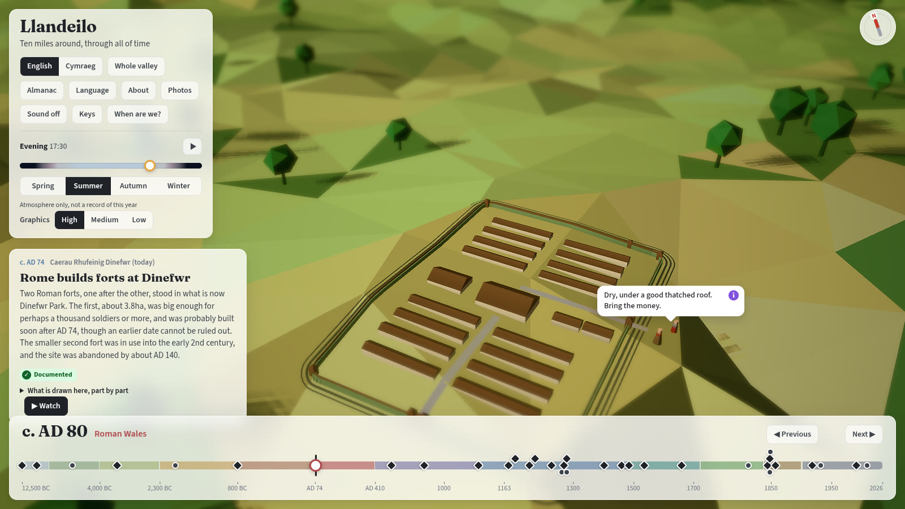
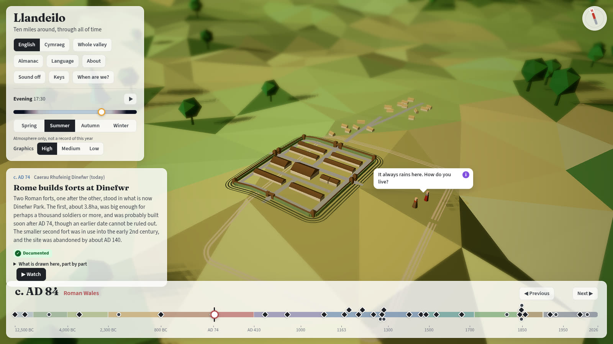
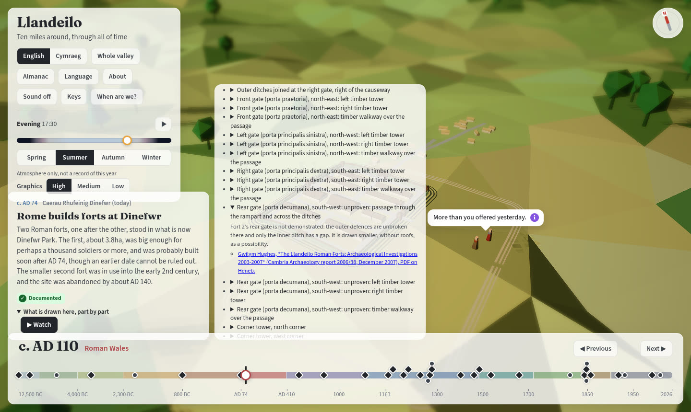

**History corrected:** the old forts were drawn 2.6 times too big, in the wrong place, with tiled roofs
and a limewashed headquarters. Some Roman tile was found here, but nothing shows what roofed the
buildings, so no tile or limewash is drawn now. A conversation said to be "outside the Roman fort"
stood inside it once the fort was drawn at its true size, and now stands outside the south-east gate.

Sent by Claude

## v0.6.0 (2026-10-09): the Roman army arrives, and D. C. Harries's photographs of Llandeilo

**Open the app:** https://dewijones92.github.io/llandeilo-omnia-mutantur-nihil-interit/

**The first cutscene: the Roman army arrives at Dinefwr.** On the AD 74 card, press **Watch**: the
camera follows a Roman column marching down the Tywi valley from Llandovery to build its fort,
narrated in English or Welsh when the sound is on, with captions always shown. No source describes
the arrival itself, so every caption carries its ⓘ and says what is known (the forts and their
dates), what is reconstructed (the route, the order of march, the kit) and what is imagined (the
farmers watching). **Skip** or Escape ends it and leaves you at the date.

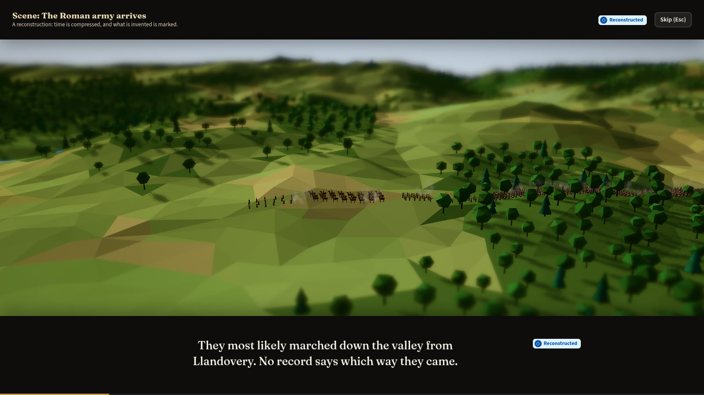
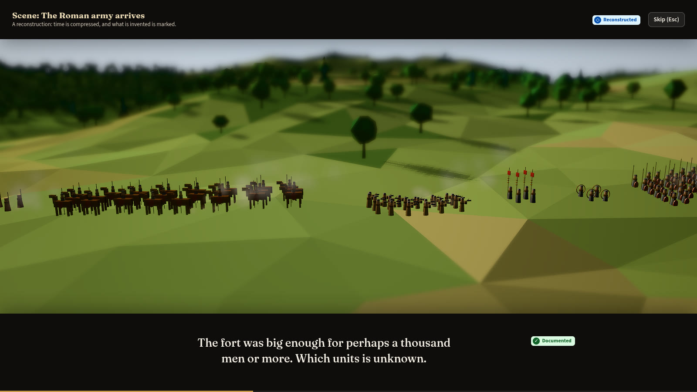

**D. C. Harries's photographs of Llandeilo** (from a suggestion on GitHub). Turn on **Photos** and
move the slider to around 1900 to 1930: camera pins mark where 28 of his 31 photographs were taken
(three can't be placed, one of them a colliery wrongly captioned as the station). They run from about
1900 to the late 1920s: Rhosmaen Street, the Cawdor Arms, the Post Office, Bridge Street, King
Street, the Market Hall, Salem chapel, the bridge and the station. Click a pin to see the photograph
with its date, what it shows, and how sure we are of where and when it was taken. Each is credited
to D. C. Harries (one only "possibly") and the Llandeilo Fawr Town Council collection on People's
Collection Wales. Each place was checked against the 1905 Ordnance Survey map, and each picture was
searched for clues to its date. Some show things later than their catalogue dates: a 1918 film
poster in one dated c. 1910, a petrol sign from 1924 or later in one dated c. 1920, and a motorcycle
and cloche hats in two dated c. 1900, so their dates now follow what the picture shows.

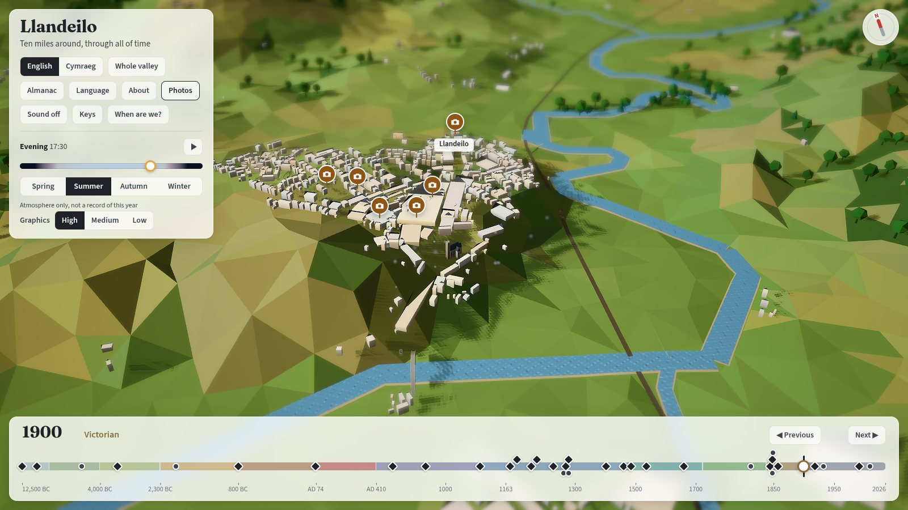
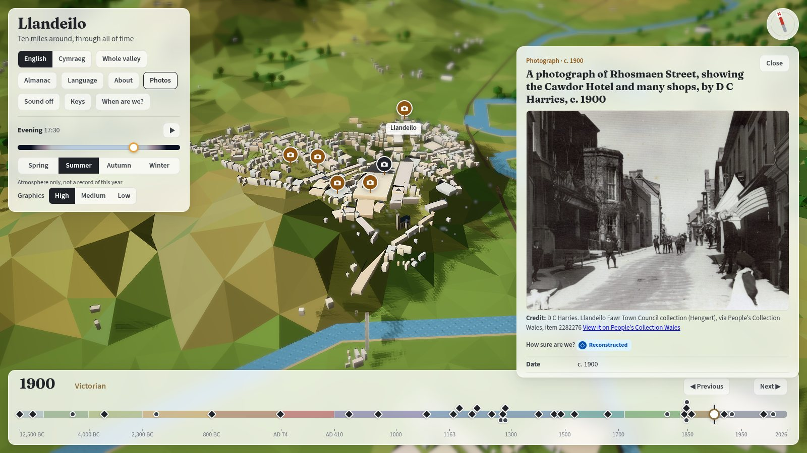

**History corrected:**

- **The hunters' burning on the high heath is about 9,000 years ago (c. 7000 BC), not 8,000.** The
  published figure is probably in radiocarbon years (the study doesn't say); turned into calendar
  years it is about a thousand years older. The ⓘ says the date is our own calculation.
- **Candlelight at a medieval Welsh court:** the ⓘ said nothing dated the Welsh law-book manuscript it
  quotes; its edition dates that manuscript to the late 13th or early 14th century. (Our research
  notes on music were also corrected: the laws give the queen's songs to the household bard, not the
  chief of song. There is no music in the app yet.)

Sent by Claude

## v0.5.0 (2026-10-09): battles and plagues, a night that reads as night, and the railways' gaps filled

**Open the app:** https://dewijones92.github.io/llandeilo-omnia-mutantur-nihil-interit/

**Three new key dates, and a new marker**, each from research checked against its sources:

- **1213: Llandeilo burned, Dinefwr besieged.** Rhys Gryg burned the town as he withdrew, and
  Dinefwr's garrison held out in one tower. Arriving at the date sets the late January season from the
  record, and a plume of smoke rises over the town (how it looked is a reconstruction).
- **1257: the battles of Coed Llathen and Cymerau.** A royal army under Stephen Bauzan, English-led
  with mostly Welsh foot soldiers, was overwhelmed about midday on 2 June. No battle site is marked, because none is
  proven, and both readings of the wood's name are given.
- **1918: influenza**, cross-checked in four newspapers: schools shut and two of the town's three
  doctors ill.
- **1849: cholera in Llandeilo** (a marker, not a key date), from one partly illegible report, so it
  has a card and an almanac note rather than a scene.

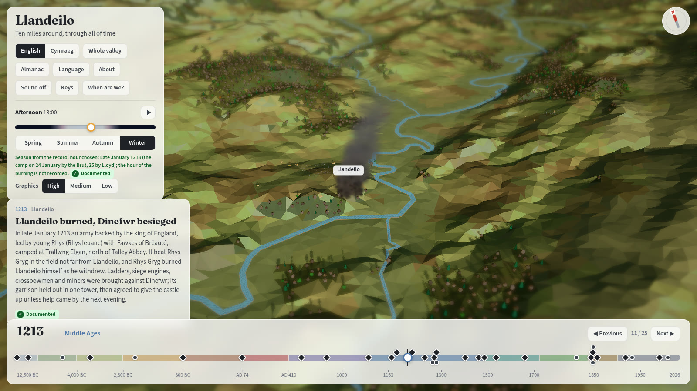
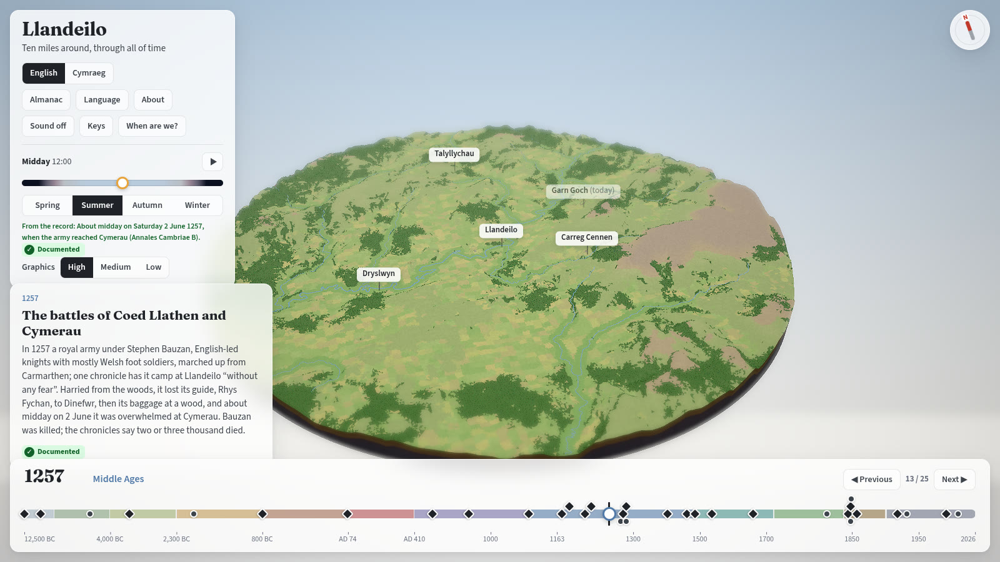
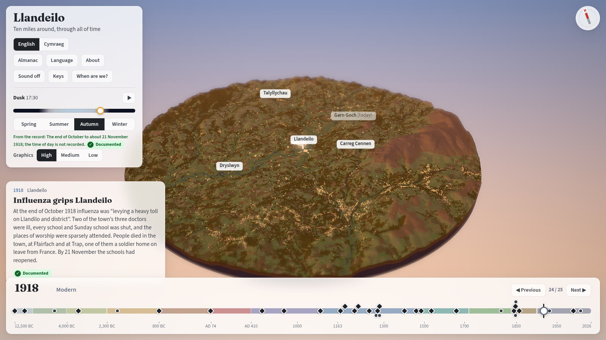

**A night that reads as night.** Nights are now properly dark, and every lit window, street
lamp and hearth carries a soft glow that stays visible from the whole-valley view. In 1880 the gas-lit town
and the farms' windows glow orange across the valley, and the 1942 blackout is a black valley. Whether the farms had lit windows is
not recorded, and the ⓘ says so.

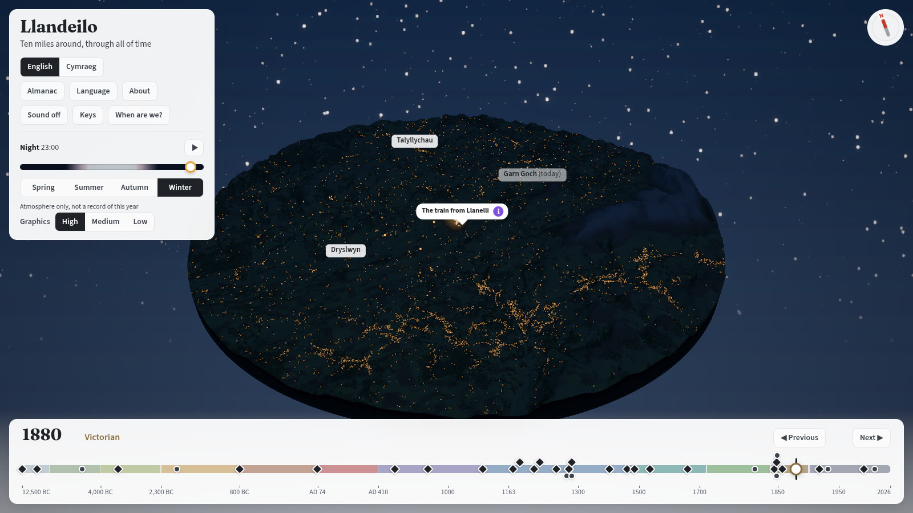
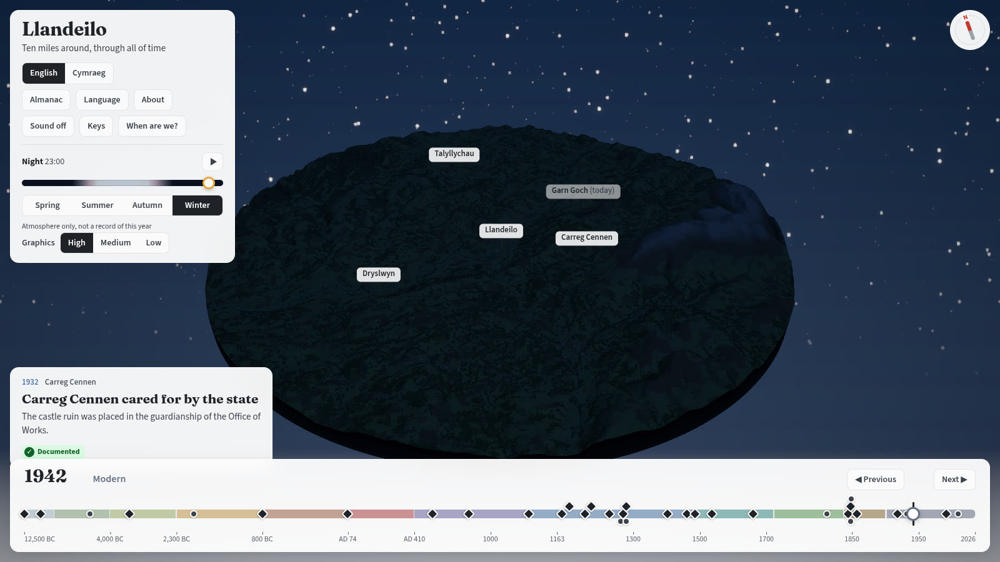

**Every marker on the timeline can be clicked.** Where key dates crowd together, their markers now
fan out above and below the line instead of hiding each other.

**The market from the Middle Ages.** The market's sound now starts with the fair Edward I granted in
1290, with a Saturday market on record by 1326 (the sound itself is a reconstruction).

**The railway lines with no known date are drawn as educated guesses**, each saying so in its ⓘ,
with the reasons and the sources: the Burry Port and Gwendraeth Valley line from about 1870 (its
stretch beside the Hirwaun Isaf incline is dated to June 1886, but where it ran is a guess), the Gwaun-cae-Gurwen colliery line from 1841, and
a short narrow-gauge track near Cross Hands, a weak guess, from about 1950. An estimated line is never
drawn before the earliest date its sources allow.

**History corrected:** the almanac had said no case of cholera was ever found in Llandeilo itself,
although the 1849 report records cases; it now says what the report says.

Sent by Claude

## v0.4.0 (2026-10-03): night light through time, honest sound, and a guess-the-year game

**Open the app:** https://dewijones92.github.io/llandeilo-omnia-mutantur-nihil-interit/

**"When are we?"** A new game: the timeline hides its labels, the valley is set to a mystery year,
and you drag a marker to guess when it is from what you can see. Five rounds, each scored. The
answer screen lists the clues that gave the year away, each with its ⓘ and a "Show me" button
that flies you to it. Documented clues with exact dates count as firm; the rest are marked "c.".

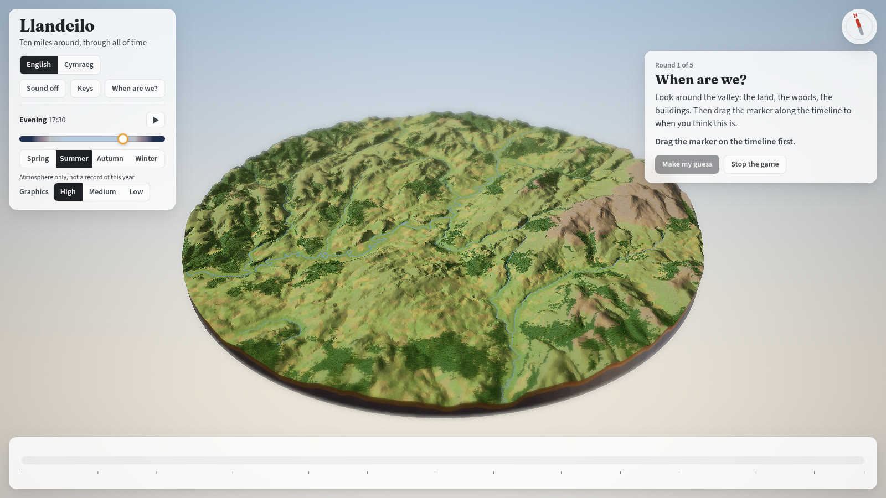

**Light after dark.** At night the valley is now lit by the light of its time, as far as the sources tell us: hearth and
rushlight; oil lamps; the town's gas street lamps by 1876; electric street lights by September
1902; the blackout from 1 September 1939; the dim-out from 17 September 1944 (it started later in
some listed, mostly coastal, areas, and whether Llandeilo was one is not known). The almanac has a
new "Light after dark" entry, with its ⓘ.

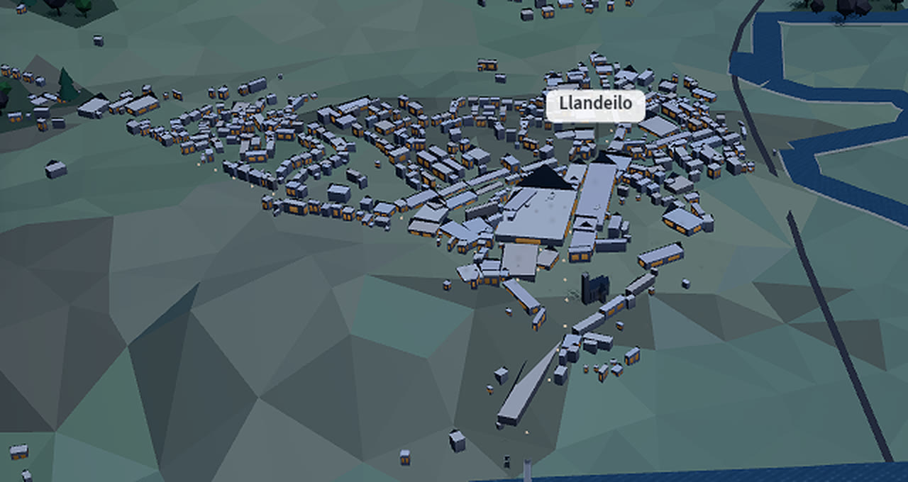
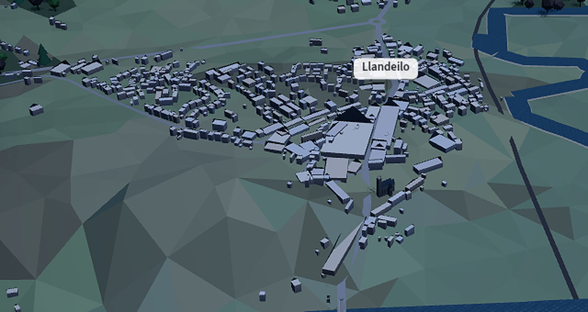

**Honest sound.** Every sound bed now has its own dated history and an ⓘ reason. Corrections to what
you heard:

- **No bells before 1857.** The first bells in any source we have read are the peal for the first
  train, on 20 January 1857. The app used to ring bells from AD 800.
- **The market sound now starts around 1600, not 1250.** Its ⓘ notes that Edward I granted the
  Bishop of St Davids a fair here in 1290 and again in 1291, around St Barnabas's day (11 June), and
  that a Saturday market is recorded by 1326.

**A Begin card and a Graphics menu.** Opening the app shows Ovid's line that gives the project its
name, *omnia mutantur, nihil interit* ("everything changes, nothing perishes"). Begin also turns the
sound on. A Graphics menu offers High, Medium and Low. High is the default and draws denser
woodland.

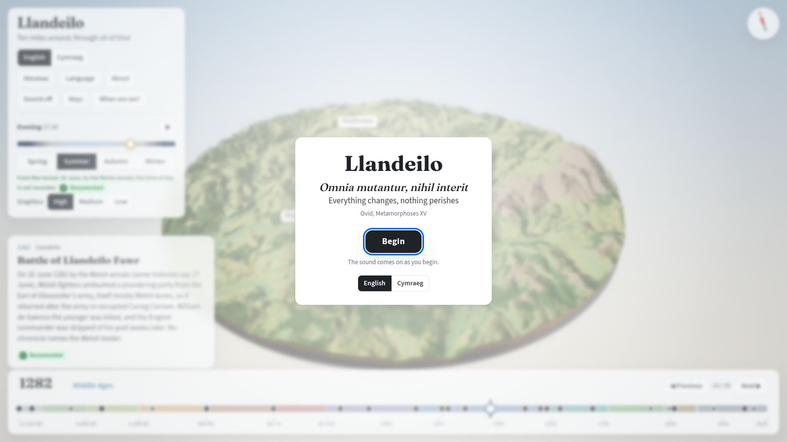

**More history corrected:**

- **The railway now appears on the dates its sources give.** Things with exact dates used to fade in
  years before they existed, so the 1858 line to Llandovery showed from about 1850, with a train
  running silently on it. Now each stretch appears on its day (Pantyffynnon to Duffryn, whose sources disagree, may be
  drawn a year early): the oldest Llanelly Railway lines,
  south of Ammanford and up the Amman valley, from 10 April 1840; the line from Ammanford to
  Llandeilo from January 1857; the Vale of Towy line to Llandovery from 1 April 1858; and the line
  east of Garnant from 1907, when it replaced the 1841 incline. A few short stretches whose dates we
  haven't found (near Cross Hands, and beyond Gwaun-cae-Gurwen) are left out for now.

  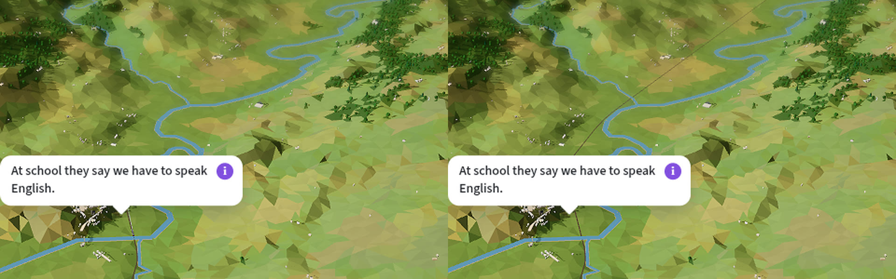

- **Steam stops on 13 June 1964**, when the last steam passenger trains ran (steam freight lasted
  until August). A stand-in two-car diesel train runs from then to today, and the sound changes
  with it.
- **Street lamps show what they burned:** electric street lights are whiter than gas.
- **The year shown is the year you are in:** mid-1858 used to read as 1859.
- **The Ice Age and wildwood birds:** the golden eagle bones are about 20,000 years old, well before
  the Late Ice Age the app shows there. Of the 43 bird species at Port Eynon, many are birds you might still see on Gower today;
  nothing says they were woodland birds.
- **1902:** no source says who had electric light at home, so homes stay lit by flame. A
  newspaper columnist that October was glad that so many of the town's tradespeople were having it
  installed.

## v0.3.0 (2026-10-03): the sky on the day, the warm Ice Age, and faster scrubbing

**Open the app:** https://dewijones92.github.io/llandeilo-omnia-mutantur-nihil-interit/

**The sky follows the record.** Where a source says what the season or the hour was, arriving at
that key date sets the sky to match, with its own ⓘ: the 1857 railway on a sleety January day,
the flood under the new bridge at 9 pm on 30 January 1848, the Walk Gate attack by night in 1843,
the 1850 church reopening at the 11 o'clock service, the 1282 ambush in June. Change the sky and it is
yours again.

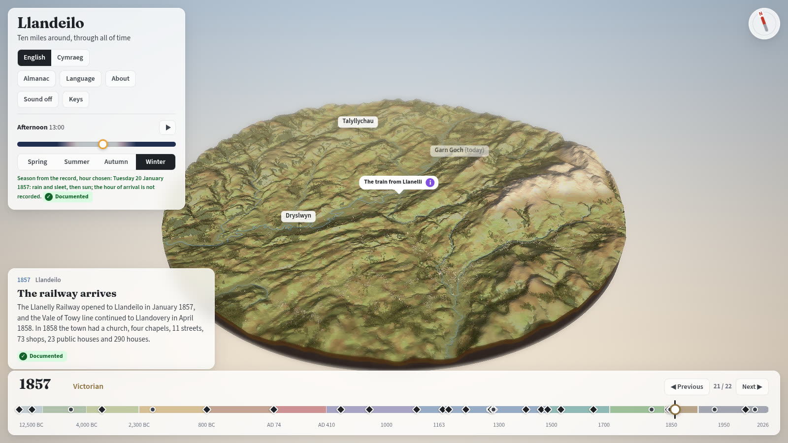
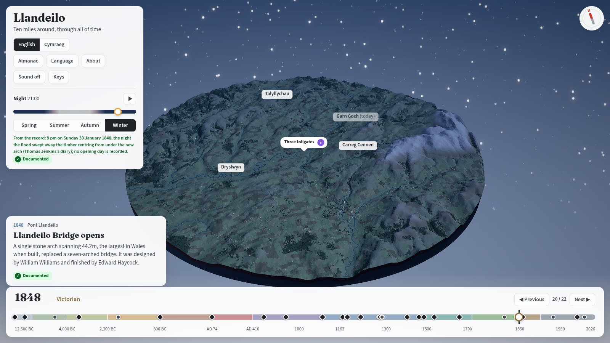

**More history corrected**, from independent checks of six more research notes (about 70 fixes in
the app):

- **12,500 BC was drawn as the coldest, barest moment.** Its dates had been read from uncalibrated
  pollen zones. In calendar years it is the warm part of the Late Glacial, with grass and juniper
  scrub.
- **The Dinefwr Roman forts** now have the primary report's sizes (240 by 160m and 140 by 110m), and
  only the smaller fort lasts into the 2nd century.
- **The Great Western took over the line in 1873**, not 1889.
- **The trilobite was found in 1698**, not 1688. Wolves were last mentioned in Wales in 1166 but
  probably lived on for another century or two.
- **Language:** Late Brittonic until about 550, then Primitive Welsh (Cymraeg Cyntefig), and modern
  Welsh from the 1400s.
- **Llandeilo's Welsh speakers:** about 45% in 2021, and the earlier figures are now labelled as
  ward figures, not the town's.
- **No page counts twice:** places that cited one web page under two references, which made them
  look like two sources, now cite it once.

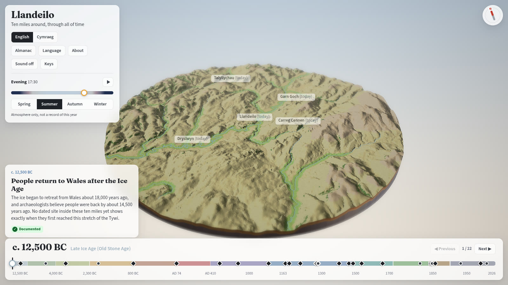
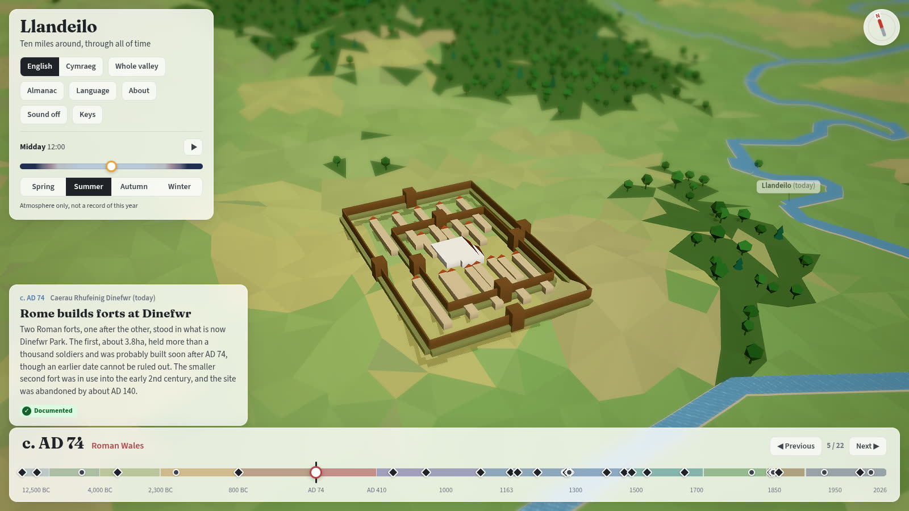
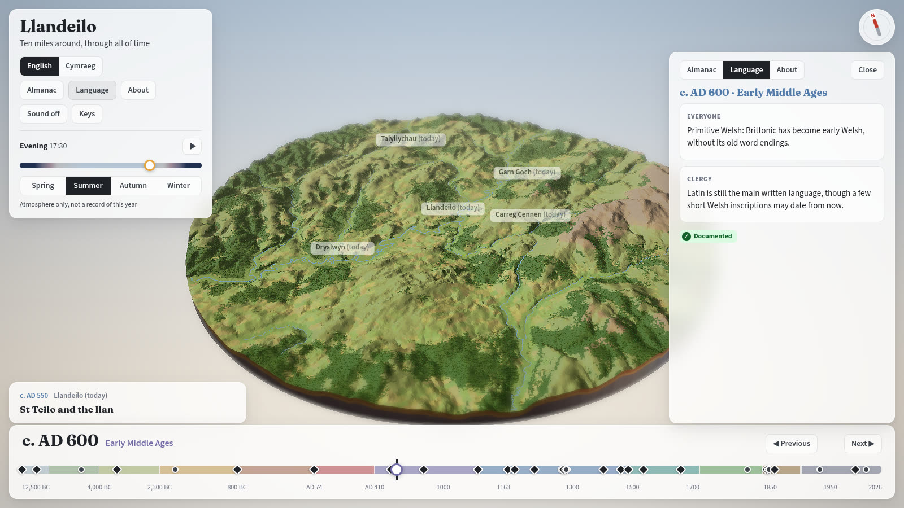

**Smoother.** On a real graphics card, scrubbing the timeline went from about 2 to about 15 frames a
second. Every step used to recolour the whole landscape and redraw every shadow; now that waits until
the slider settles.

## v0.2.0 (2026-10-02): checked history, rebuilt abbey and castle, and a keys panel

**Open the app:** https://dewijones92.github.io/llandeilo-omnia-mutantur-nihil-interit/

**History corrected.** Every research note behind the app's three main eras was re-read against its
sources by an independent check, and what was wrong is now fixed in the app:

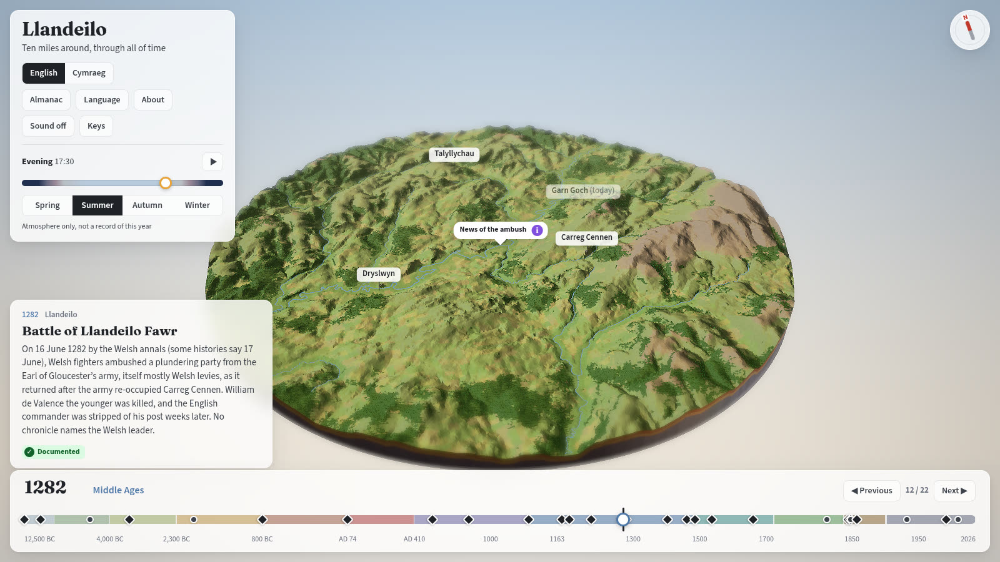

- **1282, the Battle of Llandeilo Fawr:** the date is 16 June by the Welsh annals (some histories say
  17 June). The English force had not sacked Carreg Cennen: the army re-occupied walls the Welsh had
  already burnt, and the ambushed men were a plundering party from an army mostly of Welsh levies.
- **1287, the siege of Dryslwyn:** a mined wall fell on the men inspecting the mine; it was not a
  tunnel collapse. The castle had fallen by 5 September.
- **1403, Glyndŵr:** Owain himself lodged a night in Llandeilo, and a letter of mid-July says the
  rebels had burned Llandeilo and Newtown. Dinefwr seems to have held; whether Carreg Cennen fell is
  disputed, and the app now says so.
- **Dinefwr:** no source gives 1163 for the Lord Rhys's castle, so that key date is now c. 1172, when
  "a castle in the new style" was begun.
- **Gerald of Wales** on what the Welsh ate is now quoted from his own words.
- **The Welsh text had quietly lost facts.** Sixteen places dropped a number, a date or a "probably"
  that the English kept; all are restored.

**Rebuilt from the evidence.**

- **Talley Abbey** stands on its real spot (Coflein's grid reference) and is drawn as it was built,
  about 49m long rather than the 73m planned, with only four bays of nave. After 1536 its east end
  serves as the parish church until 1773, while the rest decays.

  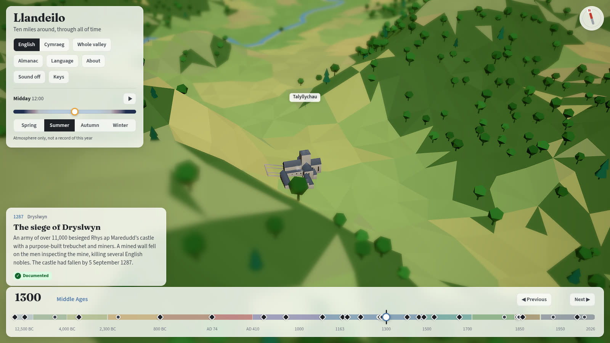
  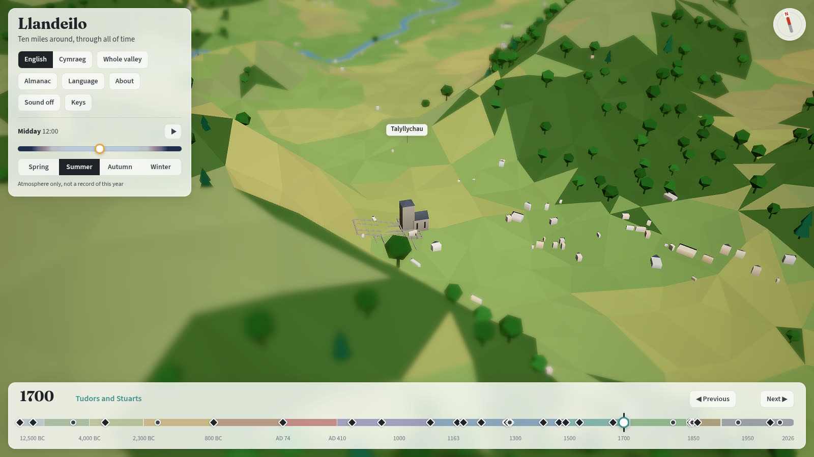
- **Dryslwyn Castle** grows ward by ward: the first ward of the 1220s, the middle ward in the
  mid-13th century, then the outer ward and gatehouse before the siege of 1287.

  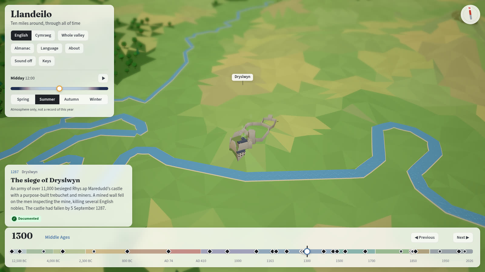

**Easier to use.**

- Press **?** or **Keys** for every shortcut and control.

  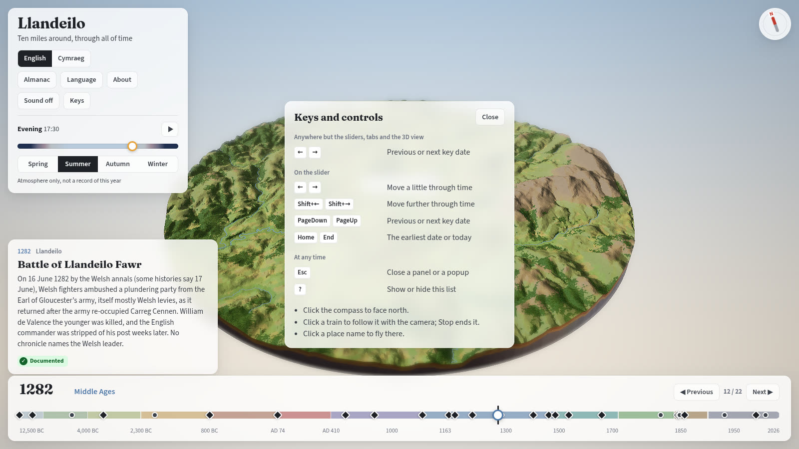

- Arrow keys step between key dates from almost anywhere.
- Place names no longer hide under panels or sit on each other, and the place a key date is about
  wins.
- A name that is anachronistic says "(today)", now on the key-date card too (the Roman forts' name is
  modern).

  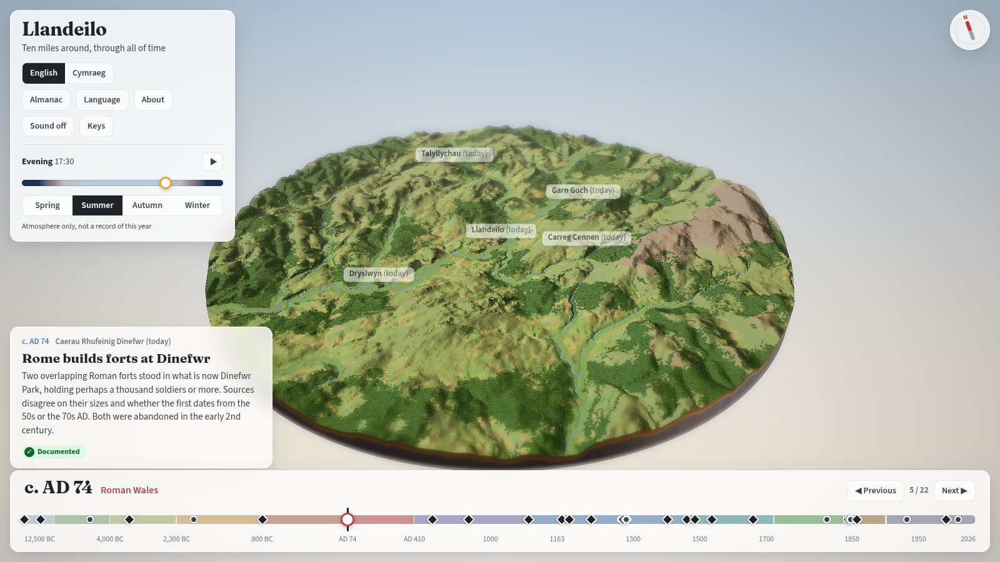

- The About panel says exactly what is drawn larger than life.
- Welsh conversations say that the voice has a standard accent, not the local southern speech.

