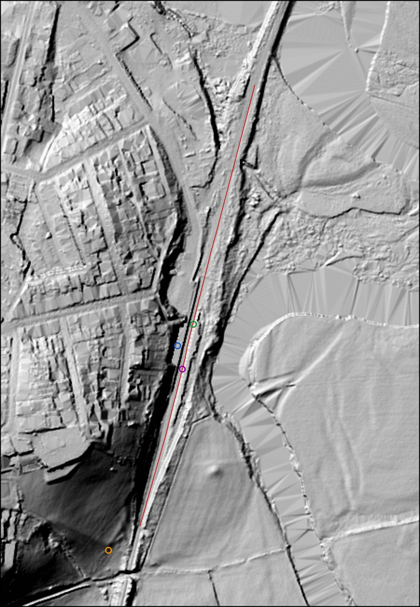

# The trains through Llandeilo, period by period, for Blender models

Research for the trains as scripted Blender models (ADR 0052 names the trains in Dewi's scope; `design/blender-models.md`
lists them eighth). Written by Claude on 2026-10-17 from sources fetched that day; the brief is in
[`briefs/trains.md`](briefs/trains.md). The choices in "Plan for the Blender model" are Claude's, under the proactive
mandate ([ADR 0027](../adr/0027-claude-proposes-and-builds-under-a-proactive-mandate.md)), and none is Dewi's. Checked by
the same agent the same day, then by an independent reviewer the same day, whose findings are applied (see below and
[check 1](reviews/trains-check-1.md), both parts).

It builds on two notes and does not repeat them: [`railway-locomotives.md`](railway-locomotives.md) (the Llanelly
Railway's engines and the 1858 Board of Trade report on *Victoria*, 1857-1872) and [`railway-later.md`](railway-later.md)
(owners, services, dated photographs and liveries, 1873 to today). Their sources are cited here by key (`railway:S1`,
`railwaylater:S4`); this note's own sources are `trains:S1` onwards.

**How it was done.** Wikipedia wikitext was downloaded and read for the class leads (never cited alone for a documented
claim); the Science Museum Group record for LMS 5000, the Department of Transport's Glanrhyd report (text layer),
Porterbrook's Class 153 brochure (archived PDF), two HMRS livery pages, railcar.co.uk's Heart of Wales line feature and
its record for car 52037 were read directly. Four photographs were looked at: two hand-coloured postcards of Llandilo
station, c. 1900 [S11][S12], and two of D. C. Harries's (c. 1910 and 1914-18, in the repo); two 1959 photographs of
Llandilo on Terry Norman's site were looked at again (`railwaylater:S2`). Readings of a picture are labelled
"observed". The station was measured on the Welsh Government 1m LiDAR terrain model (tile SN6322) [S13] against OS
Open Map Local's track and station (`harries:S12`). WebSearch was used 12 times.
**Welsh and period names.** Llandeilo was "Llandilo" on the railway and in period captions. Welsh forms at first use:
Abertawe (Swansea), Caerfyrddin (Carmarthen), Rhydaman (Ammanford), Llanymddyfri (Llandovery), Tref-y-clawdd (Knighton),
Amwythig (Shrewsbury, in England); Builth Road's Welsh form was not checked.

**Revised 2026-10-17 after an independent check** ([check 1](reviews/trains-check-1.md), part 2). It found one wrong
claim and five weakly supported ones, all applied here and marked "corrected" or "revised" where they stand: the Class
120 sets at Llandeilo were normally two cars, not three; the 1980 Llandeilo caption belongs to railcar.co.uk's record of
car 59260 [S14], not to [S6]; BR Standard 5s, not the Black Five, took the 1961-64 through trains, so the BR steam phase
is split; some LNWR trains may have run before 1873; the owner of the c. 1900 and 1914-18 trains is not identifiable; and
several livery tiers were too high (Wikipedia-only colours are reconstructed). The app's station point is 231m from
Coflein's, not 240m.

**The tier rule for a vehicle's parts.** The same as Dinefwr's, adapted. A part is **documented** where a primary
record or a museum's catalogue gives it and a second independent source agrees, or where a dated, captioned photograph
taken at or near Llandeilo shows it. It is **documented (one source: X)** where one reputable source gives it and no
second was found. A dimension that rests on Wikipedia alone (even where Wikipedia cites a book or a BR diagram book not
read here) is **reconstructed (from a lead)**, never documented: the repo's law makes Wikipedia a lead. A part that no
source describes, chosen to complete the vehicle, is **imagined**, and its ⓘ says so.

## Summary

- **One standard-gauge line, four owners.** The Llanelly Railway was "narrow gauge", the period's name for 4 ft 8½ in
  (1.435 m), against the South Wales Railway's broad gauge (G. P. Neele, LNWR, 1904, quoted in `railway:S5`, and the
  same page's account of the 1852 crossing). Every vehicle in this note runs on 1.435 m, and the existing model's
  `GAUGE_HALF = 0.72` is right. The owners and their dates are in `railway-later.md`: the Llanelly company to 31
  December 1872, the GWR (south of Llandeilo) and the LNWR's through trains (north and south) from 1873 (some LNWR trains may have run from c. 1868-71: see Phase 1), the LMS from
  1923, British Railways (Western Region) from 1948, and since 7 February 2021 Transport for Wales.
- **What is documented at Llandeilo itself, by dated record or photograph**, is uneven:

  | Years | What ran | How it is known | Strength |
  |---|---|---|---|
  | 1857-1872 | A Llanelly Railway train; engine not recorded | The one engine described in detail is *Victoria*, Hackworth 1841 (`railway:S1`) | The engine type is an analogy |
  | c. 1900 | A side-tank engine with a dome and a capped chimney, at the head of a passenger train at Llandilo (carriage wheels not readable) | Two hand-coloured postcards of one photograph (observed) [S11][S12] | Observed; class not identifiable; **colours contradict each other** |
  | 1914-18 | A train of compartment carriages with oil-lamp pots on the roofs | D. C. Harries's photograph (observed) (`harries:S4`, item 2282111) | Observed; engine not in view |
  | 1958-60 | Black Five 4-6-0s and Fowler 2-6-4 tanks on the Shrewsbury trains; GWR 57xx panniers on locals | Dated captioned photographs at Llandilo and the next stations south (`railwaylater:S2`), shed lists (`railwaylater:S4`, `S5`) | **Cross-checked** |
  | 1977-80 | Class 120 "Swindon cross-country" units, normally **two cars** (C603 at Llandeilo on 7 Jan 1977, presumably 50724 + 50673); a three-car set (C611) there in 1980 | Dated captioned photographs at Llandeilo [S6][S14]; "pairs of class 120" on the line [S6]; "two-car diesel rail cars" (`railwaylater:S52`); "Swindon cross-country sets took over" (`railwaylater:S1`) | **Cross-checked** that Class 120s ran here; the number of cars varied (corrected 2026-10-17) |
  | 1982-84 | Class 101 two-car and three-car units | Dated captioned photographs at Llandeilo [S6] | Single source (one site, several photographers) |
  | 1987, c. 1990 | Class 108 two-car units | The Glanrhyd report (`railwaylater:S8`); captioned photographs at Llandeilo [S6][S7] | **Cross-checked** |
  | 1994 to today | Class 153 single cars, now in pairs | `railwaylater:S27`, `S29`, `S38`, `S39`; Porterbrook [S5] | **Cross-checked** |

- **1873 to 1957 is the weak stretch.** No engine class is named at Llandeilo in any source read for 1873-1909 or for
  the LMS years; the LNWR's "Prince of Wales" 4-6-2 tanks worked Shrewsbury-Swansea "from an early date" after 1910
  (`railwaylater:S51`, a lead, single), and their LMS replacements from 1935 were "Class 4 2-6-4T designs by Fowler and
  Stanier" (the same page). A published album of the line in the BR years says "former LMS locomotives hauling the through
  traffic, whilst the local traffic was the preserve of small GWR engines" [S10], which fits the 1958-60 photographs.
- **The best-documented single train is the 12 noon Shrewsbury (Amwythig) to Swansea (Abertawe) at Llandilo on 29 August 1959**, hauled by
  Black Five **45190** (`railwaylater:S2`, photograph; `railwaylater:S4` lists 45190 as a class 5MT 4-6-0 of Shrewsbury
  shed at Swansea Victoria in 1950). The class's length over buffers, **63 ft 8 in (19.41 m)**, width **8 ft 8 in
  (2.64 m)** and **6 ft (1.829 m)** driving wheels are in the Science Museum Group's record of No. 5000 [S1]
  (**documented, one source**). The class page gives the length as 63 ft 7¾ in or 63 ft 11¾ in (within 4 in either
  way) and no width (`railwaylater:S48`, a lead). 45190 was one of 5125-5224, built by Armstrong Whitworth in 1935
  with a domeless boiler, but boilers were swapped "indiscriminately" among the first 225 engines, so whether it carried
  a dome in 1959 is **not known** from text (`railwaylater:S48`).
- **Liveries, by tier** (the tier rule above: a Wikipedia page alone is a lead, so reconstructed). **Documented, one
  source each:** LNWR engines black from 1873, "Blackberry Black" (LNWR Society, `railwaylater:S44`; Wikipedia, `S43`,
  agrees); LMS non-express engines varnished black, lined, from 1928 to about 1940 [S9] (HMRS); BR corridor carriages
  crimson and cream before 1957, lined maroon 1957-64 [S8] (HMRS; `railwaylater:S47` says maroon from **1956**:
  contested); TfW grey and red (Transport for Wales's own release, `railwaylater:S38`, observed in `S30`, `S31`).
  **Reconstructed, from leads only:** LMS carriages crimson lake (`railwaylater:S46`, `S47`: both Wikipedia); BR tank
  engines unlined black (`railwaylater:S49`); BR steam engines black with thin lining (`railwaylater:S47`).
  **Not known** for the Llanelly company at all. **The two c. 1900 postcards are one photograph coloured twice, and
  the engine is black on one and green on the other** [S11][S12]: hand-colouring is the printer's, not evidence of a
  livery.
- **The anchor.** Coflein's reference for Llandeilo station is **SN 63340 22580** (`railwaylater:S21`), on the west
  platform, 11m west of the track centre as OS maps it (`harries:S12`). The track through the station runs **N 14° E**
  (grid), as a passing loop about 490m long between E 263300 N 222387 and E 263423 N 222859; the platforms stand about
  **1.0-1.2m above the track bed** (29.9m OD) for about **100m**, centred near **E 263345 N 222555** [S13]. The app's
  `LLANDEILO_STATION` (E 263266, N 222361) is 231m south-west of Coflein's point and 28m west of the track (an open
  question since 2026-10-09).
- **LiDAR.** The station, the loop and about 1.1km of line to the south and about 0.45km to the north already lie inside the `llandeilo` 2m area
  (E 262180-263680, N 221486-222986). No new area is needed for the train; two of its 500m tiles carry the whole station
  (see Placement).

## Placement

| Point | Grid reference | Source | Note |
|---|---|---|---|
| Coflein, Llandeilo Railway Station (NPRN 80442) | SN 63340 22580 = E 263340, N 222580 | `railwaylater:S21` (read again 2026-10-17) | Use as the train features' `at` (the forts' rule: a documented reference, not a derived point). Coflein holds a 1993 photographic survey whose captions place the "Main station building on West side", a "Signal box on E platform" and a "Weigh house on East side of station" |
| OS Open Map Local, station symbol | E 263356.8, N 222602.7 | `harries:S12` | 29m north-north-east of Coflein's point, 6m east of the track |
| OS Open Map Local, track | Single track from the south to E 263300 N 222387; "Multi Track" (the loop) from there to E 263423 N 222859; single track beyond | `harries:S12` (RailwayTrack layer, read 2026-10-17) | The loop's line, through (263327, 222482), (263348, 222565), (263377, 222684), bears about **N 14° E** (55m east in 220m north) |
| Today's platforms, measured | Raised strips either side of the track from about (263332, 222503) to (263357, 222605); centre near **E 263345, N 222555** | [S13] | West platform about 31.1m OD, about 8m wide where sampled; east platform about 31.0m OD, about 6m wide; track bed 29.9m OD; so about 1.0-1.2m above the bed, **about 100m long** (sampled every 10m along the loop, at 5m and 8m either side of its centre line) |
| The app's `LLANDEILO_STATION` | E 263266, N 222361 | `src/content/features.ts` | Not the station: 231m south-west of Coflein's point and **28m west of the track** (OS's track lies at about E 263294 at that northing; the 1905-revised map puts the line at E 263279, 13m away, per `dc-harries-photographs.md`, so the old and today's line differ there by about 15m, or one of the two is off by that much: not checked). The train runs along the track path, so it does not stand on this point, but the feature's `at` does |

**Plan frame for the models** (proposed). Each vehicle in its own frame: x along the track (forward = towards
Llanymddyfri, Llandovery), y to the left, z up, origin at **rail top**, on the track centre line, at the **middle of the
vehicle's wheelbase** (bogie centres for a bogie vehicle, the outer axles for a rigid one), true size. A vehicle's
frame, not the whole train's: the app moves one rigid mesh today and its carriages cut across curves (todo: "The train
is rigid"), so each vehicle should come out of Blender as its own object with its pivot where the track holds it.

**The stopping point**: a train standing at Llandeilo is drawn with its middle on today's platforms, about (263345,
222555), on rail level 29.9m OD, heading N 14° E (measured [S13]). A 1959 train (a Black Five and four or five
carriages, about 100-120m) would overhang today's 100m platforms; the 1959 photographs show a bay platform as well (observed,
`railwaylater:S2`); the platforms' lengths then are **not known**.

**The LiDAR area.** No new area. The station's whole length lies in two 500m tiles of the existing `llandeilo` 2m
area: **E 263000-263500, N 222000-222500** (the south end of the loop and the single line towards Ffairfach) and **E
263000-263500, N 222500-223000** (the platforms and the loop's north end); the line north-east of the station leaves
the area at about E 263470 N 222970 (estimate, on OS's track). From the platform centre the 2m ground runs about
**1.1km south** but only about **0.45km north** (the area's north edge is N 222986): a train leaving northbound
reaches the 10m context mesh after about 450m. The tile E 263000-263500, N 223000-223500 is step 10 today, so a 2m
tile there would extend the 2m ground north. Where the old Carmarthen branch left the main line and
crossed the afon Tywi to Llandilo Bridge station at Ffairfach should be inside the area too (not measured). If Dewi wants detail beyond, the
next candidates are 500m tiles along the line north-east to Glanrhyd bridge (about 5km, the 1987 accident), not a
square; a corridor of tiles is a change to `lidar-areas.json`'s format, which today only holds squares.

*The station on the Welsh Government 1m DTM (tile SN6322), E 263150-263600, N 222300-222950, north up, 0.5m to a
pixel, hillshaded (`gdaldem hillshade -z 3`). Red: OS Open Map Local's track. Blue: Coflein's reference. Green: OS's
station symbol. Purple: the measured platform centre. Orange: the app's `LLANDEILO_STATION`. The town is on the higher
ground to the west; the line runs on a shelf below it. Made for this note; LiDAR credit as `docs/data/lidar.md`.*

## Phase 1: the Llanelly Railway, January 1857 to 31 December 1872

What is known is in `railway-locomotives.md`, independently checked on 2026-10-02, and is not repeated. In short:

- **The engine that hauled Llandeilo's trains is not recorded.** Two new engines came in 1857 (`railway:S2`, single,
  unnamed). The one engine of the period described in detail is ***Victoria***: Hackworth of Stockton, delivered 1841,
  six-coupled, 18 tons (or 14: contested), 14½ in by 16 in cylinders, 4 ft wheels on an 8 ft 6 in wheelbase, a boiler
  12 ft long and 4 ft 3 in across with a central dome, the fire grate and chimney at one end and the driver at the
  other, with a tender (`railway:S1`, the Board of Trade's 1858 report, primary). The existing Blender model follows it.
- **Other engines of the company** before 1873: Hackworth 0-6-0s of 1839-43, two Beyer, Peacock 0-4-2s of 1858
  (single-source), *Victor* (Fossick & Hackworth 1864, 0-6-0, sold December 1872), six inside-cylinder 0-6-0s from 1867,
  and *Napoleon III* (Kitson 1868, 2-4-0, later GWR 894) (`railway:S2`, `S3`, `S7`, `S8`). The GWR took 21 engines in
  1873, numbered 894-914 (`railway:S9`).
- **Carriages: no source read describes them** for 1857-1872. The open carriages of 1841 (`railway:S2`) are not
  evidence for 1857.
- **Livery: not known.**
- **Not every train at Llandeilo before 1873 need have been the Llanelly's** (added 2026-10-17, independent check; the
  caveat was already in `railway-locomotives.md` and was dropped). That note says the LNWR gained running powers and a
  share of the Vale of Towy lease from about 1868 (`railway:S5`, a lead) and that the Central Wales Extension reached
  Llandovery (Llanymddyfri) that year (`railway:S10`, a lead); `railway-later.md` says the "New Lines" (to Swansea and
  Carmarthen) were "worked by the LNWR from 1 July 1871" (single-source for the date), and the Carmarthen line left from
  Llandilo Bridge station. So some trains at Llandeilo in 1868-72 may have been LNWR trains: **not known**.
  `train-llanelly` still ends on 31 December 1872, when the Llanelly company's own lines passed to the GWR; its ⓘ
  carries this caveat. No engine of either company is named at Llandeilo in these years.
- **New here**: none of this note's searches found anything more for 1857-1872. A Museum Wales item, "Llanelly &
  Llandilo Railway report, photocopy", turned up in a search and was not read (a lead).

**Known vs inferred.** The engine's dimensions are documented for *Victoria* (primary, cross-checked on builder and
wheels); that the train at Llandeilo had such an engine is an analogy (reconstructed). Length over buffers, height, the
chimney, the tender's size and every carriage are **imagined** in today's model (`tools/models/llanelly-train.py`:
a 3.2m tender and three 4.6m carriages, guesses).

## Phase 2: the Great Western and the North Western, 1873 to 1922

- **Owners.** South of Llandeilo the GWR's from 1 January 1873; north to Llandovery joint GWR and LNWR (leased jointly
  from 1868, vested 1884); the Carmarthen branch LNWR from 1891 (`railway-later.md`). The LNWR ran the through trains
  Shrewsbury-Swansea with running powers over the GWR south of Llandeilo; in 1873 "four passenger and three goods trains
  a day to Swansea" (`railway:S5`, referenced to Denman 2012, page needed; a lead).
- **Engines.** Not named at Llandeilo in anything read for 1873-1909. The LNWR "Prince of Wales" 4-6-2 tanks, 47 built
  1910-16, "from an early date also used on passenger services between Shrewsbury and Swansea (Victoria) over the
  steeply-graded Central Wales line" (`railwaylater:S51`, a lead, read in full 2026-10-17: the sentence carries no reference). The same page
  gives 5 ft 8½ in (1.740 m) driving wheels, 3 ft 3 in (0.991 m) leading and trailing wheels and 78 long tons; **no
  length**. Single, and a lead, so **reconstructed** at best.
- **Observed, c. 1900** [S11][S12]: two postcards by A. W. Williams of Llandeilo, one photograph hand-coloured twice,
  looking along the station with the town's houses on the hill to the left (so probably north). On the road beside the
  hill a **side-tank engine** with a dome, a tall capped chimney and a small plate on its tank side, with what looks like
  a second engine behind it, heads a train of carriages with pale upper panels; a single van stands on a road to the
  right. The wheel arrangement cannot be read. **The engine is black on
  one card and green on the other**, and the carriages are coloured differently too, so the colours are the printer's
  and are not used. What the photograph does show: a tank engine, not a tender engine, on a Llandeilo passenger train
  around 1900, and two engines at its head. **Who owned the train is not shown**: the LNWR ran the through trains and
  the Carmarthen branch, but the GWR owned the line south of Llandeilo and ran "just a few trains" north of it
  (`railway-later.md`, from `railwaylater:S10`), so the engine could be either company's.
- **Observed, 1914-18** (`harries:S4`, item 2282111, a crowd on the platform; the NLW's copy is titled as civilians waiting for a troop train): compartment carriages with
  panelled sides and many doors, and round lamp pots on the roofs (oil or gas roof lamps); two roof profiles, a lower
  one at the left; the engine is out of view. Colours cannot be read (a black-and-white print). The crowd and platform
  hide the underframes, so whether the carriages ran on bogies or six wheels cannot be read, and the owner is again
  not shown.
- **Liveries.** LNWR engines black from 1873, "Blackberry Black" (`railwaylater:S44`, the LNWR Society: **documented,
  one source**; `S43`, Wikipedia, agrees but is a lead); LNWR carriages "plum and off-white" (`railwaylater:S47`, a lead,
  indirect: said of a 1948 BR trial; single). GWR engines green, frames black in the 20th century, copper-capped
  chimney; GWR carriages chocolate and cream, but **all brown or red from 1908 to 1922** (`railwaylater:S45`, a lead,
  single).

**Known vs inferred.** Documented: the owners, the LNWR engine colour (one source: LNWR Society). Observed: a tank engine
with carriages c. 1900; roof-lamped compartment carriages 1914-18. Reconstructed (a lead): the Prince of Wales tanks from
about 1910. Not known: every engine class before 1910, every carriage's length, the train's length, and **whether the
c. 1900 train and the 1914-18 train were GWR or LNWR**.

## Phase 3: the LMS and the GWR, 1923 to 1947

- **Through trains LMS**, the GWR keeping Llandeilo-Pontarddulais (`railwaylater:S1`).
- **Engines.** None named at Llandeilo. The Prince of Wales tanks became LMS 6950-6996, class 4P; withdrawals began in
  1935, "their replacements being Class 4 2-6-4T designs by Fowler and Stanier"; all gone by 1941 (`railwaylater:S51`, a
  lead). Swansea Victoria shed, whose engines worked the south end, held Fowler and Stanier 2-6-4 tanks and Black Fives in
  1938-45 (`railwaylater:S4`, one compilation; it shows what was at the shed, not which engine passed Llandeilo).
- **The Fowler 2-6-4T** (the class of 42307 and 42388, on through trains in 1958, `railwaylater:S2`): 125 built
  1927-34; 5 ft 9 in (1.753 m) driving wheels, 3 ft 3½ in (1.003 m) leading and trailing; wheelbase 38 ft 6 in (11.73 m);
  length 47 ft 2¾ in (14.39 m); 86.25 long tons [S2] (a lead, single). So none before 1927.
- **Liveries.** LMS carriages crimson lake (`railwaylater:S46`, `S47`: both Wikipedia pages, so **reconstructed, from
  leads**; corrected 2026-10-17, the first version called it cross-checked). LMS engines: crimson lake for
  "all passenger locos 1923-27, then principal express passenger classes only, 1928 to about 1940"; others "finished in
  varnished black", lined in red, "1928 to about 1940" [S9] (**documented, one source: HMRS**). So a 4P tank on these
  trains was crimson lake in 1923-27 and lined black from 1928 (an inference from [S9]'s rule; no source names this
  class's colour). A forum post says some early Fowler 2-6-4Ts were delivered crimson; not used (a forum, unchecked).
  GWR as Phase 2, chocolate and cream again after 1922 (`railwaylater:S45`).

**Known vs inferred.** Documented: the owners; the LMS engine livery rule [S9] (one source). Reconstructed (from leads):
the carriage colour. Reconstructed by analogy: a Prince of Wales tank to the mid 1930s and a Fowler 2-6-4T after, on the
through train. Not known: any engine named at Llandeilo, the train's make-up and length.

## Phase 4: British Railways steam, 1948 to 13 June 1964

The best-documented phase (`railway-later.md`, "Period 3"). The dated photographs at Llandilo and the stations south,
with what each engine was, are there; in brief, on the line through Llandeilo:

- **Through trains**: Black Five 4-6-0 **45190** at Llandilo, 29 August 1959, the 12 noon Shrewsbury-Swansea; 45283
  at Tirydail 1958; Fowler 2-6-4Ts 42307 and 42388 on Shrewsbury trains 1958 (`railwaylater:S2`, cross-checked by the
  shed lists `S4`). BR Standard class 5s "monopolised nearly all through-passenger workings" by 1961 (`railwaylater:S1`,
  Gittins and Spencer Davies: "from 1960 onwards"; at Swansea Victoria by 1954, `S4`: the start is **contested**). So the
  Black Five alone is the 1948-c. 1960 through train, not the 1961-64 one, which the plan gives to a Standard 5.
- **Locals and Carmarthen trains**: GWR 57xx 0-6-0 pannier tanks 9645 (Llandilo bay, 29 August 1959, the 3.25 to
  Carmarthen), 3641 and 9788; 7400 class 7439 at Carmarthen in 1962 (`railwaylater:S2`, `S4`, `S5`, `S6`).
- **The Black Five's dimensions**: length over buffers 63 ft 8 in (19.41 m; 19,405.6 mm), width 8 ft 8 in (2.64 m),
  driving wheels 1,829 mm, 72 tons 2 cwt (the engine) [S1], primary (a museum's catalogue of No. 5000). The class page
  gives 63 ft 7¾ in or 63 ft 11¾ in, leading wheels 3 ft 3½ in (1.003 m), an engine wheelbase of 27 ft 2 in (8.28 m)
  with the coupled wheels at 7 ft and 8 ft (4.57 m), and a 53.7-ton tender (`railwaylater:S48`, a lead). **Height not
  found** in anything read.
- **The pannier's dimensions** (57xx): 31 ft 2 in (9.50 m) over buffers, 8 ft 7 in (2.62 m) wide, 12 ft 3 in (3.74 m)
  high, 4 ft 7½ in (1.410 m) wheels on a 15 ft 6 in (4.72 m) wheelbase (`railwaylater:S49`, a lead). The 7400 class: 31
  ft 1 in, 12 ft 3 in high, the same wheels (`railwaylater:S50`, a lead).
- **Carriages.** Not named in any source read. **Observed**, 29 August 1959 (`railwaylater:S2`): the Carmarthen train in
  the bay was three or four bogie carriages, and the first of them shows a **pale upper half and a dark lower half**
  (two-tone) in the black-and-white print; the Black Five's train shows only its first carriage, dark. BR's standard
  carriage, the Mark 1, was built with a 63 ft 5 in underframe, bogies at 46 ft 6 in (14.17 m) centres and a 64 ft 6 in
  (19.66 m) gangwayed body, or a shorter 57 ft type [S4] (a lead, citing Parkin 1991). That Mark 1s ran here is **not
  known**; LMS-built carriages are as likely.
- **Liveries.** BR steam engines "black, often with a thin red, cream and grey trim", for most classes
  (`railwaylater:S47`, a lead: **reconstructed**); the Black Fives were black from new (`railwaylater:S48`, the class's
  Wikipedia page: reconstructed). Tank engines unlined black (`railwaylater:S49`, Wikipedia alone: **reconstructed**, not
  documented). Carriages: crimson and cream before 1957, "LINED MAROON LIVERY (1957-64, except Southern Region)"
  (HMRS [S8]: **documented, one source**); maroon from **1956** in `railwaylater:S47` (a lead): the year is
  **contested**. Western Region express sets went back to chocolate and cream in 1957-64 [S8] (`railwaylater:S47`
  agrees), not ordinary trains. The two-tone carriage in the 1959 bay is consistent with crimson and cream still in use
  after the change (an inference).

**Known vs inferred.** Documented: the engines by number and date; the Black Five's length, width and wheels (one source:
Science Museum Group); BR corridor carriages crimson and cream before 1957 (one source: HMRS). Reconstructed (leads): the
pannier's and the Fowler tank's dimensions; the Black Five's wheelbase; the engines' black and lining. Observed: four or so
carriages, two-tone in the bay in 1959. Not known: the Black Five's height, any BR Standard 5's dimensions, the carriages'
types, the through trains' length.

## Phase 5: first-generation diesel units, 14 June 1964 to about 1992

- **1964 onwards**: "Swindon cross-country sets took over all passenger workings" between Shrewsbury and Llanelli
  (`railwaylater:S1`); and "two-car diesel rail cars", four trains each way, five by 1970 (`railwaylater:S52`). **These
  agree** (corrected 2026-10-17, independent check): [S6] says "The Central Wales Line used to be operated with pairs of
  class 120 'Cross Country' motor coaches", captions Class 120 sets as 2-car at Knighton (C601, April 1975) and elsewhere,
  and gives the Llandeilo set of 7 January 1977 as two cars (C603, presumably 50724 + 50673). Three-car sets also ran
  (C505, with a class 179 trailer between its driving cars, at Builth Road, April 1975; C611 at Llandeilo in 1980 [S14]),
  so two cars was normal and three happened. The first version of this note called them "three-car units" from a
  Wikipedia lead on the class in general (`railwaylater:S34`), which is not about this line.
- **Dated at Llandeilo** [S6][S14] (railcar.co.uk, captions naming photographers): Class 120 set C603 "stands at
  Llandeilo waiting to cross the southbound service", 7 January 1977; sets C605 and C603 crossing at Llandeilo, 1978;
  1980: "50662, 59260 & 50669 stand at Llandeilo" on a Shrewsbury to Swansea service, set C611, a three-car set (the
  caption is on the vehicle record of 59260 [S14], not on [S6]; 50669 is probably a typo for 50699, which both sites give
  for C611 elsewhere). Class 101: W51523 "working the 03.45 Shrewsbury-Swansea", 26 July 1982; sets C801, C803 c. 1983;
  C804 (two cars) with the 12.27 Swansea to Shrewsbury and three-car C811 approaching Llandeilo, both 2 July 1983; C803
  passing C805 c. 1984. Class 108: S959 with mail, late 1980s; S952 c. September 1990. A one-car "140 001" (the
  prototype Pacer) stood beside the 101 in 1982.
  101 in 1982.
- **Glanrhyd, 19 October 1987**: the 05.27 Swansea to Shrewsbury, "a two car DMU", leading car "a Class 108 driving
  motor second No. 52037 ... built in 1960, was 17.70m long and weighed 28.5 tonnes", with a full-width cab at the outer
  end, a gangway to the second car, a driving motor brake second (`railwaylater:S8`, primary). railcar.co.uk's record of
  52037 [S7]: Derby, lot 30660, diagram 638, new to Newton Heath 9 July 1960, to Swansea Landore 26 May 1987, withdrawn
  1 December 1987 after "Llandelio flood" [sic], scrapped at Pantyffynnon; refurbished at Swindon in 1977 and "released in
  a white/blue stripe livery". It gives the car as "57 ft" long, against the report's 17.70m (58 ft 1 in).
- **Dimensions** (leads unless noted): Class 120, body 64 ft 6⅛ in (19.66 m), 9 ft 3 in (2.82 m) wide, 12 ft 9½ in
  (3.90 m) high, bogies at 46 ft 6 in centres, 8 ft 6 in (2.59 m) bogie wheelbase; the class page gives three-car sets generally, but two-car pairs were normal on this line [S6]
  (`railwaylater:S34`, citing the BR DMU diagram book). Class 101: 57 ft (17.37 m), 9 ft 3 in, 12 ft 4 in (3.76 m), 32.5 t
  powered [S3]. Class 108: 58 ft 1 in (17.70 m), 9 ft 3 in, 12 ft 4 in, power cars 29.5 t (`railwaylater:S33`); the
  length is **documented** by the report, which gives 28.5 tonnes against the lead's 29.5 (**contested**).
- **Liveries.** Green, "lighter and bluer" than the steam-era shade, to the mid 1960s; Rail Blue with yellow ends from
  1965; blue and grey from about 1980; refurbished sets white with a wide blue band from 1974 (`railwaylater:S47`,
  single). Captions on the line [S6]: "BR Rail Blue & Grey with all yellow front end" on Class 120s at Builth Road and
  Knighton, April 1975; a Class 101 car "in plain blue livery" at Cilmeri, mid 1970s (all outside the radius, on the same
  line). 52037 in white with a blue stripe from 1977 [S7]; a unit at Llandeilo in 1983 looks pale blue-grey with a yellow
  front (observed, `railwaylater:S28`). So blue and grey ran on the line by 1975, earlier than `S47`'s "about 1980".

**Known vs inferred.** Documented at Llandeilo: Class 120 (1977-80, normally two cars), 101 (1982-84), 108 (1987-90) by dated
captions; the 108's length and weight by the report. The years between the sightings are **estimates**: when 120s gave
way to 101s, and 101s to 108s, is not recorded in anything read. Reconstructed (leads): every width and height.

## Phase 6: Sprinters, about 1992 to today

- **Class 153 single cars**, converted from two-car Class 155s in 1991-92 (`railwaylater:S35`), photographed northbound
  at Rhydaman (Ammanford) in 1994 (`railwaylater:S27`) and at Llandeilo on 9 August 2015 (153312, `railwaylater:S29`). Porterbrook,
  their owner: "Passenger/crew doors are located at the ends of the 23 metre body"; length **23.21m**, width **2.70m**,
  height **3.77m**; four single-leaf swing-plug doors; 72 seats; Cummins engine, 75mph [S5]. The class page gives
  23.208m, 2.700m, 3.746m (citing the BR diagram book), bogie centres 16.0m, bogie wheelbase 2.6m, 41.2t
  (`railwaylater:S35`, a lead). So the length and width are **cross-checked**; the height differs by 2.4cm
  (**contested**, trivially).
- **Since 2021** (Transport for Wales Rail from 7 February 2021): Class 153s kept for this line; six converted for cycles
  "semi-permanently coupled with a standard carriage to provide two-carriage trains on all Heart of Wales services"
  (`railwaylater:S39`); 26 refurbished "into TfW's grey and red livery" by July 2022 (`railwaylater:S38`). Observed:
  pale grey body, a dark grey window band, red accents, yellow cab front (`railwaylater:S30`, `S31`).
- **Liveries before 2021.** The 2015 unit: yellow cab front, dark turquoise-green sides (observed, `railwaylater:S29`;
  Arriva Trains Wales). Regional Railways and Wales and West colours on this line were not found in anything read.
- **When Sprinters replaced the 108s** is **not known**: a 108 called at Llandeilo c. September 1990 [S6] and a 153 ran
  at Ammanford in 1994 (`railwaylater:S27`). A Class 150 on the line rests on a "citation needed" line only
  (`railwaylater:S12`).

**Known vs inferred.** Documented: the 153's length and width, its presence from 1994, the 2015 and 2021-on liveries.
Not known: the changeover year (1990-94), the liveries of the 1990s.

## Contested points (kept contested)

| Point | One reading | Another |
|---|---|---|
| *Victoria*'s weight | 18 tons (`railway:S1`, primary) | 14 tons "full working weight" (`railway:S2`) |
| When the first Llanelly engines ran | 1839 (`railway:S2`) | 1840 (`railway:S5`); *Victoria* "delivered in 1841" (`railway:S1`) |
| Cars in a Class 120 set at Llandeilo | Mostly two: "pairs of class 120" and "2-car" sets on the line [S6]; "two-car diesel rail cars" (`railwaylater:S52`) | Three: the class's general formation (`railwaylater:S34`, a lead), and the one three-car set at Llandeilo, C611 in 1980 [S14]. Both ran; two was normal (revised 2026-10-17) |
| BR carriages turn maroon | 1956 (`railwaylater:S47`) | 1957 [S8] |
| Black Five's length | 63 ft 8 in over buffers [S1] | 63 ft 7¾ in or 63 ft 11¾ in (`railwaylater:S48`) |
| Class 108 car 52037 | 17.70m, 28.5 tonnes (`railwaylater:S8`, primary) | "57 ft" [S7]; 58 ft 1 in and 29.5 t for a power car (`railwaylater:S33`) |
| Glanrhyd's date on one record | 19 October 1987 (the report; [S7]'s incident line) | 18 October 1987 ([S7]'s photo caption) |
| Class 153's height | 3.77m [S5] | 3.746m (`railwaylater:S35`) |
| Blue and grey on DMUs | from "about 1980" (`railwaylater:S47`) | on Class 120s on this line in April 1975 [S6] |
| The c. 1900 engine's colour | black [S11] | green [S12] (the same photograph, coloured twice: neither is evidence) |
| Where the station is | Coflein SN 63340 22580; OS symbol (263357, 222603) | the app's `LLANDEILO_STATION` (263266, 222361) |
| Who ran trains at Llandeilo before 1873 | The Llanelly company alone (`train-llanelly` to 31 Dec 1872) | Some LNWR trains from c. 1868 (running powers, `railway:S5`, a lead) or from 1 July 1871 (the New Lines, `railwaylater:S11`, a lead) |
| When BR Standard 5s took the through trains | "from 1960 onwards", "by 1961 ... monopolised" (`railwaylater:S1`) | at Swansea Victoria by 1954 (`railwaylater:S4`, shed lists) |
| Set C611's third car, Llandeilo 1980 | 50669 ([S14], the caption) | 50699 ([S6], and [S14]'s own entries for the set): probably a typo |
| Owner of the c. 1900 train and the 1914-18 carriages | LNWR (the through trains and the Carmarthen branch) | GWR (the line south of Llandeilo; "just a few trains" north, `railwaylater:S10`) |

## Gaps

- **Engines at Llandeilo, 1873-1909 and 1923-1957**: no class named in anything read. The c. 1900 postcard shows a tank
  engine whose class a railway historian might read from the original (rear wheels, tank shape, plate); the cards here
  are 1000 pixels wide. Leads: Denman (2012), "The Locomotive Fleet" (`railway:S6`); Gittins and Spencer Davies in full
  (`railwaylater:S1`); John Organ, *Llandeilo to Swansea* (Middleton Press, 2009) [S10], an album of the southern
  section "with former LMS locomotives hauling the through traffic"; the LNWR's 1908 Central Wales working time tables
  (a Welsh Railways Research Circle listing, seen in a search, not read).
- **Every carriage before 1964**: types, lengths, numbers per train. The 1914-18 photograph shows compartment carriages
  with roof lamps; their length is not measurable from it.
- **The Llanelly company's livery** (engines and carriages), 1857-1872.
- **The Black Five's height and the tender's own length** (only the overall length is documented [S1]).
- **When each diesel type gave way to the next** (c. 1981, c. 1986, c. 1992 are estimates between dated sightings).
- **Liveries 1990-2003** (Regional Railways, Wales and West, Wales and Borders) on this line.
- **The station's platform lengths before today**, and whether the 1959 bay platform could take a four-carriage train
  (a lead is the 1905-revised 25-inch map, `harries:S14`).
- **Not read**: Museum Wales's "Llanelly & Llandilo Railway report, photocopy" (seen in a search); railcar.co.uk's
  records of 50662, 51523 and the 120 and 101 sets (they would date liveries).
- **BR Standard Class 5**: no dimension, number or photograph at Llandeilo in anything read; the class took over the
  through trains c. 1960-64 (`railwaylater:S1`) and a measured source is needed before it is modelled.
- **Who owned the c. 1900 train and the 1914-18 carriages** (GWR or LNWR): the photographs do not show it.

## For the owner's decision

- **How many trains.** The app draws one train at a time, chosen by year. This note proposes twelve phases of rolling
  stock (below) where the app has three. Claude's recommendation: build them in the order of evidence: the BR Black Five
  train (1948-64), the Class 108 (1987) and the TfW 153 pair first, the Llanelly train's move onto the pipeline next, and
  the 1873-1947 trains last, labelled as analogies, since no engine is named here before 1958.
- **Two trains at the station.** In 1959 a pannier tank waited in the bay for Carmarthen while the Shrewsbury train
  passed (`railwaylater:S2`), and units crossed at the loop in 1977-84 [S6]. A second train is a scene, not a model;
  Claude's recommendation: not yet.
- **Engine colours where only a rule is known** (the LMS tank, 1923-27 crimson and 1928 on lined black, from [S9]'s
  rule): show the rule's colour with the ⓘ saying it is inferred, or a neutral black. Claude's recommendation: the
  rule's colour, labelled.

## Plan for the Blender model

Proposed by Claude under the proactive mandate (ADR 0027). Rolling stock is not a plan of a building, so the forts' plan
types do not fit; each phase is a **consist**: an ordered list of vehicles, each a part with an id, a name, its own
provenance and its kits, in the vehicle frame above. **Every number not marked "documented", "measured" or quoted from a
named source is an estimate and is marked so.** Lengths are over buffers unless said. A vehicle's id names the
physical type for good, so `br/black-five` is the same part wherever it appears.

**Phases and dates (proposed):**

| Feature id (proposed) | Years | Stock | Basis |
|---|---|---|---|
| `train-llanelly` (exists) | 1857 to 31 Dec 1872 | Hackworth six-coupled engine and tender, carriages | `railway:S1` (engine, by analogy); carriages imagined; some LNWR trains may have run from c. 1868-71 (Phase 1) |
| `train-lnwr` (owner assumed; GWR possible) | 1 Jan 1873 to c. 1910 | A tank engine and four carriages | Observed c. 1900 [S11][S12]; class imagined |
| `train-lnwr-tank` | c. 1910 to 31 Dec 1922 | LNWR Prince of Wales 4-6-2T and compartment carriages (carriage owner assumed) | `railwaylater:S51` (lead); carriages observed 1914-18 |
| `train-lms-tank` | 1 Jan 1923 to c. 1935 | The same engine in LMS colours | `railwaylater:S51`; [S9] |
| `train-lms-fowler` | c. 1935 to 31 Dec 1947 | Fowler 2-6-4T and LMS carriages | `railwaylater:S51` (replacements), `S4` (shed); [S2] |
| `train-br-steam` | 1 Jan 1948 to c. 1960 | Black Five 45190 and four carriages | `railwaylater:S2`, `S4`; [S1] |
| `train-br-standard5` (new 2026-10-17) | c. 1960 to 13 Jun 1964 (end of that day) | BR Standard Class 5 4-6-0 and four carriages | `railwaylater:S1`, `S4`; no dimensions found |
| `train-dmu-120` | 14 Jun 1964 to c. 1981 | Class 120, two cars (three at times) | [S6], [S14], `railwaylater:S1`, `S52` |
| `train-dmu-101` | c. 1981 to c. 1986 | Class 101, two cars | [S6] |
| `train-dmu-108` | c. 1986 to c. 1992 | Class 108, two cars (52037 and partner) | `railwaylater:S8`; [S6][S7] |
| `train-sprinter` | c. 1992 to 6 Feb 2021 | Class 153, one car (two at times) | `railwaylater:S27`, `S29`, `S35`; [S5] |
| `train-tfw` | 7 Feb 2021 to now | Class 153, two cars, grey and red | `railwaylater:S37`, `S38`, `S39`; [S5] |

The dates join with no gap, and `END_OF_STEAM` (14 June 1964) stays the steam-diesel seam. **The boundaries at c. 1910,
c. 1935, c. 1960, c. 1981, c. 1986 and c. 1992 are estimates**, each between two dated pieces of evidence; the ⓘ says
so. The 1923 and 1948 boundaries are owners' dates; `train-lnwr-tank` and `train-lms-tank` are one engine in two colours,
so the build makes one mesh with two material sets. **Owners**: the `lnwr` ids assume the LNWR for the c. 1900 engine and
the 1914-18 carriages because the LNWR ran the through trains; the photographs do not show the owner and the GWR also ran
trains here, so the ⓘ says "owner not identified".

**Phase `train-llanelly`** (replaces `tools/models/llanelly-train.py`'s own numbers; heading: the driver's end leads).

| id | Shape | Dimensions | Tier | Sources | Kits needed | Textures needed |
|---|---|---|---|---|---|---|
| `llanelly/victoria-engine` | engine, six-coupled, boiler with central dome, fire and chimney at one end, driver's platform at the other, outside cylinders | Wheels 4 ft (1.219 m) on an 8 ft 6 in (2.59 m) wheelbase; boiler 12 ft (3.66 m) by 4 ft 3 in (1.30 m); cylinders 14½ in by 16 in; overall length, height and chimney height **unknown** (estimates 5.0m, 3.6m to the chimney top) | documented (dimensions, `railway:S1`, primary, builder and wheels cross-checked by `railway:S2`); outside cylinders documented (one source: `railway:S2`); that this engine ran Llandeilo trains reconstructed | `railway:S1`, `railway:S2` | `spoked-wheelset` (new: diameter, spokes unknown, estimate 12), `coupling-rod` (new), `dumb-buffer` (new, imagined) | iron, brass dome (imagined), paint (**unknown**: labelled imagined) |
| `llanelly/tender` | four-wheeled tender | **Unknown** (estimate 3.2 x 2.0 m, as today) | documented that one ran (`railway:S1`: the fireman stood on it); form imagined | `railway:S1` | `spoked-wheelset` | timber, iron (imagined) |
| `llanelly/carriage` | four-wheeled carriage, x3 | **Unknown** (estimate 4.6 x 2.3 m, as today) | imagined | none | `spoked-wheelset`, `compartment-side` (new) | paint unknown |

**Phase `train-lnwr`** (1873 to c. 1910).

| id | Shape | Dimensions | Tier | Sources | Kits needed | Textures needed |
|---|---|---|---|---|---|---|
| `lnwr/tank-1900` (owner assumed LNWR; GWR possible) | side-tank engine, dome, tall capped chimney, plate on the tank side | **Unknown**; class not identified (estimate an 0-6-2T outline, 10m, 1.4m wheels) | observed that a tank engine worked here c. 1900 [S11][S12]; **owner not identifiable** (the LNWR ran the through trains and the Carmarthen branch, the GWR the line south and "just a few trains" north, `railway-later.md`); class and size imagined | S11, S12 | `spoked-wheelset`, `coupling-rod`, `oval-buffer` (new) | black, imagined: LNWR black is documented (one source: LNWR Society, `railwaylater:S44`) but this engine's owner is open, and the two postcards colour it black and green |
| `lnwr/carriage-1900` | carriage with pale upper panels, x4 | **Unknown** (estimate 9m, six-wheeled or bogie: not readable) | observed (outline); **owner not identifiable** (GWR or LNWR) | S11, S12 | `compartment-side`, `roof-lamp` (new) | "plum and off-white" (`railwaylater:S47`, a lead, indirect: imagined for this date, and for an owner that is itself open) |

**Phase `train-lnwr-tank` and `train-lms-tank`** (c. 1910 to c. 1935).

| id | Shape | Dimensions | Tier | Sources | Kits needed | Textures needed |
|---|---|---|---|---|---|---|
| `lnwr/prince-of-wales-tank` | 4-6-2 tank engine | Driving wheels 5 ft 8½ in (1.740 m); leading and trailing 3 ft 3 in (0.991 m); 78 long tons; length **unknown** (estimate 13m); height unknown | reconstructed (a lead, single, for its use on the route and its wheels) | `railwaylater:S51` | `spoked-wheelset`, `coupling-rod`, `oval-buffer` | 1910-22 LNWR black (documented, one source: LNWR Society, `railwaylater:S44`); 1923-27 LMS crimson lake, 1928 on lined black ([S9]'s rule, one source: HMRS; inferred for this class) |
| `lnwr/compartment-carriage` | compartment carriage with roof lamps, x4 (bogie or six-wheeled: not visible) | **Unknown** (estimate 15m, 2.6m wide) | observed (1914-18, `harries:S4` item 2282111: panelled sides, many doors, roof lamp pots; the crowd and platform hide the running gear); **owner not identifiable** (LNWR assumed because the through trains were LNWR; GWR trains also ran, `railway-later.md`); length and the bogie choice imagined | `harries:S4` | `compartment-side`, `roof-lamp`, `bogie` (new, imagined frame) | LNWR "plum and off-white" (single, indirect; imagined for this date and owner); from 1923 LMS crimson lake (reconstructed, from leads: `railwaylater:S46`, `S47`) |

**Phase `train-lms-fowler`** (c. 1935 to 1947).

| id | Shape | Dimensions | Tier | Sources | Kits needed | Textures needed |
|---|---|---|---|---|---|---|
| `lms/fowler-2-6-4t` | 2-6-4 tank engine | 47 ft 2¾ in (14.39 m) over buffers; wheelbase 38 ft 6 in (11.73 m); driving wheels 5 ft 9 in (1.753 m); leading and trailing 3 ft 3½ in (1.003 m); 86.25 long tons; height, width **unknown** (estimates 3.9m, 2.7m) | reconstructed (a lead, single, for the dimensions; on this train by analogy with the shed lists 1938-45 and the class's 1958 work) | S2, `railwaylater:S4`, `railwaylater:S2` | `spoked-wheelset`, `coupling-rod`, `oval-buffer`, `smokebox-door` (new) | LMS lined black ([S9], inferred for this class) |
| `lms/carriage` | bogie carriage, x4 | **Unknown** (estimate 17.5m, 2.7m) | imagined | none | `bogie`, `gangway` (new) | LMS crimson lake (reconstructed, from leads: both sources are Wikipedia pages, `railwaylater:S46`, `S47`) |

**Phase `train-br-steam`** (1948 to 13 June 1964).

| id | Shape | Dimensions | Tier | Sources | Kits needed | Textures needed |
|---|---|---|---|---|---|---|
| `br/black-five` | 4-6-0 tender engine, no. 45190 | 63 ft 8 in (19.41 m) over buffers, engine and tender; width 8 ft 8 in (2.64 m); driving wheels 1.829 m [S1]; leading wheels 3 ft 3½ in (1.003 m), engine wheelbase 27 ft 2 in (8.28 m), coupled 7 ft + 8 ft (`railwaylater:S48`, lead); height **unknown** (estimate 3.95m); dome or not **unknown** for 1959 | documented (at Llandilo 29 Aug 1959, `railwaylater:S2` and `S4`; length, width, wheels: one source, the Science Museum Group [S1], the lead agreeing); wheelbase reconstructed (lead); height imagined | S1, `railwaylater:S2`, `S4`, `S48` | `spoked-wheelset`, `coupling-rod`, `walschaerts-gear` (new, documented by name in `S48`), `oval-buffer`, `smokebox-door`, `number-plate` (new: smokebox plate 45190, observed in the photograph) | BR black with lining (reconstructed, from a lead: `railwaylater:S47`; the class was black from new, `S48`, also a lead); smokebox and cab details unknown |
| `br/standard-5` (new 2026-10-17) | BR Standard Class 5 4-6-0 tender engine, number not known | **No dimension found in anything read** (a measured source is needed before the model is built) | documented that the class worked the through trains c. 1960-64 (one source: Gittins and Spencer Davies, `railwaylater:S1`; 73018 and 73025 of Shrewsbury shed at Swansea Victoria in 1954, `railwaylater:S4`); shape and size not yet sourced | `railwaylater:S1`, `S4` | as `br/black-five` | BR black with lining (reconstructed, from a lead: `railwaylater:S47`) |
| `br/carriage` | bogie corridor carriage, x4 | Mark 1 body 64 ft 6 in (19.66 m), bogies at 46 ft 6 in (14.17 m) [S4] (lead); width **unknown** (estimate 2.9m); whether Mark 1s or LMS-built carriages ran here **unknown** | reconstructed (type by analogy; a lead for the size) | S4 | `bogie`, `gangway`, `compartment-side` | crimson and cream before 1957 (documented, one source: HMRS [S8]), maroon after (**contested year**, `railwaylater:S47` a lead, [S8]); lining yellow and black [S8] |
| `gwr/pannier-57xx` (second train, not proposed yet) | 0-6-0 pannier tank, no. 9645 | 31 ft 2 in (9.50 m); 8 ft 7 in (2.62 m); 12 ft 3 in (3.74 m); 4 ft 7½ in (1.410 m) wheels on 15 ft 6 in (4.72 m) | documented (at Llandilo 1959, `railwaylater:S2`); dimensions reconstructed (lead) | `railwaylater:S2`, `S49` | as above | BR unlined black (reconstructed, from a lead: `railwaylater:S49`) |

**Phase `train-dmu-120`, `train-dmu-101`, `train-dmu-108`** (first-generation units).

| id | Shape | Dimensions | Tier | Sources | Kits needed | Textures needed |
|---|---|---|---|---|---|---|
| `br/class-120-car` | two cars normally: two driving motor cars with full-width cabs (one 120/1 and one 120/2 on C601, [S6]); a three-car variant has a trailer between them (class 179 on C505, [S6]; C611 at Llandeilo in 1980, [S14]) | Body 64 ft 6⅛ in (19.66 m); 9 ft 3 in (2.82 m) wide; 12 ft 9½ in (3.90 m) high; bogies at 46 ft 6 in, 8 ft 6 in (2.59 m) wheelbase | documented that they ran, normally in pairs (`railwaylater:S1`, [S6], [S14]; revised 2026-10-17: the first version said three cars from a Wikipedia lead on the class in general); dimensions reconstructed (lead citing the BR diagram book) | S6, S14, `railwaylater:S1`, `S34` | `dmu-bogie` (new), `dmu-cab-front` (new: yellow end panel), `slam-door` (new) | green (1964-c. 1966), Rail Blue with yellow ends (from 1965), blue and grey with all-yellow ends (by 1975 on this line, [S6]): `railwaylater:S47` (a lead), S6 |
| `br/class-101-car` | two cars (three at times) | 57 ft (17.37 m); 9 ft 3 in; 12 ft 4 in (3.76 m) | documented that they ran ([S6], one source); dimensions reconstructed (lead) | S6, S3 | as above | blue and grey (observed pale blue-grey 1983, `railwaylater:S28`; [S6]) |
| `br/class-108-car` | two cars: driving motor second 52037 (full-width cab, gangway) and a driving motor brake second | 17.70 m long, 28.5 tonnes (the report); 9 ft 3 in, 12 ft 4 in (lead) | documented (the report, primary, for 52037's length, weight and layout; dated captions [S6]); width and height reconstructed (lead) | `railwaylater:S8`, S6, S7, `railwaylater:S33` | `dmu-bogie`, `dmu-cab-front`, `slam-door` | white with a blue stripe from 1977 for 52037 [S7] (one source); blue and grey for others (imagined per car) |

**Phase `train-sprinter` and `train-tfw`.**

| id | Shape | Dimensions | Tier | Sources | Kits needed | Textures needed |
|---|---|---|---|---|---|---|
| `br/class-153` | single car, cabs at both ends, four single-leaf plug doors at the ends | 23.21 m long, 2.70 m wide, 3.77 m high [S5] (23.208, 2.700, 3.746 in the lead); bogie centres 16.0 m, bogie wheelbase 2.6 m (lead) | documented (length and width cross-checked; height contested by 2.4cm); bogies reconstructed (lead) | S5, `railwaylater:S35` | `sprinter-bogie` (new), `plug-door` (new), `bsi-coupler` (new, documented by name in S5) | to 2021: yellow front, turquoise-green sides (observed 2015, ATW, `railwaylater:S29`); earlier colours unknown; from 2021-22 TfW grey and red with yellow front (`railwaylater:S38`, observed `S30`, `S31`) |

**What the Blender build will need.**

1. **A rolling-stock plan type.** Today's plan types describe buildings. A consist (ordered vehicles, each with its
   frame, length, bogie or axle positions, provenance and kits) is a new pure type beside them, read by the build sheet
   (ADR 0053's "TypeScript decides, Blender dresses"); `llanelly-train.py`'s constants move into it (ADR 0052 already
   says so).
2. **One object per vehicle**, with its pivot points (axles or bogie centres) exported, so the app can lay each on the
   track; the app's train is one rigid mesh today and cuts across curves (todo list).
3. **New kits**, each a claim with its own provenance: `spoked-wheelset` (diameters documented per class where given),
   `coupling-rod`, `walschaerts-gear` (Black Five), `smokebox-door`, `number-plate`, `oval-buffer` and `dumb-buffer`,
   `bogie`, `gangway`, `compartment-side`, `roof-lamp` (observed 1914-18), `dmu-bogie`, `dmu-cab-front`, `slam-door`,
   `sprinter-bogie`, `plug-door`, `bsi-coupler`. None of the ten existing kits applies (they are Roman timber and turf).
4. **`RollingStock`** (`src/domain/model.ts`) grows from three values to one per phase above, with `STEAM` true for the
   first six; the diesel units have no chimney anchor, so the smoke code needs no change.
5. **Textures**: painted sheet steel per livery, with lining as a texture, not geometry; glass; the Black Five's
   smokebox graphite (imagined); every colour labelled documented, inferred from a rule, or imagined, as in the tables.
6. **The `at`** of every train feature moves to Coflein's point (E 263340, N 222580); the train's stopping point is the
   measured platform centre, which is a property of the track path, not of the feature.
7. **Gaps that would lift tiers**: Denman's locomotive chapter (1857-1872), Organ's album (the LMS and BR years), the
   original of the c. 1900 photograph (the engine's class), and a measured drawing or museum record for each class
   (heights, which no source read gives for the Black Five).

## Sources

- [S1] Science Museum Group, "London Midland & Scottish Railway steam locomotive 4-6-0 5MT class, No 5000, 1935", object 1978-7040 – https://collection.sciencemuseumgroup.org.uk/objects/co205797/london-midland-scottish-railway-steam-locomotive-4-6-0-5mt-class-no-5000-1935-steam-locomotive – "Length over buffers: 63' 8"; width: 8' 8"; weight: 72 tons; 2 cwt."; details "2641.6 mm x 19405.6 mm", "driving wheel diameter: 1829 mm"; no height. Primary (museum catalogue of a surviving member of the class). Read 2026-10-17.
- [S2] Wikipedia, "LMS Fowler 2-6-4T" – https://en.wikipedia.org/wiki/LMS_Fowler_2-6-4T – built 1927-34, 125; driving wheels 5 ft 9 in, leading and trailing 3 ft 3½ in; wheelbase 38.5 ft; length 47 ft 2¾ in; 86.25 long tons. Lead. Wikitext read 2026-10-17.
- [S3] Wikipedia, "British Rail Classes 101 and 102" – https://en.wikipedia.org/wiki/British_Rail_Classes_101_and_102 – built 1956-60; 2-, 3- or 4-car sets; car 57 ft 0 in; 9 ft 3 in wide; 12 ft 4 in high; 32.5 t powered, 25 t unpowered (citing therailwaycentre.com, archived). Lead. Wikitext read 2026-10-17.
- [S4] Wikipedia, "British Rail Mark 1" – https://en.wikipedia.org/wiki/British_Rail_Mark_1 – most built on 63 ft 5 in underframes with bogies at 46 ft 6 in centres, body 64 ft 6 in if gangwayed; a smaller number 56 ft 11 in underframes, 57-58 ft bodies (citing Parkin 1991, pp. 15, 18, 22, 203). Lead. Wikitext read 2026-10-17.
- [S5] Porterbrook Leasing Company, *Class 153 Diesel Multiple Unit* (brochure, edition 1A, January 2014), pp. 16-17, archived 23 November 2015 – https://web.archive.org/web/20151123143042/http://www.porterbrook.co.uk:80/downloads/brochures/153%20Brochure.pdf – "the 23 metre body"; Length 23.21m, Width 2.70m, Height 3.77m; four single-leaf swing-plug doors; 72 seats; Cummins NT855R5; 75mph; BSI couplers; "Number of vehicles (Arriva Trains Wales) 3". The owner's own document. Read 2026-10-17 (text layer).
- [S6] railcar.co.uk, "Heart of Wales line" (feature page of captioned photographs) – https://railcar.co.uk/images/feature/heart-of-wales-line – at Llandeilo: Class 120 C603 (presumably 50724 + 50673) 7 Jan 1977 (Stephen Burdett), C605 and C603 1978 (John Law); Class 101 W51523 26 July 1982 (Robert Thomas), C801 and C803 c. 1983 (Nicky Reason), C804 and C811 (three cars) 2 July 1983 (Adrian Nicholls), C803 and C805 c. 1984 (Stephen Williams); Class 108 S959 late 1980s (Stephen Williams), S952 c. Sept 1990 (Stuart Mackay collection); "140 001" in 1982. On the line: "The Central Wales Line used to be operated with pairs of class 120 'Cross Country' motor coaches fitted with headlights"; "tended to be worked in the early 1980's by power twins of either class 101 but mostly class 120"; 2-car Class 120 C601 at Knighton, April 1975, and 3-car C505 at Builth Road, April 1975; liveries "BR Rail Blue & Grey with all yellow front end" (Builth Road and Knighton, April 1975) and "plain blue livery" (Cilmeri, mid 1970s). **Not on this page**: the 1980 Llandeilo caption "50662, 59260 & 50669" (credited to this page in the first version; it is on [S14]). Secondary (an enthusiasts' database; captions by contributors). First read through a summarising fetch; re-read as raw HTML by the independent check, 2026-10-17.
- [S7] railcar.co.uk, vehicle record 52037 – https://railcar.co.uk/data/vehicle/52037 – Class 108, "57 ft", BR Derby, lot 30660, diagram 638; Newton Heath 9 July 1960; Landore 26 May 1987; withdrawn 1 Dec 1987 ("Llandelio flood" [sic], the record's own spelling); refurbished Swindon 12 Aug 1977 in "white/blue stripe livery"; Glanrhyd with M51910; scrapped at Pantyffynnon; one caption dated 18 Oct 1987. Secondary. First read through a summarising fetch; re-read as raw HTML by the independent check, 2026-10-17, which confirmed each of these.
- [S8] Historical Model Railway Society, "BR coach lining (up to & including blue/grey period)" – https://hmrs.org.uk/br-coach-lining-up-to-including-blue-grey-period.html – "CRIMSON & CREAM (pre-1957) or CHOCOLATE & CREAM (Western Region principal express stock 1957-64)"; "LINED MAROON LIVERY (1957-64, except Southern Region)"; yellow and black lining; blue and grey "main line stock, all regions from 1964". A society's transfer guide. Read 2026-10-17.
- [S9] Historical Model Railway Society, "LMS locomotive lining transfer" – https://hmrs.org.uk/lms-locomotive-lining.html – crimson lake "(Officially all passenger locos 1923-27, then principal express passenger classes only, 1928 to about 1940)"; "These locos were finished in varnished black" ("Intermediate Passenger" or "Standard Mixed Traffic" livery, 1928 to about 1940), with a red line. Read 2026-10-17.
- [S10] John Organ, *Country Railway Routes: Llandeilo to Swansea including the Llanelli and Carmarthen* (Middleton Press, 1 February 2009), ISBN 9781906008468, publisher's page – https://www.middletonpress.co.uk/books/railways/country-railway-routes/llandeilo-to-swansea.html – "The photographs in this album show a diverse array of motive power with former LMS locomotives hauling the through traffic, whilst the local traffic was the preserve of small GWR engines." The book itself not read. Read 2026-10-17.
- [S11] People's Collection Wales, "Postcard image of Llandilo / Llandeilo Station, c. 1900", by Williams, Llandeilo, item 2084711 (Creative Archive Licence) – https://www.peoplescollection.wales/items/2084711 – full image (1000 x 615) looked at: a hand-coloured view along the station, probably north (the town's houses are on the hill to the left; corrected 2026-10-17, the first version said "south"); a black side-tank engine, with what looks like a second engine behind it, at the head of a train on the road beside the hill; carriages with pale upper panels; a van on the next road. Observed. Also listed as `harries:S16` (titles only there).
- [S12] People's Collection Wales, "Postcard image of Llandilo / Llandeilo Station, c. 1900", by A. W. Williams, Llandeilo, item 2084726 (Creative Archive Licence) – https://www.peoplescollection.wales/items/2084726 – full image looked at: two views on one card; the upper is the same photograph as S11, coloured with the engine **green**; the lower the platforms and canopies. Observed.
- [S13] Welsh Government LiDAR, 2020-22 national survey, 1m DTM, tile SN6322 (`wg_del_26_263222_20220222dtm.tif`), DataMapWales; Open Government Licence v3 (see [`../data/lidar.md`](../data/lidar.md)) – https://dmwproductionblob.blob.core.windows.net/lidar-zips/2020-22/dtm/wg_del_26_263222_20220222dtm.tif – sampled with `gdallocationinfo` along and across the loop at the station, 2026-10-17: track bed 29.9m OD, platforms 31.0-31.1m OD, about 100m long; hillshade in [`refs/trains/`](refs/trains/).
- [S14] railcar.co.uk, vehicle record 59260 – https://railcar.co.uk/data/vehicle/59260 – a list of dated captions for the vehicle, set C611: 20 June 1976 (other sets), 15 July 1978, 3 May 1979, 5 May 1979, and "Date: 1980 Set number: c611 50662,59260 & 50669 stand at Llandeilo on the Central Wales line. The train is working a Shrewsbury to Swansea Service" (Peter Shoesmith). The same record lists 50699 against the set in its other entries, and [S6] gives C611 as "50699, 59260 and 50662" at Shrewsbury in 1978, so "50669" is probably a typo for 50699 (a contradiction, kept: see Contested points). Secondary (an enthusiasts' database; captions by contributors). Read 2026-10-17 as raw HTML by the independent check (the caption was first credited to [S6] by mistake).
